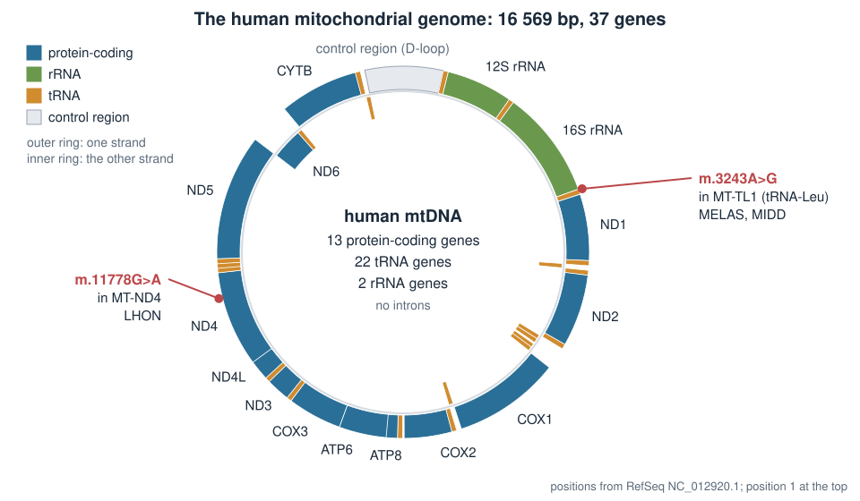
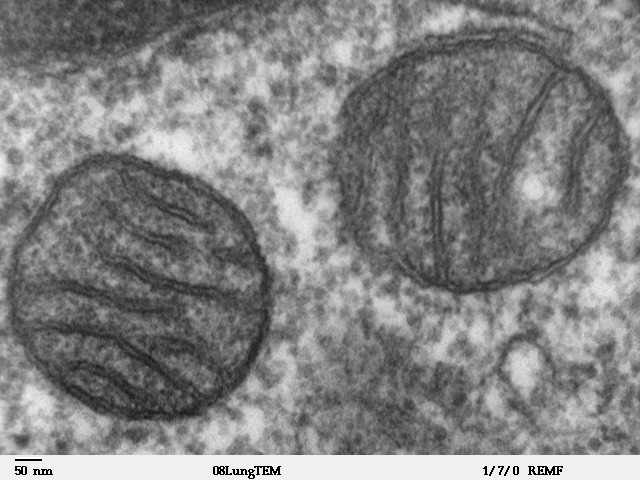
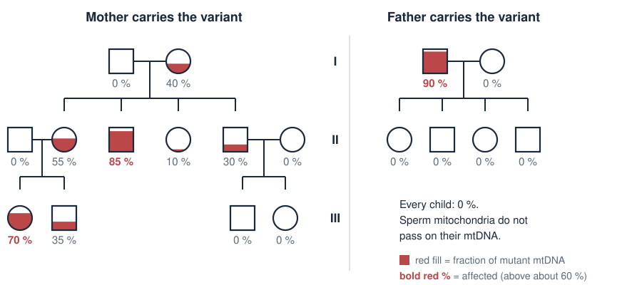
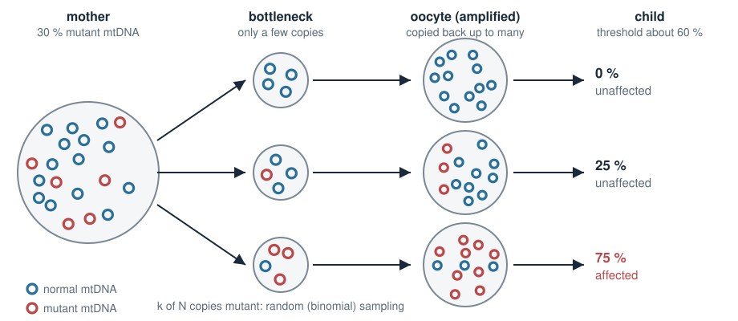
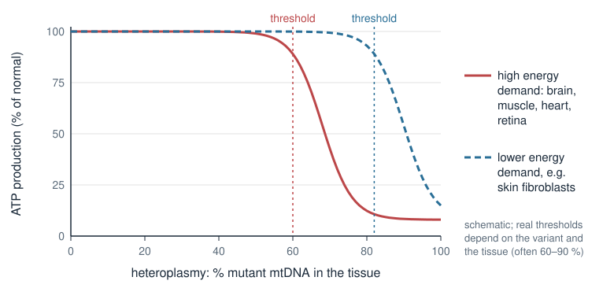
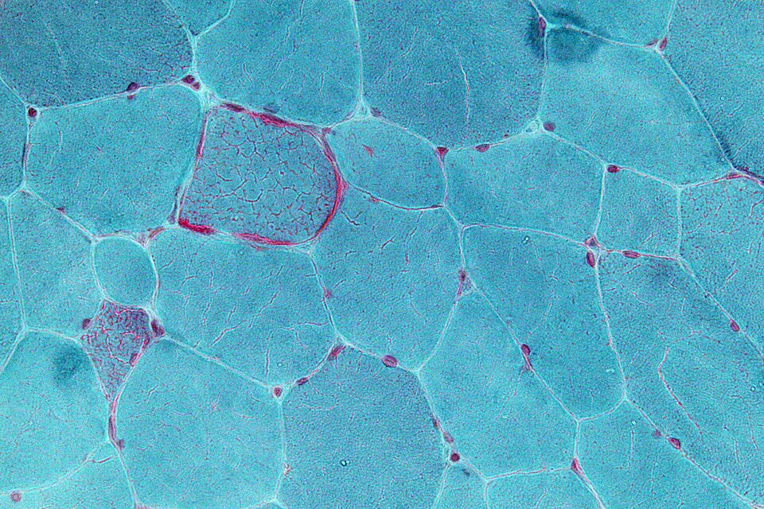
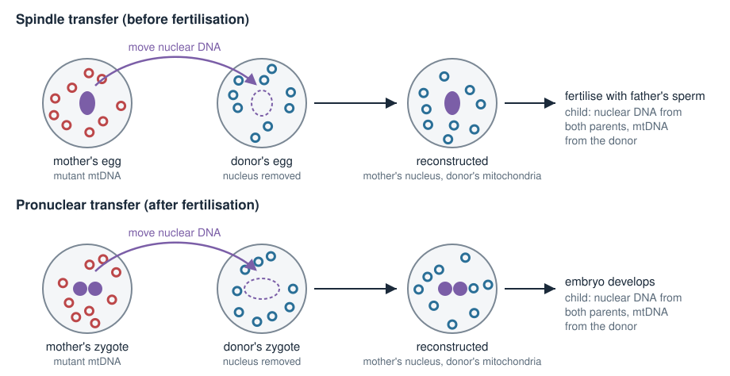

## About this lecture

Everything so far in the course has been about genes in the **nucleus**, which follow Mendel's laws because meiosis deals out chromosomes fairly. Mitochondria and chloroplasts carry **their own small genomes**, outside the nucleus, and these follow quite different rules.

- The **mitochondrial** and **chloroplast genomes**: small, circular, many copies per cell.
- Where they came from: **endosymbiosis**, and the gene transfer to the nucleus that followed.
- **Maternal (uniparental) inheritance**: reciprocal crosses give different results; a nuclear marker as a control.
- **Heteroplasmy**, the **bottleneck** and the **threshold effect**: why the children of one mother can be so different, worked out by hand with the binomial.
- Telling a **mtDNA** disease from a **nuclear** one in a family.
- Two human diseases: **MELAS** (m.3243A>G) and **LHON** (m.11778G>A).
- **Mitochondrial donation**, and why it raises ethical questions.

Book: Hartwell, *Genetics: From Genes to Genomes*, organelle inheritance chapter.

::: notes
This is the last unit of Part 5. The pedigree unit in Part 1 gave mitochondrial inheritance one slide: from the mother to all her children, never from the father. Today we explain why, and why real families do not look as clean as that rule. The key new idea is that a cell has hundreds or thousands of copies of the organelle genome, not two, so a "genotype" becomes a proportion. Once students see that, the variable severity of mitochondrial disease, the bottleneck and the threshold all follow. The previous unit, bacterial genetics, is the right warm-up: mitochondria and chloroplasts are former bacteria.
:::

## Two genomes outside the nucleus {.smaller}

| | Nuclear genome (human) | mtDNA (human) | cpDNA (*Arabidopsis*) |
|---|---|---|---|
| Size | about 3 100 Mb | **16 569 bp** | 154 478 bp |
| Shape | linear chromosomes | **circular** | circular |
| Genes | about 20 000 protein-coding | **37** | about 130 |
| Copies per cell | 2 (diploid) | **hundreds to thousands** | hundreds to thousands |
| Introns | many | none | some |
| Inherited from | both parents (Mendel) | **mother** | mother (in most plants) |

Lengths from NCBI RefSeq: human mtDNA NC_012920.1, *Arabidopsis thaliana* chloroplast NC_000932.1.

Organelle genes are **not** dealt out by meiosis. They are passed on with the **cytoplasm**, and the egg supplies almost all of it.

::: notes
Give the scale first: the mitochondrial genome is about 200 000 times smaller than the nuclear genome. But a cell has many copies of it, so mtDNA can be up to a few percent of a cell's DNA. Other organisms vary a lot: yeast mtDNA is about 86 kb, plant mitochondrial genomes are often several hundred kb, and the chloroplast genomes of land plants are mostly 120 to 160 kb. The last row is the headline of today: no meiosis, so no segregation in Mendel's sense, and no 1:1 contribution from the two parents. The figure for cpDNA genes counts the gene features in the RefSeq record, some of which are duplicated in the inverted repeats.
:::

## The human mitochondrial genome {.smaller}

{width="72%" fig-align="center"}

- **13 proteins**, all subunits of the respiratory chain and ATP synthase (*ND1–6*, *ND4L*, *CYTB*, *COX1–3*, *ATP6*, *ATP8*); **22 tRNAs** and **2 rRNAs** to translate them.
- Extremely compact: no introns, genes overlap (*ATP8*/*ATP6* by 46 bp), only one larger non-coding region (the control region, or **D-loop**).
- Its own **genetic code**: UGA is tryptophan, not stop.

::: notes
Walk around the circle. The rRNAs and most genes are on one strand (outer ring); ND6 and eight tRNAs are on the other (inner ring). The tRNAs, in orange, sit between the larger genes; the whole strand is transcribed as long polycistronic RNAs that are cut at the tRNAs. Some protein genes do not even end in a complete stop codon: the stop codon is finished when the mRNA gets its poly-A tail. You check that in the R exercise. The two red points are today's disease variants. The m. prefix in m.3243A>G means a position in the mitochondrial reference sequence, just as c. means coding sequence. The different genetic code is one sign that mtDNA has been evolving on its own for a very long time.
:::

## Most mitochondrial proteins come from the nucleus {.smaller}

- A human mitochondrion contains **more than 1000 different proteins**. Only **13** are encoded by mtDNA.
- All the rest, including the mtDNA polymerase (POLG), the ribosomal proteins and most respiratory chain subunits, are **nuclear genes**, translated in the cytosol and **imported**.
- Even the chloroplast's key enzyme is split: Rubisco's large subunit (*rbcL*) is in the cpDNA, the small subunit (*RBCS*) in the nucleus.

| Mitochondrial disease caused by… | Inheritance | Example |
|---|---|---|
| a variant in **mtDNA** | **maternal**, variable (heteroplasmy) | MELAS, LHON |
| a variant in a **nuclear** gene for a mitochondrial protein | **Mendelian** (AR, AD, X-linked) | *POLG* disorders, many cases of Leigh syndrome |

::: notes
This slide prevents a common error: "mitochondrial disease" does not mean "maternally inherited". Many mitochondrial diseases, especially in children, are autosomal recessive, because the gene is in the nucleus. So when a pedigree of a mitochondrial disease shows an affected child of two unaffected parents, with a 1 in 4 recurrence, that is a nuclear gene and Part 1 applies. The organelle and the nucleus depend on each other: neither genome alone can make a working mitochondrion. That interdependence is the long-term result of endosymbiosis, on the next slide.
:::

## Where organelles came from: endosymbiosis {.smaller}

Mitochondria descend from an **alphaproteobacterium**, and chloroplasts from a **cyanobacterium**, each taken up by a host cell more than a billion years ago.

:::: {.columns}
::: {.column width="66%"}
| Evidence | Bacteria | Mitochondria and chloroplasts |
|---|---|---|
| Genome | one circular chromosome | small circular DNA |
| Ribosomes | 70S, sensitive to e.g. chloramphenicol | bacteria-like, also sensitive |
| Division | binary fission | divide by fission, not made from scratch |
| Membranes | inner + outer (Gram-negative) | double membrane |
| DNA sequence | — | rRNA and protein genes group with alphaproteobacteria / cyanobacteria in phylogenetic trees |
:::
::: {.column width="34%"}
{width="100%"}

[Photo: Louisa Howard, public domain, via Wikimedia Commons](https://commons.wikimedia.org/wiki/File:Mitochondria,_mammalian_lung_-_TEM.jpg){.photo-credit}

Two mitochondria (electron micrograph, mammalian lung): the outer membrane and the folded inner membrane.
:::
::::

Over time, most of the symbiont's genes **moved to the nucleus** or were lost. Pieces of mtDNA still land in our chromosomes (**NUMTs**, nuclear mitochondrial DNA segments).

::: notes
This connects to the previous unit: bacteria swap DNA, and organelles are former bacteria that have handed most of their genome over to the host. The strongest evidence is the sequence evidence: a tree of 16S-type rRNA puts mitochondria among the alphaproteobacteria and chloroplasts among the cyanobacteria. Gene transfer to the nucleus is still going on in plants, and in humans NUMTs are a practical nuisance: when you sequence mtDNA, reads from nuclear copies can look like low-level heteroplasmy. Why keep any genes in the organelle at all? One idea is that genes for very hydrophobic membrane proteins are hard to import, so they stay where the protein is needed.
:::

## Maternal inheritance {.smaller}

:::: {.columns}
::: {.column width="52%"}
In humans and most animals:

- the **egg** carries a very large number of mitochondria (and mtDNA copies, of the order of 100 000);
- the **sperm** brings very few, in its midpiece, and they are **tagged and destroyed** in the early embryo.

So mtDNA comes from the **mother**, and only women pass it on.

:::
::: {.column width="48%"}

**Reciprocal crosses differ.** That is the classic test for organelle inheritance:

| Cross | Offspring |
|---|---|
| mutant ♀ × normal ♂ | **all** carry the mutation |
| normal ♀ × mutant ♂ | **none** do |

For nuclear genes, reciprocal crosses give the same result (Mendel, Part 1), except for X-linked genes.

:::
::::

::: notes
Two separate reasons make inheritance maternal: the huge numerical difference (the egg has orders of magnitude more mtDNA than a sperm), and active destruction of the paternal mitochondria after fertilisation. Recall from the Mendel unit that Mendel did reciprocal crosses and got identical results: that told him that egg and pollen contribute equally. A difference between reciprocal crosses points to either sex linkage or organelle inheritance. Sex linkage gives a difference that depends on the sex of the offspring; organelle inheritance gives a difference that depends only on the sex of the parent. Ask the class: how would you tell the two apart in a pedigree? Answer on the next slide.
:::

## Maternal inheritance in a pedigree {.smaller}

{width="76%" fig-align="center"}

- Affected or carrier **mother → every child** gets the variant, at **different levels**.
- **Father → no child**, whether the children are sons or daughters.
- Both sexes are affected. It looks like neither autosomal nor X-linked inheritance.

::: notes
Compare with the one-line version from the pedigree unit (fig06 there). The new element is the percentage under each person: the fraction of their mtDNA that carries the variant. In the left family the mother has 40 percent and is healthy; her four children have 85, 55, 10 and 30 percent. Only the 85 percent son is affected. The 55 percent daughter is healthy, but one of her children reaches 70 percent and is affected. On the right, an affected father passes nothing, and that holds in every generation. So the rule "mother to all children" is true for the variant but not for the disease: severity is a matter of degree. The rest of the lecture explains where the spread of percentages comes from.
:::

## Following a nuclear and an organelle gene in one cross

The bread mould *Neurospora crassa* has a slow-growing mutant, ***poky***, with defective mitochondria (Mitchell and Mitchell, 1952). In a cross, the "female" parent supplies the cytoplasm; the "male" adds little more than a nucleus. The progeny are **haploid**.

Cross: ***poky*** female, *ad*^+^ × wild-type male, *ad*^−^ (*ad* is a nuclear gene for adenine synthesis)

| Gene | Where | Progeny |
|---|---|---|
| *ad* | nucleus | ½ *ad*^+^ : ½ *ad*^−^ (Mendel's first law, in a haploid) |
| *poky* | mitochondria | **all** *poky*: they follow the **female** |

**The method:** put a nuclear marker in the same cross as a control. If the nuclear marker segregates 1 : 1 but the other trait follows one parent in **every** offspring, and the reciprocal cross gives the opposite, the trait is in the cytoplasm.

::: notes
This is the fungal version of Correns' plant crosses and of the human pedigrees, and it is the cleanest way to show the two kinds of inheritance side by side. Neurospora was the organism of Beadle and Tatum; poky was one of the first mitochondrial mutants found, and it was later traced to a small deletion in a mitochondrial ribosomal RNA gene. Ask the room to predict the reciprocal cross, wild-type female times poky male, before you move on; the exercise asks for both. The nuclear gene is a built-in control: it shows that meiosis worked and that both parents contributed a nucleus. Without it, "all offspring look like the mother" could also mean something odd, such as no fertilisation at all.
:::

## Uniparental inheritance in other organisms {.smaller}

| Organism | What is inherited | From |
|---|---|---|
| Humans, most animals | mtDNA | the mother |
| Most flowering plants | mtDNA and cpDNA | the mother (seed parent) |
| Many conifers | cpDNA | the **father** (pollen) |
| *Chlamydomonas* (a green alga, two mating types) | cpDNA / mtDNA | the **mt^+^** parent / the **mt^−^** parent |
| Baker's yeast | mtDNA | **both** parents; the mixture then sorts out in the buds |

Rare exceptions exist: **paternal leakage** of mtDNA has been documented in mice and, very rarely, in humans.

The rule is **uniparental** inheritance, but which parent depends on the organism.

::: notes
Hartwell uses Chlamydomonas because its two mating types look identical, so "maternal" makes no sense there; the alga still passes chloroplast DNA from one mating type (mt plus) and mitochondrial DNA from the other (mt minus). Yeast is the counter-example: both parents contribute mitochondria to the zygote, which then gives buds that end up with one type or the other, a process called vegetative segregation that we meet again on the bottleneck slide. Paternal leakage: in human muscle a single well-documented case was published in 2002; claims of more common biparental inheritance in humans have been disputed, partly because NUMTs can mimic paternal mtDNA. For exam purposes, human mtDNA is maternally inherited.
:::

## Variegation: Correns and the four-o'clock plant {.smaller}

In 1909 Carl Correns crossed flowers on green, white and variegated (green-and-white) branches of *Mirabilis jalapa*:

| Seed parent: flower on a… | Pollen from any branch gives seedlings that are… |
|---|---|
| green branch | green |
| white branch | white (no chlorophyll; they die) |
| variegated branch | green, white **or** variegated |

- The **pollen does not matter**: the colour follows the **seed parent's branch**. Chloroplasts come from the egg.
- A variegated plant is **heteroplasmic**: its cells contain normal and defective chloroplasts. As cells divide, chloroplasts are shared out **at random**, so some cell lineages end up all-defective (white) and others all-normal (green).

::: notes
This is one of the first clear cases of non-Mendelian inheritance, published within ten years of the rediscovery of Mendel. Read the table as a set of reciprocal crosses: a white flower times green pollen gives white seedlings, green times white pollen gives green. The variegated row introduces the key idea of the lecture. A cell that contains two kinds of organelles divides them randomly between daughter cells. After many divisions some lineages drift to all normal and some to all mutant, which on a leaf looks like green and white sectors. The same random sorting happens to mtDNA in human cells and, most dramatically, in the female germline.
:::

## Heteroplasmy and homoplasmy {.smaller}

- **Homoplasmy**: all copies of the organelle genome in a cell (or person) are the same.
- **Heteroplasmy**: a **mixture** of normal and mutant copies. It is described by the **heteroplasmy level**, the percentage of mutant copies, e.g. 40 %.
- The level is not a fixed property of a person. It differs **between tissues**, and can **change with age**, because mtDNA is copied and segregates at random as cells divide (**replicative segregation**).
- With hundreds to thousands of copies, "genotype" is no longer *AA*, *Aa* or *aa*. It is a **proportion** between 0 and 1.

A blood test can therefore underestimate the level in muscle or brain. For m.3243A>G the level in blood also tends to **fall with age**.

::: notes
This is the conceptual shift students must make. For a nuclear gene you have two copies and three genotypes. For mtDNA you have a population of genomes in every cell, and the genotype is a frequency, exactly like an allele frequency in a population. Readers who know the drift unit in Part 7 will recognise everything that follows: random sampling of a finite number of copies changes the frequency by chance, and small samples change it the most. In the clinic this means that you measure heteroplasmy in a tissue, ideally in more than one, and that a low level in blood does not exclude a high level in muscle.
:::

## The mitochondrial bottleneck {.smaller}

{width="70%" fig-align="center"}

During oocyte development, only a **small number** of mtDNA copies (or segregating units) found the mtDNA of each future egg. They are then copied up to the large number in a mature oocyte.

- Each oocyte draws its founders **at random**: $k \sim \text{Binomial}(N, h)$ mutant copies out of $N$, so its level is $k/N$.
- **Mean** level = the mother's level $h$; **variance** $= h(1-h)/N$. A small $N$ gives a wide spread.

::: notes
This explains the pedigree on the earlier slide. The mother has 30 percent mutant mtDNA. If each egg simply got a random sample of a hundred thousand copies, every egg would have very close to 30 percent. Instead, there is a narrow point in the germline where only a few copies are passed on, and the egg's level is fixed by which copies happen to pass. Measured bottleneck sizes vary between studies and species, from about ten to a few hundred units; the exact mechanism is still studied. The binomial model is a simplification, but it captures the main point, and it is exactly the model we use in the demo and in R. Check the variance formula with numbers: h = 0.3 and N = 20 give 0.3 times 0.7 over 20, about 0.0105, a standard deviation of about 10 percentage points.
:::

## The threshold effect {.smaller}

{width="66%" fig-align="center"}

- A cell with some normal mtDNA can usually compensate: function stays near normal until the mutant fraction passes a **threshold**, then falls steeply.
- The threshold depends on the **variant** and the **tissue**: tissues with a high energy demand (brain, skeletal and heart muscle, retina) are hit first.
- Combined with heteroplasmy, this explains why relatives with the same variant can be healthy, mildly affected or severely affected.

::: notes
The threshold is why heteroplasmy matters clinically. Below it, the normal copies make enough working protein (or, for a tRNA variant, enough working tRNA) to keep the respiratory chain going. Above it, ATP production collapses. The figure is schematic: the curves are not data. Thresholds of roughly 60 to 90 percent are often quoted, and the exact value depends on how severe the variant is and on the tissue. The threshold is also the reason why the bottleneck is dangerous: a mother below the threshold can have an egg above it, as the next two slides compute and the demo shows. Note also the parallel to incomplete penetrance and variable expressivity from the Extensions to Mendel unit: here we know the mechanism.
:::

## The bottleneck by hand: N = 3

A mother with *h* = 0.3 (30% mutant). Suppose each egg is founded by **N = 3** copies, drawn at random. Each copy is mutant with probability 0.3.

| Mutant founders *k* | Level *k*/*N* | Probability $\binom{3}{k}\,0.3^k\,0.7^{3-k}$ |
|:-:|:-:|---|
| 0 | 0% | 1 × 0.7^3^ = **0.343** |
| 1 | 33% | 3 × 0.3 × 0.7^2^ = **0.441** |
| 2 | 67% | 3 × 0.3^2^ × 0.7 = **0.189** |
| 3 | 100% | 1 × 0.3^3^ = **0.027** |

- Mean level: (0 × 0.343 + 1 × 0.441 + 2 × 0.189 + 3 × 0.027)/3 = 0.9/3 = **0.30**, the mother's level.
- SD: $\sqrt{0.3 \times 0.7 / 3}$ = **0.26**: 26 percentage points.
- With a threshold of 60%: P(level ≥ 60%) = 0.189 + 0.027 = **0.216**. A healthy 30% mother has about a **1 in 5** chance of an egg above the threshold, and a **1 in 3** chance of an egg with no mutant copies at all.

::: notes
This is the binomial distribution from the probability unit, with numbers small enough to write out. Build the table row by row on the board: the binomial coefficient counts which of the three copies are mutant, the powers give the probability of one such arrangement. Point out that the four probabilities add to one. The mean comes out exactly at the mother's level: the bottleneck does not push the level up or down on average, it only spreads it. With N = 3 the only possible levels are 0, 33, 67 and 100 percent, which is why the demo histogram for small N has a few widely spaced bars. The exercise does the same with N = 2 and N = 4 and a 50 percent mother.
:::

## From the mother's level to the risk for a child

Same mother (*h* = 0.3), threshold 60%. The exact binomial probability that an egg is **at or above 60%**:

| Bottleneck size *N* | 3 | 5 | 10 | 20 | 50 | 200 |
|---|---:|---:|---:|---:|---:|---:|
| SD of the egg level (points) | 26 | 21 | 15 | 10 | 6.5 | 3.2 |
| P(egg ≥ 60%) | 0.22 | 0.16 | 0.047 | 0.005 | 1 × 10^−5^ | ≈ 0 |

- The **smaller** the bottleneck, the **wider** the spread and the larger the risk. The SD falls as $1/\sqrt{N}$.
- The risk depends on three numbers: the mother's level *h*, the bottleneck *N*, and the threshold. None is known exactly for a given woman, which is why counselling uses **empirical** risks from many families.

::: notes
These probabilities were computed with pbinom in R; the N = 20 value, 0.5 percent, is the one the demo shows for its default settings. Read the table from left to right: from one in five to essentially zero. The step from N = 3 to N = 5 is not a smooth decline because with small N only a few levels are possible, and whether one of them falls just above the threshold matters; the overall trend is still clear. Estimates of the real human bottleneck vary between studies, from around ten to a few hundred segregating units, so the risk for a given mother is uncertain by more than an order of magnitude. This is why measuring the level in her oocytes or embryos, by preimplantation testing, is more informative than any formula. The R exercise draws these curves with pbinom.
:::

## Try it: the bottleneck {.smaller}

```{=html}
<link rel="stylesheet" href="../demos/dist/demo.css">
<div data-demo="bottleneck" data-preset="melas"></div>
<script src="../demos/dist/bottleneck.js"></script>
```

::: notes
Interactive demo. It starts with a mother at 30 percent, a bottleneck of N = 20 copies, 200 oocytes and a threshold of 60 percent. Each oocyte draws 20 copies binomially; the histogram shows the oocyte levels, the dashed line the mother, the red line the threshold, and red bars the oocytes at or above it. On seed 1, 1 of 200 oocytes (0.5 percent) is above 60 percent; the exact binomial value is also 0.5 percent. Mean 30.0 percent, SD 9.9 percentage points against the expected 10.2. Click "tight: N = 5": now 37 of 200 (18.5 percent) are at or above 60 percent, and 34 oocytes have no mutant copies at all. Then "wide: N = 200": none are above the threshold and the SD falls to about 3 points. Then "mother 70 %": she is above the threshold herself; 181 of 200 eggs are at or above 60. Drag the threshold to 80 percent and the fraction drops to 52 of 200. The lesson: the risk for a child depends on the mother's level, the bottleneck size and the threshold, and the spread is large when N is small.
:::

## MELAS: m.3243A>G in *MT-TL1* {.smaller}

:::: {.columns}
::: {.column width="62%"}
- **MELAS**: mitochondrial encephalomyopathy, lactic acidosis and stroke-like episodes.
- Most cases carry **m.3243A>G**, a change in the gene for **tRNA-Leu(UUR)**, *MT-TL1*. A faulty tRNA affects the translation of **all 13** mtDNA-encoded proteins.
- Almost always **heteroplasmic**. The same variant gives a **spectrum**: from no symptoms, through diabetes and deafness (**MIDD**, maternally inherited diabetes and deafness), to full MELAS, roughly in order of rising level in affected tissues.
- ClinVar: classified **Pathogenic**, reviewed by an expert panel.

Genetic counselling for a woman who carries m.3243A>G is hard: her own level says little about the level of each child.
:::
::: {.column width="38%"}
{width="100%"}

[Photo: Nephron, CC BY-SA 3.0, via Wikimedia Commons](https://commons.wikimedia.org/wiki/File:Ragged_red_fibres_-_gtc_-_very_high_mag.jpg){.photo-credit}

**Ragged red fibres** in a muscle biopsy from a mitochondrial myopathy (Gomori trichrome stain): fibres packed with abnormal mitochondria stain red at their edges.
:::
::::

::: notes
The micrograph is a muscle biopsy from a patient with a mitochondrial myopathy (the image does not say which variant): ragged red fibres are muscle fibres in which defective mitochondria have proliferated under the membrane, a classic finding in MELAS and in MERRF. Because the patient is heteroplasmic, affected and normal-looking fibres lie side by side, a mosaic in one tissue. MELAS shows every concept of the lecture in one disease. The variant is in a tRNA gene, so it does not change one protein; it impairs mitochondrial translation as a whole, which is why many tissues are involved. Heteroplasmy explains the range from symptom-free carriers to severe disease, and tissue differences explain the mix of brain, muscle, pancreas and inner-ear symptoms. The bottleneck explains why a mildly affected mother can have a severely affected child. In the exercise, students look the variant up in ClinVar and see the long list of conditions submitters have reported for it, which is the clinical spectrum in database form.
:::

## LHON: m.11778G>A in *MT-ND4* {.smaller}

- **Leber hereditary optic neuropathy**: sudden, painless loss of central vision in both eyes, usually in young adults.
- The most common cause is **m.11778G>A** in *MT-ND4*, a subunit of complex I: a **missense** change, p.Arg340His.
- Usually **homoplasmic**: every child of a carrier mother carries it at about 100 %.
- Yet **penetrance is incomplete**. In families with m.11778G>A only about a third to a half of the maternal relatives lose their sight, and **most affected people are male**.

So heteroplasmy cannot be the whole story. Other factors, including nuclear genes, sex and environment (for example smoking), decide who becomes ill.

::: notes
LHON is the counterpart to MELAS. With a homoplasmic variant, the bottleneck plays no role: all the children inherit the variant fully, as the homoplasmic preset in the demo shows. The puzzle is then reduced penetrance and the strong male bias, which nobody has fully explained; nuclear modifier genes and hormonal effects are both discussed, and smoking increases the risk of vision loss. The figures on this slide are from the OMIM text for this variant quoted in ClinVar: 33 to 60 percent of maternal relatives affected, about 80 percent of them male. LHON is the example in the pedigree unit of Part 1.
:::

## Preventing transmission: mitochondrial donation {.smaller}

{width="66%" fig-align="center"}

- The mother's **nuclear** DNA is moved into a donor egg (or zygote) whose own nucleus has been removed. The child gets nuclear DNA from both parents and **mtDNA from the donor**.
- Legal in the **UK** since **2015**. In 2025 the Newcastle team reported **8 children** born after pronuclear transfer, with no or low levels of the mother's mtDNA in blood.
- A small amount of the mother's mtDNA is carried over, and could in principle rise again through the bottleneck.

The ethical questions (a germline modification, "three genetic parents", consent of future generations) are discussed in the [Ethics](../ethics/lec.qmd) unit.

::: notes
Options for a woman who carries a pathogenic mtDNA variant include egg donation, preimplantation genetic testing (choosing embryos with a low level, which works for heteroplasmic variants), and mitochondrial donation. Spindle transfer moves the metaphase II spindle of an unfertilised egg; pronuclear transfer moves the two pronuclei from a fertilised egg. The 2025 reports appeared in the New England Journal of Medicine (McFarland et al. and Hyslop et al.). The "three-parent baby" headline is misleading in one sense: the donor contributes 37 genes out of about 20 000, none of which shape appearance or personality. But the change is passed on by daughters to all their descendants, which is why it is regulated as a germline modification. Keep the ethics discussion for the ethics module.
:::

## Mitochondrial or nuclear? Reading a family {.smaller}

Three questions, in this order:

1. **Does a man pass it on?** An affected father with an affected child rules out mtDNA: fathers do not transmit it.
2. **Do all children of an affected or carrier mother carry it?** For a mtDNA variant: yes, every child carries it, though at **different levels**, so severity varies.
3. **Does it look Mendelian?** Two affected sibs of healthy parents, about ¼ of the sibship, nobody else affected: think of a **nuclear, autosomal recessive** gene for a mitochondrial protein.

| Family | Q1 | Q2 | Q3 | Most likely |
|----------------------------------|----|----|----|--------------|
| A man lost his central vision at 24. Two sons of his sister are affected too; none of his own five children is | no | fits | no | **mtDNA** (think LHON) |
| A girl and one of her two brothers have a respiratory chain disease; parents, grandparents, aunts and uncles are healthy | – | – | **yes** | **nuclear, AR**: ¼ recurrence |

::: notes
This is the practical skill students need for B7 in the exercise, which has three families of its own. The first question is the most powerful, because it can exclude mtDNA in one step. The second is the positive signature, but it needs care: with heteroplasmy or incomplete penetrance, some carrier children look unaffected, so you may need to test rather than look. In the first family the man's sister passed the trait to her sons, he passed it to none of five children: that fits maternal transmission, and the age and symptom fit LHON, which mostly affects young men. The third question protects against the most common error, calling every mitochondrial disease maternal. The second family has the classic autosomal recessive pattern; a mtDNA variant would usually show up in the mother's relatives too, though a new mtDNA mutation can occasionally mimic this. Real families are often small, so in practice the decision is backed by sequencing both mtDNA and the nuclear genes.
:::

## Check yourself: common mistakes

| Mistake | Better |
|---|---|
| "Mitochondrial disease is always maternally inherited." | Only when the variant is in **mtDNA**. Most mitochondrial proteins are **nuclear**, and their diseases follow Mendel. |
| "A man cannot carry a mtDNA variant." | He can carry it, and be affected. He just does not **pass it on**. |
| "All children of a carrier mother are equally affected." | They all inherit the variant, but at **different levels** (bottleneck), so severity varies. |
| "The bottleneck raises the mutant level." | On average the level stays at the mother's *h*; the bottleneck only **spreads** it. |
| "A low level in blood means low risk for the child." | Levels differ between **tissues**, and the bottleneck acts on the **oocytes**. |
| "Homoplasmic means healthy." | Homoplasmic for a pathogenic variant (LHON) means **all** copies are mutant; penetrance decides. |

::: notes
Run it as a quick quiz. The first row is the one that matters most in the clinic and in the exam. The bottleneck row is the subtle one: students often think the bottleneck selects for or against the mutant, but in the binomial model it only adds variance. Selection on mtDNA does happen, as the mitochondrial donation slide hints, but it is a separate process.
:::

## Organelle vs nuclear inheritance {.smaller}

| | Nuclear genes | Organelle genes |
|---|---|---|
| Copies per cell | 2 | hundreds to thousands |
| Genotype | *AA*, *Aa*, *aa* | a **level** between 0 and 100 % |
| Passed on by | both parents, through meiosis | usually **one** parent (in humans the mother), with the cytoplasm |
| Reciprocal crosses | same result (autosomal) | **differ** |
| Ratios among offspring | 3 : 1, 1 : 1, … | **no fixed ratios**: a continuous spread of levels |
| What causes variation among siblings | segregation of two alleles | random sampling at the **bottleneck** |
| Recurrence risk | ¼, ½, … | depends on the mother's level, *N* and the threshold |

::: notes
Use this table as a revision summary before the summary slide. The middle rows are the ones students most often miss: there are no Mendelian ratios for organelle genes, because there is no pair of alleles to segregate. What replaces segregation is sampling. And the last row is why genetic counselling for mtDNA disease uses empirical risk tables rather than a simple fraction.
:::

## Summary {.smaller}

| Concept | Key fact |
|---|---|
| mtDNA | 16 569 bp, circular, 37 genes (13 proteins, 22 tRNAs, 2 rRNAs); many copies per cell |
| cpDNA | about 120–160 kb in land plants; about 130 genes |
| Endosymbiosis | mitochondria from alphaproteobacteria, chloroplasts from cyanobacteria; most genes moved to the nucleus |
| Maternal inheritance | the egg supplies the mtDNA; reciprocal crosses differ; fathers do not transmit |
| Uniparental, not always maternal | conifers (paternal cpDNA), *Chlamydomonas* (mt^+^ cpDNA) |
| Heteroplasmy | a mixture of normal and mutant copies; the level differs by tissue and over time |
| Bottleneck | few copies found each oocyte: level $\sim$ Binomial$(N, h)/N$, mean $h$, variance $h(1-h)/N$ |
| Threshold | symptoms only above a tissue-specific level, often 60–90 % |
| Risk for a child | P(egg level ≥ threshold): large for small *N*, falls steeply as *N* grows |
| MELAS / LHON | m.3243A>G in *MT-TL1* (heteroplasmic) / m.11778G>A in *MT-ND4* (homoplasmic, incomplete penetrance) |
| Nuclear-encoded mito disease | Mendelian inheritance (e.g. *POLG*) |

::: notes
If they remember three things: mtDNA comes from the mother; the genotype is a level, not a pair of alleles; and the bottleneck plus the threshold explain why children of the same mother differ. Everything else on the table is detail around those three ideas.
:::

## Where this leads

- **Exercise and demo**: simulate the bottleneck, see the effect of *N*, and read real records for m.3243A>G and m.11778G>A.
- **Exercise in R**: the same simulation with `rbinom` and `replicate`, risk curves with `pbinom`, and a table of the 37 mtDNA genes from RefSeq.
- **Part 6, Eukaryotic regulation**: X inactivation is another source of mosaicism, like heteroplasmy, but between two whole chromosomes.
- **Part 7, Drift and selection**: random sampling of a finite number of copies is **genetic drift**. The bottleneck is drift inside one woman's germline, and the variance formula $h(1-h)/N$ reappears for populations.
- **Ethics**: mitochondrial donation and germline modification.

::: notes
The strongest forward link is to drift in Part 7: the Wright-Fisher model is exactly our bottleneck model, repeated generation after generation in a population. Students who understood today's histogram will recognise it there. The X-inactivation link is lighter: both make a woman a mosaic of cells that differ in which genetic material they use.
:::
