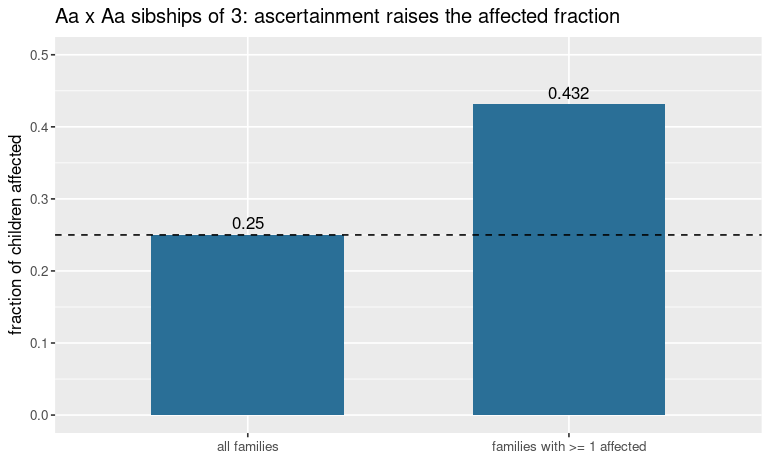

## Goal

By the end of this exercise you should be able to:

- simulate families in R with `rbinom` and `replicate`, and filter them the way a clinic does.

## Before you start

This page builds on the by-hand part of the [Exercise](exercise.qmd), so do that first. You need the packages dplyr and ggplot2.

## Tasks

This unit's new R idiom is **simulation with `rbinom` and `replicate`, then filtering**. [`rbinom`](https://rdrr.io/r/stats/Binomial.html)`(n, size, prob)` draws `n` binomial random numbers: with `size = 1` each draw is 1 (affected) with probability `prob`, otherwise 0. [`replicate`](https://rdrr.io/r/base/lapply.html)`(N, expr)` runs `expr` `N` times and collects the results; here each run is one family. We then keep only some families with [`filter`](https://dplyr.tidyverse.org/reference/filter.html), as a clinic does without meaning to. Use [`set.seed`](https://rdrr.io/r/base/Random.html) so that your numbers match the solutions.

```r
library(dplyr)
library(ggplot2)
```

### Risk as a function

**R1.** Write a function `p_child_affected(p_carrier_mother, p_carrier_father)` that returns the probability that a child is affected by an autosomal recessive disease. Check it on two known carriers (answer ¼). Then use it for B6 in the [exercise](exercise.qmd): an unaffected sister of a PKU patient and a man from a population with carrier frequency 1/50. Also compute B7 (both partners have an affected sibling).

```r
p_child_affected <- function(p_carrier_mother, p_carrier_father) {
  p_carrier_mother * p_carrier_father * 1/4
}

p_child_affected(1, 1)          # two known carriers
p_child_affected(2/3, 1/50)     # unaffected sib of a patient x person from the population
1 / p_child_affected(2/3, 1/50) # as "1 in ..."
p_child_affected(2/3, 2/3)      # both partners have an affected sib
```

**R2.** The carrier frequency depends on the population. Compute the risk from R1 for carrier frequencies 1/25, 1/50 and 1/100 in one tibble. Your function works on whole vectors, so no loop is needed.

```r
tibble(carrier_freq = c(1/25, 1/50, 1/100)) |>
  mutate(risk = p_child_affected(2/3, carrier_freq),
         one_in = round(1 / risk))
```

### Simulating families

**R3.** Simulate 10 000 families with *Aa* × *Aa* parents and three children each. `rbinom(3, size = 1, prob = 1/4)` is one family; `replicate` makes 10 000 of them, one per column. What fraction of all children are affected? How many families have 0, 1, 2 and 3 affected children?

```r
set.seed(1)
n_fam <- 10000
n_kids <- 3
q <- 1/4
kids <- replicate(n_fam, rbinom(n_kids, size = 1, prob = q))
dim(kids)        # 3 rows (children) x 10000 columns (families)
kids[, 1:5]      # the first five families: 1 = affected
mean(kids)       # fraction of all children who are affected

families <- tibble(family = 1:n_fam, n_affected = colSums(kids))
families |> count(n_affected)
```

**R4.** A clinic only sees families that have **at least one** affected child. Keep only those families. What fraction of their children are affected? Compare with the analytic value $\frac{nq}{1-(1-q)^n}$ affected per family, divided by $n$.

```r
clinic <- families |> filter(n_affected >= 1)
nrow(clinic)
sum(clinic$n_affected) / (n_kids * nrow(clinic))   # fraction affected among their children

expected_per_family <- n_kids * q / (1 - (1 - q)^n_kids)
expected_per_family
expected_per_family / n_kids
```

**R5.** Make a bar chart that compares the fraction of affected children in all families and in the clinic's families, with a dashed line at the Mendelian ¼.

```r
summary_tbl <- bind_rows(
  families |> mutate(group = "all families"),
  clinic   |> mutate(group = "families with >= 1 affected")
) |>
  group_by(group) |>
  summarise(n_families = n(),
            frac_affected = sum(n_affected) / (n_kids * n()))
summary_tbl

ggplot(summary_tbl, aes(x = group, y = frac_affected)) +
  geom_col(fill = "#2a6f97", width = 0.6) +
  geom_hline(yintercept = 1/4, linetype = "dashed") +
  geom_text(aes(label = round(frac_affected, 3)), vjust = -0.4) +
  labs(x = NULL, y = "fraction of children affected",
       title = "Aa x Aa sibships of 3: ascertainment raises the affected fraction") +
  ylim(0, 0.5)
```

**R6.** Does the bias grow or shrink with family size? Compute the analytic fraction $\frac{q}{1-(1-q)^n}$ for $n = 1, \dots, 6$. Explain the value for $n = 1$.

```r
sizes <- 1:6
round(q / (1 - (1 - q)^sizes), 3)
```

## Solutions

::: {.callout-note collapse="true" title="Solutions: In R"}

Run with `Rscript --vanilla` from the unit folder. Messages from loading packages are not shown.

**R1.**

```
[1] 0.25
[1] 0.003333333
[1] 300
[1] 0.1111111
```

¼ for two known carriers, **1/300** for B6(b) and **1/9** for B7, as by hand.

**R2.**

```
# A tibble: 3 × 3
  carrier_freq    risk one_in
         <dbl>   <dbl>  <dbl>
1         0.04 0.00667    150
2         0.02 0.00333    300
3         0.01 0.00167    600
```

The risk is proportional to the partner's carrier frequency. Halving the carrier frequency halves the risk.

**R3.**

```
[1]     3 10000
     [,1] [,2] [,3] [,4] [,5]
[1,]    0    1    1    0    0
[2,]    0    0    0    0    0
[3,]    0    1    0    0    1
[1] 0.2504333
# A tibble: 4 × 2
  n_affected     n
       <dbl> <int>
1          0  4201
2          1  4247
3          2  1390
4          3   162
```

Over all families, 0.250 of the children are affected: Mendel's ¼. The expected counts are 10 000 × (27, 27, 9, 1)/64 = 4219, 4219, 1406 and 156 families, close to what we see. **42% of the families have no affected child.**

**R4.**

```
[1] 5799
[1] 0.4318561
[1] 1.297297
[1] 0.4324324
```

Only 5 799 of the 10 000 families reach the clinic. Among their children, **0.432** are affected, not 0.25. The analytic value is 3 × 0.25 / (1 − 0.75³) = 0.75 / 0.578 = **1.297** affected per family, that is 1.297 / 3 = **0.432** per child. The simulation agrees. The ¼ is still true for each child; the families with no affected child are simply missing. This is **ascertainment bias**. A χ² test of the clinic families against 1:3 would wrongly reject recessive inheritance.

**R5.**

```
# A tibble: 2 × 3
  group                       n_families frac_affected
  <chr>                            <int>         <dbl>
1 all families                     10000         0.250
2 families with >= 1 affected       5799         0.432
```

{width="70%" fig-align="center"}

**R6.**

```
[1] 1.000 0.571 0.432 0.366 0.328 0.304
```

The bias **shrinks** as families get larger, because a large family is less likely to have no affected child, so fewer families are missing. For *n* = 1 the fraction is 1: a one-child family is seen only if that child is affected, so every child we see is affected.
:::

## Where this leads

The pattern `rbinom` + `replicate` + `filter` returns when we simulate heteroplasmy and genetic drift.
