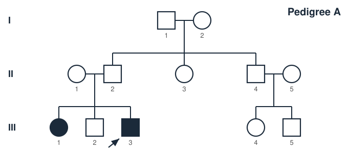
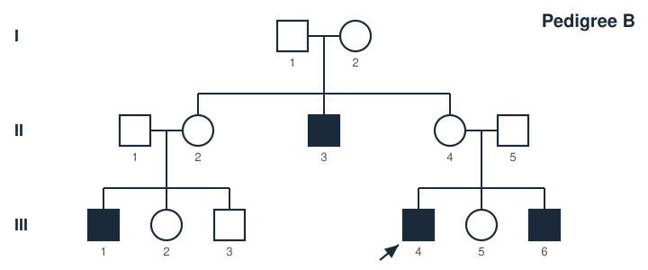
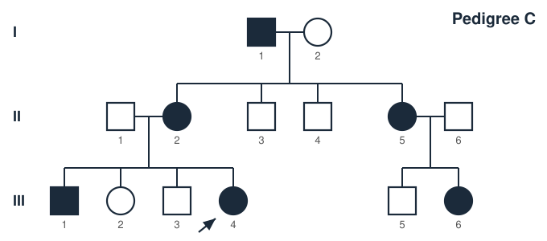
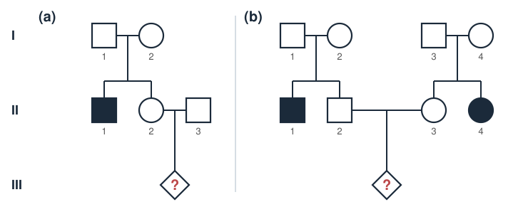

## Goal

By the end of this exercise you should be able to:

- read a pedigree drawn with standard symbols, and name each person (II-3);
- decide, trio by trio, which modes of inheritance (AR, AD, XR, XD) a pedigree **rules out**, and rank the modes that remain;
- identify **obligate carriers**;
- compute carrier and risk probabilities with the product rule and the 2/3 conditional probability;
- explain how consanguinity, incomplete penetrance, new mutations and **ascertainment bias** affect what a pedigree shows;
- look up the mode of inheritance, gene and chromosome of a disease in OMIM, MedGen and NCBI Gene, and read a variant record in ClinVar.

Do the pen-and-paper part first. The demo and R come after.

## Background

**Symbols.** Square = male, circle = female, filled = affected, half-filled = carrier, slash = deceased, double mating line = related partners, arrow = proband. Generations are roman numerals from the top; people are numbered left to right.

**Transmission rules.** Autosomes: each parent passes one of two alleles, ½ each. X chromosome: a father passes his **X to every daughter** and his **Y to every son**; a mother passes either X, ½ each. Males have one X (**hemizygous**).

**What rules a mode out** (one gene, full penetrance, no new mutations):

| You see in one family | Rules out |
|---|---|
| Affected child, both parents unaffected | AD and XD |
| Both parents affected, an unaffected child | AR |
| Father → son transmission, mother unaffected | XD (and makes XR unlikely) |
| Affected father, unaffected daughter | XD |
| Affected mother, unaffected son | XR |
| Affected daughter, unaffected father | XR |

Among the modes that remain, prefer the one that needs the **fewest extra assumptions**, such as carriers who married into the family.

**Risk formulas.**

- Unaffected child of *Aa* × *Aa*: $P(Aa \mid \text{unaffected}) = \frac{1/2}{3/4} = \frac{2}{3}$.
- Child affected (AR) = P(mother is *Aa*) × P(father is *Aa*) × ¼.
- Ascertainment: in sibships of size *n* where each child is affected with probability *q*, families with at least one affected child have on average $\dfrac{nq}{1-(1-q)^n}$ affected children.

## By hand

Use the pedigrees below. Unless stated, assume one gene, full penetrance and no new mutations.

{width="70%" fig-align="center"}

**B1.** For **pedigree A**, take each mode in turn (AR, AD, XR, XD). Is it consistent, or ruled out? If it is ruled out, name the parents and the child that make it impossible.

**B2.** In pedigree A, assume autosomal recessive inheritance.
(a) Which people are obligate carriers?
(b) What is the probability that III-2 is a carrier?
(c) The allele is rare, so assume that only one of I-1 and I-2 is a carrier. What is the probability that II-3 is a carrier?

{width="72%" fig-align="center"}

**B3.** For **pedigree B**, which modes are ruled out, and by which trio? For each mode that remains, list the people who must be carriers. Which mode is most likely, and why? Name a real disease that is often inherited like this.

**B4.** In pedigree B, assume X-linked recessive inheritance.
(a) What is the probability that III-5 is a carrier?
(b) III-5 has a son with an unaffected man. What is the probability that the son is affected?

{width="70%" fig-align="center"}

**B5.** For **pedigree C**, which modes are ruled out, and by which trio? Three modes remain. Rank them, with a reason. Under autosomal dominant inheritance, what is the probability that I-1's four children show exactly the pattern drawn (both daughters affected, both sons unaffected)? Describe one new family that would rule out X-linked dominant.

{width="66%" fig-align="center"}

**B6.** In **panel (a)**, II-1 has phenylketonuria (PKU, autosomal recessive). His sister II-2 has a child with II-3, a man from a population in which the carrier frequency is 1/50. He has no family history.
(a) What is the probability that II-2 is a carrier?
(b) What is the risk that their child (III-1) has PKU?
(c) Their first child turns out to have PKU. What is the risk for their second child?

**B7.** In **panel (b)**, II-1 and II-4 both have PKU. Their unaffected siblings II-2 and II-3 have a child together. The two families are not related. What is the risk that the child has PKU?

**B8. (consanguinity)** A man is a known carrier of a rare recessive allele; his wife is not a carrier. Two of their grandchildren, first cousins through two different children, have a child together. Assume nobody who married in carries the allele.
(a) What is the probability that each cousin is a carrier?
(b) What is the risk that their child is *aa*?
(c) Compare with one of the cousins having a child with an unrelated partner from a population with carrier frequency 1/50.

**B9. (X-linked risk)** A woman's brother has Duchenne muscular dystrophy (X-linked recessive). Her parents are unaffected, and we assume it was not a new mutation.
(a) What is the probability that she is a carrier?
(b) What is the probability that her first son is affected?

## Explore {#explore}

The demo draws a random pedigree under a **hidden** mode of inheritance. Click a mode to test it. If the mode is **consistent**, the demo shows one set of genotypes that fits everyone (– means either allele) and draws the obligate carriers half-filled. If it is **ruled out**, the parents and child that make it impossible are ringed in red. The demo assumes full penetrance and no new mutations; people who married in may be carriers.

```{=html}
<link rel="stylesheet" href="../demos/dist/demo.css">
<div data-demo="pedigree" data-seed="2"></div>
<script src="../demos/dist/pedigree.js"></script>
```

**E1.** Test all four modes on the first pedigree. Which are ruled out? For each, write the trio that breaks it, in the form "II-1 × II-2 → III-3".

**E2.** Two modes are consistent. Under each, which people must be carriers? Which of them married into the family? Which mode do you favour, and why? Note the double line: does it change your mind? Then press **reveal true mode**.

**E3.** Press **new pedigree** once. Which mode is ruled out now, and by which trio? Of the three modes left, which is most likely? Look at the children of the affected men I-1 and III-3. Under autosomal dominant inheritance, how likely is that pattern?

**E4.** Press **new pedigree** about ten times, and test AR each time. How often is AR ruled out? Using the rule-out table, explain why AR is so hard to rule out.

**E5.** The demo assumes full penetrance. Sketch a small autosomal dominant family that the demo would wrongly rule out as AD if one person in it were non-penetrant. Which of the demo's verdicts would change?

::: {.callout-note collapse="true" title="Solutions: Explore"}

**E1.** The pedigree is seed 2. **AD** is ruled out by II-1 × II-2 → III-3 (an affected son of two unaffected parents), and again by III-4 × III-5 → IV-4. **XD** is ruled out by II-1 × II-2 → III-3: an affected son needs X<sup>A</sup> from his mother, and II-2 is unaffected. The same holds for III-5 → IV-4.

**E2.** **AR** and **XR** are consistent.

- Under **AR**, II-1 and II-2 (the parents of III-3) and III-4 and III-5 (the parents of IV-4) must be carriers. **II-1 married into the family**, so AR needs a second, unrelated carrier of the same rare allele.
- Under **XR**, I-2, II-2, II-3 and III-5 must be carriers. They are all **blood relatives**, linked through women, so nobody who married in needs to be a carrier.

XR needs fewer coincidences, so it is favoured. The double line (III-4 and III-5 are first cousins) is a classic hint for AR, and it does explain IV-4 under AR. But it does not explain III-3, whose parents are not related. The true mode is **X-linked recessive**: affected males related through unaffected women.

**E3.** (Seed 3.) **XR** is ruled out by II-1 × II-2 → III-1 (and → III-2): II-2 is an affected woman, so under XR she is X<sup>a</sup>X<sup>a</sup> and every son must be affected. **AR, AD and XD** remain. AR needs two people who married in (II-1 and III-4) to be carriers, so it is unlikely. I-1 has two affected daughters and one unaffected son; III-3 has an affected daughter and an unaffected son. That is exactly the XD pattern. Under AD, each of these five children independently has a ½ chance of matching it: (½)<sup>5</sup> = 1/32. XD is the best explanation, and reveal confirms it. One affected son or one unaffected daughter of an affected father would have ruled XD out.

**E4.** AR is ruled out only rarely. The only trio that excludes it is **two affected parents with an unaffected child**, because *aa* × *aa* can only give *aa*. Any unaffected person can be a carrier, so an affected child of unaffected parents, or a skipped generation, never contradicts AR. This is why the second step of the strategy (count the carriers a mode needs) matters so much for AR.

**E5.** For example: I-1 affected, his son II-1 unaffected (but non-penetrant, *Aa*), and II-1's daughter III-1 affected, with an unaffected mother II-2. The trio II-1 × II-2 → III-1 is "affected child, both parents unaffected", so the demo rules out **AD**, and XD as well, even though the true mode is AD. AR would stay consistent (II-1 and II-2 as carriers). A real geneticist would treat II-1 as an obligate carrier with incomplete penetrance. This is a limit of any rule-out table that assumes full penetrance.
:::

## Find it

Each disease has a record in [OMIM](https://www.omim.org) (Online Mendelian Inheritance in Man), which gives a six-digit **MIM number**, and in [MedGen](https://www.ncbi.nlm.nih.gov/medgen/) at NCBI. [Orphanet](https://www.orpha.net) is a European portal for rare diseases with similar information. The gene record is in [NCBI Gene](https://www.ncbi.nlm.nih.gov/gene/). In OMIM, the table **Phenotype-Gene Relationships** near the top of a disease entry lists the chromosome location, the gene and the inheritance (AD, AR, XLR, XLD). In MedGen, read the section **Mode of inheritance**. In NCBI Gene, read **Location** in the Summary box.

**F1.** Duchenne muscular dystrophy: OMIM [310200](https://www.omim.org/entry/310200), or MedGen ["Duchenne muscular dystrophy"](https://www.ncbi.nlm.nih.gov/medgen/C0013264). What is the mode of inheritance? Which gene is mutated, and on which chromosome band does it lie (NCBI Gene: search "*DMD* human")? Which hallmark from the lecture fits the fact that most patients are boys?

**F2.** Marfan syndrome: OMIM [154700](https://www.omim.org/entry/154700), or MedGen ["Marfan syndrome"](https://www.ncbi.nlm.nih.gov/medgen/C0024796). Mode of inheritance, gene and chromosome band? What pedigree pattern would you expect to see?

**F3.** Phenylketonuria: OMIM [261600](https://www.omim.org/entry/261600), or MedGen ["Phenylketonuria"](https://www.ncbi.nlm.nih.gov/medgen/C0031485). Mode of inheritance, gene and chromosome band? What does the gene's protein do (read the gene's full name)?

**F4.** X-linked hypophosphatemic rickets: OMIM [307800](https://www.omim.org/entry/307800), or MedGen ["Familial X-linked hypophosphatemic vitamin D refractory rickets"](https://www.ncbi.nlm.nih.gov/medgen/C0733682). Mode of inheritance, gene and chromosome band? An affected father has two sons and two daughters with an unaffected woman: what do you predict?

**F5. ClinVar.** [ClinVar](https://www.ncbi.nlm.nih.gov/clinvar/) collects reports on human variants and what they do. Search ClinVar for [`PAH[gene] R408W`](https://www.ncbi.nlm.nih.gov/clinvar/?term=PAH%5Bgene%5D+R408W), a common PKU variant, and open the record named `NM_000277.3(PAH):c.1222C>T (p.Arg408Trp)`. Report:
(a) the variant's name in HGVS notation, and what `c.1222C>T` and `p.Arg408Trp` each mean;
(b) its **germline classification** (clinical significance) and its **review status**;
(c) the condition it is reported for, and its molecular consequence;
(d) its dbSNP ID (rs number).
Then, in two or three sentences, explain what a ClinVar record contains, and why the review status matters.

::: {.callout-note collapse="true" title="Solutions: Find it"}

These facts were checked against NCBI MedGen, NCBI Gene and ClinVar (via the NCBI E-utilities).

| | Disease (MIM) | Inheritance | Gene (gene MIM) | Location |
|---|---|---|---|---|
| F1 | Duchenne muscular dystrophy (310200) | X-linked recessive | *DMD*, dystrophin (300377) | Xp21.2-p21.1 |
| F2 | Marfan syndrome (154700) | autosomal dominant | *FBN1*, fibrillin 1 (134797) | 15q21.1 |
| F3 | Phenylketonuria (261600) | autosomal recessive | *PAH*, phenylalanine hydroxylase (612349) | 12q23.2 |
| F4 | X-linked hypophosphatemic rickets (307800) | X-linked dominant | *PHEX*, phosphate regulating endopeptidase X-linked (300550) | Xp22.11 |

**Click path (MedGen).** Open the MedGen link (or search MedGen for the disease name) → the page for the disease → section **Mode of inheritance** (for example "X-linked recessive inheritance") → the **Genes** field names the gene. **Click path (NCBI Gene).** Search Gene for "DMD human" → "DMD dystrophin [*Homo sapiens* (human)]" → Summary → **Location**: Xp21.2-p21.1. In OMIM the same facts are in the **Phenotype-Gene Relationships** table (Location, Phenotype, Inheritance, Gene/Locus).

- **F1.** X-linked recessive: males are hemizygous, so one X<sup>a</sup> is enough. Affected boys are related through carrier mothers, and there is no father-to-son transmission.
- **F2.** Autosomal dominant: affected people in every generation, about ½ of the children of an affected parent affected, both sexes, and male-to-male transmission possible.
- **F3.** Autosomal recessive. *PAH* encodes phenylalanine hydroxylase, the liver enzyme that converts phenylalanine to tyrosine. Without it phenylalanine builds up. (This is why newborns are screened and treated with a low-phenylalanine diet.)
- **F4.** X-linked dominant. An affected father gives his X to both daughters, so both are affected, and his Y to both sons, so neither is.

**F5.** ClinVar Variation ID **577** (accession **VCV000000577**). Click path: ClinVar search → `PAH[gene] R408W` → the record `NM_000277.3(PAH):c.1222C>T (p.Arg408Trp)`.

(a) HGVS name `NM_000277.3(PAH):c.1222C>T (p.Arg408Trp)`. `NM_000277.3` is the reference transcript (version 3) of *PAH*. `c.1222C>T` means position 1222 of the **coding** sequence changes from C to T. `p.Arg408Trp` means amino acid 408 of the **protein** changes from arginine to tryptophan (R408W in one-letter code).
(b) Germline classification **Pathogenic**; review status **reviewed by expert panel** (three stars; the highest level below practice guideline).
(c) Condition **phenylketonuria**; molecular consequence **missense variant**.
(d) dbSNP **rs5030858**. (It is also OMIM allelic variant 612349.0002. On GRCh38 it lies at chr12:102,840,493.)

A ClinVar record joins a **variant** (its HGVS names on transcript and protein, its genomic location and identifiers) with **interpretations** submitted by laboratories and expert groups: the classification (pathogenic, likely pathogenic, uncertain significance, likely benign, benign), the condition, and the evidence. The **review status** tells you how much to trust the classification: a single lab's submission with no criteria counts for less than agreement among several labs, or an expert-panel review. The number of submissions changes over time; the classification of a well-studied variant such as R408W is stable.
:::

## Solutions

::: {.callout-note collapse="true" title="Solutions: By hand"}

**B1.** Pedigree A.

- **AR: consistent.** II-1 and II-2 are both carriers.
- **AD: ruled out** by II-1 × II-2 → III-1 (and → III-3): affected children of two unaffected parents.
- **XR: ruled out** by II-1 × II-2 → III-1: an affected daughter (X<sup>a</sup>X<sup>a</sup>) needs X<sup>a</sup> from her father, but II-2 is unaffected.
- **XD: ruled out** by II-1 × II-2 → III-1 (affected daughter of two unaffected parents) and → III-3 (affected son of an unaffected mother).

Only **autosomal recessive** remains. An affected daughter of unaffected parents is enough on its own.

**B2.** (a) **II-1 and II-2**, the parents of the affected children. (b) III-2 is an unaffected child of *Aa* × *Aa*: **2/3**. (c) II-2 is *Aa*, so one of his parents is a carrier. If exactly one of I-1 and I-2 is *Aa* (and the other *AA*), each of their children is a carrier with probability **1/2**. So II-3 is a carrier with probability 1/2.

**B3.** Pedigree B.

- **AD: ruled out**, for example by I-1 × I-2 → II-3 (affected son of unaffected parents), and again by II-1 × II-2 → III-1 and II-4 × II-5 → III-4.
- **XD: ruled out** by I-1 × I-2 → II-3: an affected son needs an affected mother.
- **XR: consistent.** Carriers needed: **I-2, II-2, II-4**, all blood relatives; nobody who married in.
- **AR: consistent.** Carriers needed: I-1, I-2, II-2 and II-4, **and also II-1 and II-5**, who married in. Two unrelated people from outside the family would both have to carry the same rare allele.

**XR is most likely**: only males are affected, and they are related through unaffected women. Duchenne muscular dystrophy and haemophilia A are inherited like this.

**B4.** (a) Under XR, II-4 is an obligate carrier (X<sup>A</sup>X<sup>a</sup>), and II-5 is X<sup>A</sup>Y. III-5 gets X<sup>A</sup> from her father and either X from her mother: carrier with probability **1/2**. (b) Her son is affected only if she is a carrier and passes X<sup>a</sup>: 1/2 × 1/2 = **1/4**.

**B5.** Pedigree C.

- **XR: ruled out** by II-1 × II-2 → III-3: II-2 is an affected woman (X<sup>a</sup>X<sup>a</sup>), so every son should be affected, but III-3 is not. Also II-5 × II-6 → III-5, and II-1 × II-2 → III-4 (affected daughter, unaffected father).
- **XD, AD and AR are consistent.** Ranking:
  1. **XD** is most likely. The affected father I-1 has both daughters affected and both sons unaffected, exactly as XD predicts. The affected mothers pass it to about half of their sons and daughters, which also fits.
  2. **AD** fits, but the pattern among I-1's children is a coincidence under AD: (½)<sup>4</sup> = **1/16**.
  3. **AR** needs I-2 and two people who married in (II-1 and II-6) all to be carriers, which is very unlikely for a rare allele.

To rule out XD, find an affected father with an **unaffected daughter** or an **affected son** (whose mother is unaffected).

**B6.** (a) II-2 is an unaffected child of two obligate carriers: **2/3**. (b) 2/3 × 1/50 × 1/4 = 2/600 = **1/300**. (c) An affected child proves that both parents are *Aa*. So the risk for the next child is **1/4**. Each child is an independent event, and the earlier child does not change the next one.

**B7.** Each is an unaffected sibling of a patient, so each is a carrier with probability 2/3: 2/3 × 2/3 × 1/4 = 4/36 = **1/9**.

**B8.** (a) Each child of the carrier grandfather is a carrier with probability 1/2. Each grandchild then gets the allele with probability 1/2. So each cousin is a carrier with probability 1/2 × 1/2 = **1/4**. (b) 1/4 × 1/4 × 1/4 = **1/64** ≈ 0.016. (c) 1/4 × 1/50 × 1/4 = **1/800** ≈ 0.00125. Marrying a cousin raises the risk about 12.5-fold here, because the allele is in the family. In a random family, where nobody is known to be a carrier, the absolute risk is much smaller.

**B9.** (a) Her brother is X<sup>a</sup>Y and got X<sup>a</sup> from their mother, who is therefore an obligate carrier (X<sup>A</sup>X<sup>a</sup>). The woman got one of her mother's two X chromosomes: carrier with probability **1/2**. (b) 1/2 (she is a carrier) × 1/2 (she passes X<sup>a</sup> to the son) = **1/4**.
:::

## Where this leads

Sex chromosomes and X-linkage are treated in full in Part 2 (*Chromosome theory*), where *LOD scores* also use pedigrees to map disease genes. The carrier frequencies we assumed come from *Hardy–Weinberg* in Part 7, and mitochondrial inheritance is in *Organelle inheritance* in Part 5.

**Next:** [Exercise in R](exercise-r.qmd): compute risks with a function, and simulate families to see how ascertainment bias inflates the affected fraction.
