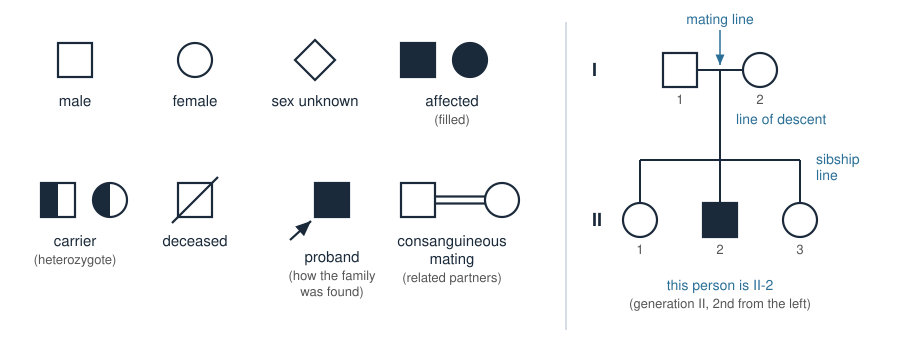
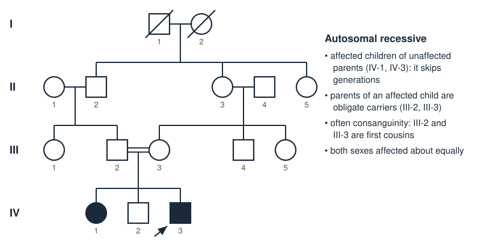
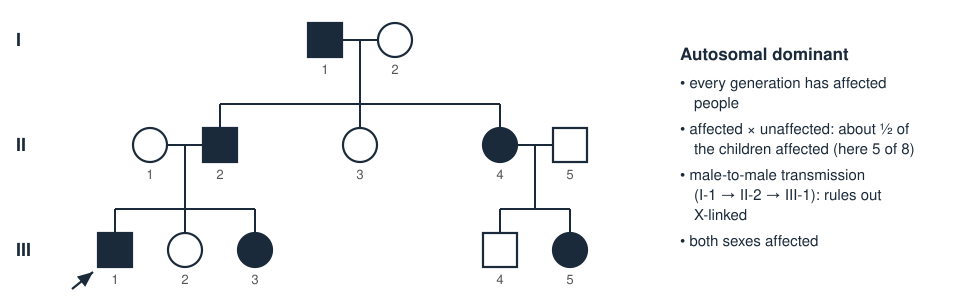
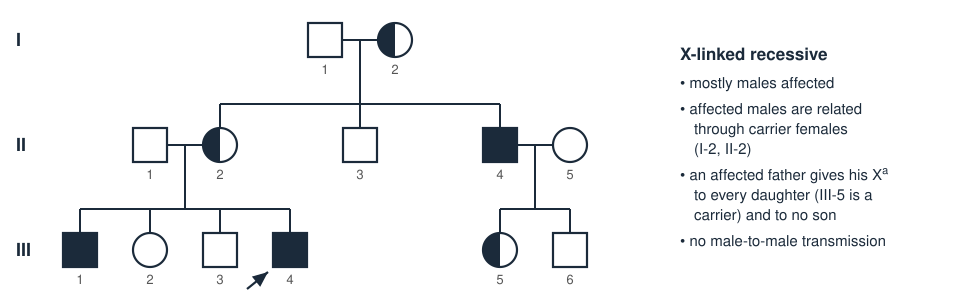
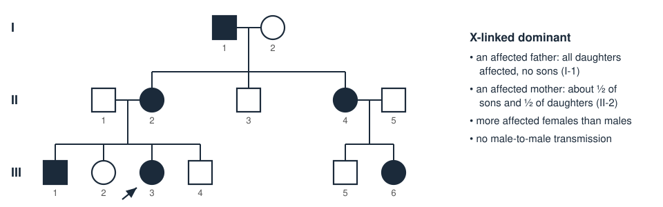
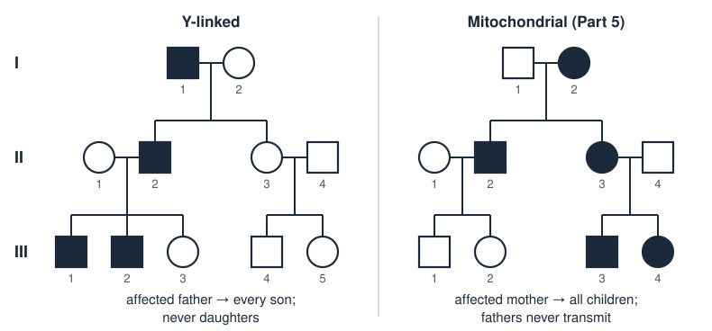
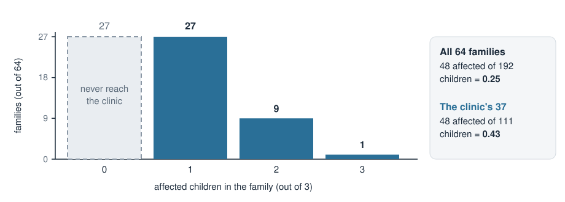

## About this lecture

We cannot set up crosses in humans. To learn how a human trait is inherited, we **read the family tree that already exists**: the pedigree.

- The **standard symbols** of a pedigree, and how to name each person (II-3).
- The **hallmarks** of five modes of inheritance: autosomal recessive, autosomal dominant, X-linked recessive, X-linked dominant and Y-linked. Mitochondrial inheritance gets a brief mention.
- A **strategy**: do not try to prove a mode; **rule modes out**, one family at a time, with a worked example.
- **Risk calculations**: the 2/3 carrier probability, partners from the population, X-linked risks, and children of relatives, each worked with numbers.
- **Complications**: incomplete penetrance, new mutations and ascertainment bias, with the numbers behind the bias.

You already know Mendel's laws, the χ² test and the probability rules (product rule, sum rule, conditional probability). Today we use all three. Book: Hartwell, Mendel's principles chapter (pedigrees) and the chromosome theory chapter (sex-linked traits).

::: notes
The whole lecture is one skill: look at a family tree and say which modes of inheritance it allows. Students already have the tools: segregation of one gene from the Mendel unit, and conditional probability from the probability unit. Today we only add two things: the drawing conventions, and the transmission rules for the X and Y chromosomes. Stress the strategy early: we rule modes out. A pedigree rarely proves a mode; it often excludes several. The risk part at the end reuses the 2/3 they met in the probability unit, now with a family attached.
:::

## Why humans need pedigrees

In peas or flies we **choose the cross**: true-breeding parents, a test cross, hundreds of offspring. In humans we can do none of this.

| | Experimental organism | Humans |
|---|---|---|
| Crosses | chosen by the geneticist | chosen by the people |
| Offspring per family | hundreds | usually 1–4 |
| Generation time | days to weeks | 25–30 years |
| Genotypes of parents | known (true-breeding lines) | unknown |

So we collect what already happened: **who is affected, and how they are related**, over as many generations as we can trace. One family is small, so a 3:1 ratio is rarely visible. Instead we look for **patterns that are impossible** under a given mode.

::: notes
The point is the contrast with the Mendel unit. There we chose the parents and counted hundreds of offspring, so a chi-square test against 3:1 was natural. Here a family has two or three children, so ratios are useless within one family; with three children, 0, 1, 2 or 3 affected are all quite likely. What a pedigree does give us is structure: who passed what to whom. A single impossible transmission, such as an affected child of two unaffected parents under dominant inheritance, excludes a mode no matter how small the family is. That is why the analysis is about exclusion. Mention that clinical genetics still draws pedigrees routinely, now often next to DNA tests.
:::

## The symbols {.smaller}

{width="88%" fig-align="center"}

- **Generations** are roman numerals from the top; people are numbered **left to right** within a generation, so "II-2" names one person.
- The **proband** is the affected person through whom the family came to attention. Remember this: it matters for bias later.
- **Half-filled** means a known (or obligate) heterozygous carrier. Most pedigrees do not show carriers, because nobody has tested them.

::: notes
Go through the symbols quickly; they are a convention, not a concept. Squares are males, circles females, diamonds sex unknown. Filled means affected. A diagonal slash means deceased. A horizontal line between two people is a mating; a double line means the partners are related (consanguineous). The vertical line of descent drops to a horizontal sibship line, and the children hang from it in birth order, left to right. The arrow marks the proband. Some books mark X-linked carrier women with a dot in the centre instead of half-filling; we use half-filled for all carriers. Point out that carriers are only drawn when we know: either by a test, or because the logic of the pedigree forces it (an obligate carrier).
:::

## Autosomal recessive {.smaller}

{width="72%" fig-align="center"}

- The affected person is *aa*; both parents are usually unaffected **carriers** (*Aa* × *Aa*), so ¼ of their children are expected to be affected.
- The trait **skips generations**: it appears among siblings, often with no affected ancestor.
- **Consanguinity** (a double line) is common: relatives are more likely to carry the *same* rare allele.
- Examples: phenylketonuria (PKU), cystic fibrosis.

::: notes
Read the figure from the bottom. IV-1 and IV-3 are affected but their parents are not: so the allele was hidden in both parents, which is the hallmark of a recessive trait. Both parents must be carriers, so III-2 and III-3 are obligate carriers even though nobody tested them. They are first cousins, which is the classic clue: a rare recessive allele from a shared grandparent can come down both sides. Both sexes are affected, as expected for an autosome. Note what is missing: no affected people in generations I to III. That is common for rare recessive diseases. Ask: what would rule out AR? Only two affected parents with an unaffected child, because aa × aa can only give aa.
:::

## Autosomal dominant {.smaller}

{width="85%" fig-align="center"}

- Every affected person has an **affected parent** (with full penetrance and no new mutation): the trait appears in **every generation**.
- Affected (*Aa*) × unaffected (*aa*) gives **½ affected** children, of either sex.
- **Male-to-male transmission** (father → son) is possible. A son gets his father's Y, not his X, so this **rules out X-linkage**.
- Examples: Huntington disease, Marfan syndrome.

::: notes
The pattern is vertical: affected people in each generation, each with an affected parent. Most affected people are heterozygous, because the disease allele is rare, so the cross is Aa × aa and half the children are affected. Here 5 of 8: in small families, expect noise around one half. The key line is I-1 to II-2 to III-1: father to son to grandson. A father gives his son a Y chromosome, so a trait that goes from father to son cannot be on the X. This is the single most useful observation for separating autosomal dominant from X-linked dominant. What rules out AD? An affected child of two unaffected parents; we will see later that new mutations and incomplete penetrance can produce exactly this, which is why the assumptions matter.
:::

## Sex linkage, just enough for pedigrees

Recap only; Part 2 (*Chromosome theory*) covers sex chromosomes properly.

- Females are **XX**; males are **XY**. A male has **one** X, so he is **hemizygous** for X-linked genes: a single recessive allele shows.
- A father gives his **X to every daughter** and his **Y to every son**.
- A mother gives one of her two X chromosomes to each child, **½ each**.
- Notation: X<sup>A</sup> and X<sup>a</sup> for the two alleles on the X; X<sup>a</sup>Y is an affected male for an X-linked recessive trait.

| Parents | Sons | Daughters |
|---|---|---|
| X<sup>A</sup>X<sup>a</sup> (carrier) × X<sup>A</sup>Y | ½ X<sup>a</sup>Y affected | ½ X<sup>A</sup>X<sup>a</sup> carriers, none affected |
| X<sup>A</sup>X<sup>A</sup> × X<sup>a</sup>Y (affected) | all X<sup>A</sup>Y unaffected | all X<sup>A</sup>X<sup>a</sup> carriers |

::: notes
This slide gives just what pedigree reading needs; meiosis, sex determination and dosage compensation come in Part 2. The two transmission rules carry everything: fathers pass X to daughters and Y to sons; mothers pass either X with probability one half. From the rules, the two crosses in the table follow directly; have the students derive them with a Punnett square, using X^A and X^a as the gametes. The second row is the reason an affected man's grandsons, through his daughters, can be affected: his daughters are obligate carriers. Mention hemizygous: males have no second copy to mask a recessive allele, which is why X-linked recessive diseases are much more common in males.
:::

## X-linked recessive {.smaller}

{width="85%" fig-align="center"}

- **Mostly males** are affected; an affected female needs an affected father *and* a carrier mother.
- Affected males are related **through unaffected carrier females**: the trait passes from grandfather to grandson via a daughter.
- **No male-to-male transmission**: an affected father gives his X<sup>a</sup> to every daughter and to no son.
- Examples: Duchenne muscular dystrophy, haemophilia A, red–green colour blindness.

::: notes
Point to I-2, a carrier woman: half her sons are affected (II-4), half her daughters are carriers (II-2). II-2 in turn has two affected sons among four children. This is the "knight's move" pattern: grandfather or great-uncle to grandson, through women who are not affected. On the right, II-4 is an affected man: all his daughters are carriers (III-5), none of his sons is affected. What rules out XR? An affected woman with an unaffected son (she is XaXa, so every son gets Xa), or an affected daughter whose father is unaffected. Male-to-male transmission does not strictly rule out XR, if the mother happens to be a carrier, but it makes XR much less likely. The demo shows this case.
:::

## X-linked dominant {.smaller}

{width="85%" fig-align="center"}

- An affected father has **all daughters affected and no affected sons**.
- An affected (heterozygous) mother passes it to **½ of her sons and ½ of her daughters**: here it looks just like autosomal dominant.
- More affected **females** than males, often with milder symptoms in females.
- Example: X-linked hypophosphatemic rickets (*PHEX*).

::: notes
X-linked dominant is rare, and easy to confuse with autosomal dominant, because an affected mother gives the same one-half to both sexes under either mode. The families that decide it are those with an affected father. Under XD all his daughters are affected and none of his sons; under AD each child, of either sex, has a one-half chance. One unaffected daughter or one affected son of an affected father rules XD out. Females are more often affected because they have two X chromosomes, and therefore two chances to carry the allele. Females are often milder because of X inactivation, which comes in Part 6.
:::

## Y-linked and mitochondrial {.smaller}

{width="72%" fig-align="center"}

- **Y-linked**: only males, from father to **every** son. There are few Y genes; examples involve male fertility.
- **Mitochondrial**: from the mother to **all** her children; fathers never transmit. Severity varies because cells carry a mixture of normal and mutant mitochondria (**heteroplasmy**). Example: Leber hereditary optic neuropathy. Full story in Part 5 (*Organelle inheritance*).

::: notes
Both are quick. Y-linked inheritance is strict father-to-son, with no females ever affected, because the Y passes only from father to son. The Y carries few genes, mostly for male development and fertility, so Y-linked pedigrees are rare in the clinic. Mitochondria come from the egg, so the mother passes them to all her children and a father passes them to none. In real families the pattern is blurred by heteroplasmy, so not every child of an affected mother is equally affected; that is the topic of the organelle inheritance unit in Part 5. The demo and the exercises use only the four nuclear modes.
:::

## A strategy: rule modes out

Do not ask "which mode is it?". Ask **"which modes are impossible?"**, family by family. With full penetrance and no new mutations:

| You see in one family | Rules out |
|---|---|
| Affected child, **both parents unaffected** | AD and XD |
| **Both parents affected**, an unaffected child | AR |
| **Father → son** transmission, mother unaffected | XD (and makes XR unlikely) |
| Affected **father**, **unaffected daughter** | XD |
| Affected **mother**, **unaffected son** | XR |
| Affected **daughter**, **unaffected father** | XR |

1. Check each mode against every parent–child trio.
2. Among the modes left, prefer the one that needs **fewest extra assumptions**, such as carriers marrying in from the population.

::: notes
This is the slide to copy into notes. Each row is a single trio: father, mother, child. Each impossible trio is a proof that the mode is wrong, under our assumptions. Go through the rows and ask students to justify each from the transmission rules. For the first row under XD: an affected daughter needs an affected parent, and an affected son needs an affected mother, so both are ruled out. Step 2 is about likelihood, not logic: AR is almost never strictly ruled out, because any unaffected person could be a carrier. But if AR needs three unrelated people who married in to all be carriers of a rare allele, it is a poor explanation.
:::

## Worked example: rule out, step by step {.smaller}

{width="60%" fig-align="center"}

| Mode | Check the trios | Verdict |
|--|----------|----|
| **XD** | I-1 (affected father) → II-2 (affected **son**), mother I-2 unaffected; I-1 also has an unaffected **daughter**, II-3 | **ruled out** |
| **XR** | II-4 is an affected **woman** with an unaffected **son**, III-4 | **ruled out** |
| **AR** | possible, but each affected × unaffected mating then needs the unaffected partner to be a carrier: I-2, II-1 **and** II-5, all marrying in | consistent, **very unlikely** |
| **AD** | every affected person has an affected parent; about ½ of each sibship affected | consistent, **no extra carriers** |

Conclusion: **consistent with autosomal dominant**, and nothing else is plausible.

::: notes
Do this one live, with the class calling out each step. Order matters for speed: check the X-linked modes first, because they are easiest to break with one trio. XD falls to the father-to-son transmission, and independently to the unaffected daughter of an affected father. XR falls to II-4: an affected woman under XR is XaXa, so every son must be affected, and III-4 is not. AR is the hard one, as always: it is only ruled out by two affected parents with an unaffected child, which this family does not have. Instead, count the carriers it needs. Each affected person here has one unaffected parent who married in, and under AR every one of them must carry the same rare allele: three unrelated carriers. That is the second step of the strategy at work. AD needs nothing extra. Students should write the answer in this form: what is ruled out, by which trio, and why the remaining mode is preferred.
:::

## Consistent is not the same as proven

A pedigree often fits **several** modes. Look at fig04 again (X-linked recessive):

- **AR also fits**, if I-1 and I-2 are both carriers and II-1, who married in, is a carrier too. For a rare allele that is unlikely, but it is not impossible.
- **AD is ruled out**: III-1 is affected but his parents II-1 and II-2 are not.
- **XD is ruled out**: affected sons of an unaffected mother.

So we say "**consistent with** X-linked recessive", and we prefer it because it needs no extra carriers. More families, or a DNA test, can settle it.

{width="60%" fig-align="center"}

::: notes
Students tend to want one right answer. Make the point that the honest result of pedigree analysis is a list of modes that remain, ranked by how plausible they are. In fig04, AR survives the logic test but needs the in-law II-1 to carry the same rare allele. XR needs nothing extra beyond a carrier grandmother. That is why we favour XR. In the demo, you can test each mode: it will report consistent or ruled out, show a set of genotypes that works, and name the people who married in and must be carriers.
:::

## Demo: which mode?

```{=html}
<link rel="stylesheet" href="../demos/dist/demo.css">
<div data-demo="pedigree" data-seed="3"></div>
<script src="../demos/dist/pedigree.js"></script>
```

::: notes
This pedigree was generated under a hidden mode. Test X-linked recessive first: it is ruled out, and the demo rings the trio, an affected mother with an unaffected son. Then test AD, XD and AR: all three are consistent. Ask the class which is most likely. Under XD the affected father I-1 must have all daughters affected and no sons; he has exactly that, and so does III-3. Under AD that pattern has probability one half per child, about 1/32 for these five children. Under AR, two people who married in must be carriers. Then press reveal. Press "new pedigree" for another family if time allows. The demo assumes full penetrance and no new mutations, so it can rule out a mode that a real family would still allow.
:::

## Risk 1: the 2/3 carrier probability

Two unaffected parents have a child with PKU (autosomal recessive). So both parents are *Aa*. What is the chance that their **unaffected** daughter is a carrier?

$$
Aa \times Aa \;\rightarrow\; \tfrac14\,AA,\; \tfrac12\,Aa,\; \tfrac14\,aa
$$

She is **not** *aa*, so we condition on "unaffected" (recap: [Probability and the χ² test](../probability-chisq/lec.qmd)):

$$
P(Aa \mid \text{unaffected}) = \frac{1/2}{1/4 + 1/2} = \frac{2}{3}.
$$

- The answer is **2/3**, not 1/2: knowing she is unaffected removes the *aa* quarter.
- Her **parents** are *obligate* carriers: probability 1.

::: notes
This is the conditional probability from the probability unit, in a family setting. Students often say one half, because Aa is half of the Punnett square. But the Punnett square includes aa, and we already know she is not aa. Among the three unaffected quarters, two are Aa and one is AA. Draw the Punnett square, cross out aa, count what is left. Point out that the parents' carrier status is not a probability at all: an affected child proves it.
:::

## Risk 2: a partner from the population

The unaffected sister (carrier probability 2/3) has a child with a man from the population. He has no family history. **Assume** a carrier frequency of **1/50**.

$$
P(\text{child } aa) = \underbrace{\tfrac23}_{\text{she is }Aa} \times \underbrace{\tfrac1{50}}_{\text{he is }Aa} \times \underbrace{\tfrac14}_{\text{both pass }a} = \tfrac{1}{300}.
$$

- **Product rule**: three independent events must all happen.
- Where does 1/50 come from? If a disease affects 1 in 10 000 births, then *q* = 1/100 and the carrier frequency 2*pq* ≈ 1/50. That is Hardy–Weinberg, in Part 7 (*Hardy–Weinberg*).
- If **both** partners have an affected sibling: 2/3 × 2/3 × 1/4 = **1/9**.

::: notes
Build the risk as a chain: she must be a carrier, he must be a carrier, and both must pass on a. Each is a probability and they multiply. The population carrier frequency is the weak link; it depends on the population, and for most diseases the clinic looks it up. Here we treat 1/50 as an assumption. Make clear that the 1/50 is derived, not looked up: incidence 1/10 000 means q squared = 1/10 000, so q = 1/100 and 2pq is about 2/100 = 1/50. The last line is a classic exam problem: two unaffected people who each have an affected sibling. Compare 1/300 with 1/9: family history moves the risk by a factor of about 30.
:::

## Risk 3: X-linked recessive

Lena's **maternal uncle** has Duchenne muscular dystrophy (XR). Her grandparents, her mother and Lena are unaffected. Assume no new mutation. What is the risk that Lena's first son is affected?

Walk **down** the family, one transmission at a time:

| Step | Who | Reason | Probability |
|---|---|---|---|
| 1 | grandmother is X^A^X^a^ | her son is affected; his X came from her | **1** (obligate carrier) |
| 2 | Lena's mother is X^A^X^a^ | she got one of her mother's two X chromosomes | ½ |
| 3 | Lena is X^A^X^a^ | same again, from her mother | ½ |
| 4 | Lena's son gets X^a^ | a son gets one of his mother's two X | ½ |

$$P(\text{son affected}) = 1 \times \tfrac12 \times \tfrac12 \times \tfrac12 = \tfrac18$$

- The **father's side never matters** for a son: fathers give sons their Y.
- Each woman along the line passes X^a^ with probability ½, so each extra generation **halves** the risk.

::: notes
This is the X-linked version of the risk chain, and it is the kind of problem students meet in the exercise, with a different family. The key step is the first: the grandmother is not "a possible carrier", she is an obligate carrier, because an affected son must have got his X from his mother (if we rule out a new mutation; for DMD new mutations are in fact common, which is why genetic counselling also tests). Then every downward step through a woman is a coin toss. Two common mistakes: multiplying in a factor for the father, and forgetting that a daughter of an affected man (not this case) is an obligate carrier with probability 1. A simplification to name: we have not used the information that Lena's mother and Lena are unaffected, because carrier women are unaffected anyway for XR, so it does not change the probabilities. If Lena already had unaffected sons, a conditional calculation like the 2/3 one would lower her carrier probability; that is beyond this course.
:::

## Consanguinity raises recessive risk

Relatives share alleles **by descent** from common ancestors. If one great-grandparent carried a rare allele, it can come down **both sides** of a cousin marriage and meet again in a child.

- For a rare allele, an unrelated partner is almost never a carrier of the *same* allele. A cousin is much more likely to be, because the allele may be in the family.
- The child of **first cousins** is homozygous **by descent** at about **1/16** of its genes.
- This is why consanguinity in a pedigree is a hint for **autosomal recessive** inheritance, and why rare recessive diseases are more common in families and populations where cousin marriage is frequent.

::: notes
Keep this qualitative. The one number is 1/16, the inbreeding coefficient of a child of first cousins: the probability that the two copies of a gene in that child are copies of the same ancestral allele. It does not mean the child has a 1/16 risk of disease: the risk depends on whether the shared ancestors carried a disease allele at all. The key idea is that relatedness makes the second carrier much more likely when the allele is rare. Do not moralise: in many parts of the world cousin marriage is common and most children are healthy; the increase in absolute risk is modest. Inbreeding returns in Part 7 with Hardy–Weinberg.
:::

## Consanguinity: counting meioses

When we **know** an ancestor carried the allele, follow it down each path. Each **meiosis** on the way passes it on with probability ½.

**Worked example.** A great-grandfather is a known carrier of a rare recessive allele; his wife is not. Two of his great-grandchildren, **second cousins**, have a child. Nobody who married in is a carrier.

| Step | Probability |
|---|---|
| great-grandfather → child → grandchild → second cousin 1: three meioses | (½)³ = 1/8 |
| the same for second cousin 2, along the other branch | 1/8 |
| both cousins carriers **and** both pass *a* | 1/8 × 1/8 × 1/4 = **1/256** |
| compare: cousin 1 with an unrelated partner (carrier frequency 1/50) | 1/8 × 1/50 × 1/4 = **1/1600** |

The related partner raises the risk about **6-fold** here, because the allele is **known** to be in the family.

- The closer the relatives, the fewer meioses, and the larger the effect.
- Without a known carrier, the absolute risk from cousin marriage is much smaller; the 1/16 inbreeding coefficient is the general measure (Part 7).

::: notes
This turns the qualitative slide into a method students can apply: draw the path from the known carrier to each partner, count the meioses, and raise one half to that power. Then multiply as usual with the final quarter. The comparison with the unrelated partner is the point: what makes cousin marriage risky is that the same rare allele can arrive by two routes. With first cousins there are two meioses on each path, so each cousin's carrier probability is 1/4, and the effect is larger still; that is the exercise problem, so do not do it here. Note the assumption that nobody who married in carries the allele, which is reasonable for a rare allele. The numbers are conditional on a known carrier ancestor; in a random family the absolute risk is far lower.
:::

## Complications

Our rules assumed **full penetrance** and **no new mutations**. Real families break both.

- **Incomplete penetrance** (from [Extensions to Mendel](../mendel-extensions/lec.qmd)): a person carries a dominant allele but is unaffected. An AD trait then **skips a generation** and can look recessive.
- **New mutations**: an affected child of two unaffected parents under AD. Most cases of achondroplasia arise this way.
- **Ascertainment bias**: families reach the clinic **because** they have an affected child. Families with *Aa* × *Aa* parents but no affected child are never seen.

Each one can make a correct mode look "ruled out", so read impossible trios with these in mind.

::: notes
These three are why a real geneticist does not apply the rule-out table blindly. Incomplete penetrance: an obligate carrier, such as an unaffected parent between an affected grandparent and an affected grandchild, is the tell-tale sign. New mutations: for dominant diseases that reduce reproduction, many cases are new; an isolated affected child of unaffected parents is then expected, not paradoxical. Ascertainment is subtler and gets its own slide: it does not break transmission rules, it distorts ratios.
:::

## Ascertainment bias: the missing families

Take 64 *Aa* × *Aa* families, each with 3 children. Each child is affected with probability ¼ (binomial, from *Probability and the χ² test*):

{width="80%" fig-align="center"}

The clinic only sees families with **at least one** affected child. The 27 families with none are invisible, but their 81 unaffected children are missing from the count, so the affected fraction looks too **high**.

::: notes
Build the bar chart from the binomial: P(0 of 3) = (3/4)^3 = 27/64, P(1) = 3 × 1/4 × 9/16 = 27/64, P(2) = 3 × 1/16 × 3/4 = 9/64, P(3) = 1/64. Out of 64 families, expect 27, 27, 9 and 1. Count affected children: 27 × 1 + 9 × 2 + 1 × 3 = 48 of 192 children, exactly a quarter. Now remove the 27 families that never come to the clinic. The 48 affected children are all still there, but the children are now only 37 × 3 = 111. 48/111 = 0.43. Nothing about transmission has changed; only the way we collected the families. Historically this was a real problem for testing Mendelian ratios in humans.
:::

## Ascertainment bias: the formula

The same reasoning for any sibship size *n* and per-child probability *q*:

- expected affected per family, **all** families: *nq*;
- fraction of families with **at least one** affected: 1 − (1 − *q*)^*n*^;
- all affected children are in ascertained families, so per **ascertained** family:

$$
\frac{n q}{1-(1-q)^n} = \frac{3 \times 0.25}{1 - 0.75^3} = \frac{0.75}{0.578} = 1.30,
$$

so the fraction affected is 1.30/3 ≈ **0.43**, not 0.25 (the same 48/111 as on the previous slide).

- The bias **shrinks** as families get larger: fewer families have no affected child.
- A naive χ² test of 1 : 3 in clinic families would **wrongly reject** a recessive trait.
- One correction, the **sib method**: take **each** affected child in turn and count how many of their siblings are affected. In the clinic's 37 families: 24 of 96 siblings, exactly ¼.

::: notes
The numerator is the expected number of affected children per family, n times q. Every affected child sits in a family that has at least one affected child, so dividing by the probability of being ascertained rescales the expectation to the families we actually see. With 3 children, 42% of Aa × Aa families have no affected child and are invisible, so the observed fraction is inflated to 0.43. With larger families the bias shrinks; with n = 1 every ascertained family is a single affected child, so the fraction is 1. The sib method numbers: the 27 families with one affected child give 27 index children with 0 affected among 54 siblings; the 9 families with two give 18 index children, each with 1 affected of 2 siblings (18 of 36); the 1 family with three gives 3 index children, each with 2 of 2 (6 of 6). Total 24 of 96 = 1/4. Removing only one proband per family would over-correct in this model, which is why the method counts every affected child as an index case. We do not go further than this. In the exercise students reproduce this with rbinom and replicate, then filter, and compare with this formula.
:::

## Common mistakes

| Mistake | Fix |
|---|---|
| "This family has 1 affected of 4 children, so it is recessive (¼)." | Families are too small for ratios. Look for **impossible trios**. |
| "Male-to-male transmission rules out XR." | It rules out **XD**; XR is only **unlikely** (needs a carrier mother). |
| "Skipped generation, so it must be recessive." | Or a dominant allele with **incomplete penetrance**. |
| "The unaffected sister of a patient is a carrier with probability ½." | **⅔**: she is known not to be *aa*. |
| "Two carrier parents: risk ¼ × ¼ for the second child after an affected first child." | Each child is independent: **¼** again. |
| "The parents of an affected child (AR) are carriers with probability ⅔." | They are **obligate** carriers: probability **1**. |
| "Under XR, the affected man's sons are at risk." | Sons get his **Y**. His **daughters** are obligate carriers. |
| "AR is consistent, so AR is the answer." | AR is almost **always** consistent. Count the carriers it needs. |

::: notes
These come from exam scripts. Ask students to cover the right column and explain each fix before revealing it. The independence error and the ⅔ versus ½ error are the two most frequent. The last row is the conceptual one: the logical test alone almost never excludes AR, so the plausibility step decides.
:::

## Summary

- A pedigree is the human substitute for a controlled cross; families are small, so we look for **impossible transmissions**, not ratios.
- **AR**: skips generations, both sexes, often consanguinity. **AD**: every generation, ½ of children, male-to-male possible.
- **XR**: mostly males, through carrier mothers, no father-to-son. **XD**: affected father → all daughters, no sons.
- **Y-linked**: father → every son. **Mitochondrial**: mother → all children (Part 5).
- **Rule modes out** trio by trio; among those left, prefer the one with the fewest extra carriers. Consistent ≠ proven.
- Risks: unaffected sibling of a patient **2/3** carrier; multiply independent steps; X-linked: each woman down the line passes X<sup>a</sup> with ½; known carrier ancestor: (½) per meiosis.
- Watch for **incomplete penetrance**, **new mutations** and **ascertainment bias** (clinic families over-represent affected children: 0.43 instead of 0.25 for sibships of 3).

::: notes
Recap the two-step strategy once more, since it is what students will use in the exam: exclude by impossible trios, then rank what remains by plausibility. Remind them of the three numbers: one quarter for a carrier couple, two thirds for an unaffected sibling, one half for a dominant parent. Everything else is the product rule.
:::

## Where this leads

- **Part 2**: *Chromosome theory* explains sex chromosomes and X-linkage in full, and *LOD scores* use pedigrees to **map** disease genes.
- **Part 5**: *Organelle inheritance* treats mitochondrial inheritance and heteroplasmy.
- **Part 7**: *Hardy–Weinberg* gives the population carrier frequencies we assumed today, and the inbreeding coefficient.
- In the exercise: analyse pedigrees by hand, look up real diseases in OMIM, MedGen and ClinVar, and simulate ascertainment bias in R.

::: notes
Pedigrees are not a dead end. In Part 2 the same family trees are used to find where a disease gene lies on a chromosome, by asking whether it is inherited together with a marker. The population numbers we assumed today come from Hardy–Weinberg. The exercise links today to the databases: OMIM and MedGen record the mode of inheritance of each disease, and ClinVar records which variants in a gene cause it.
:::
