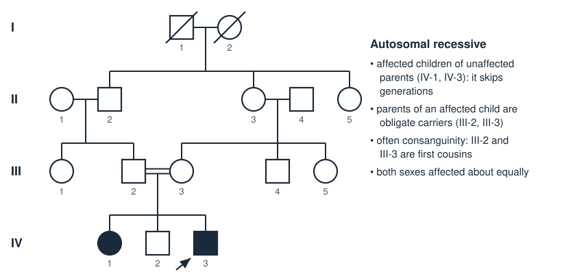

Short questions on reading pedigrees and on simple risk calculations. Try each on paper first, then open the answer. Unless a question says otherwise, assume one gene, **full penetrance** and **no new mutations**.

---

**Q1.** Why do human geneticists use pedigrees, when geneticists studying peas or flies use controlled crosses?

::: {.callout-tip collapse="true" title="Hint"}
Think about who chooses the parents, how many children there are, and how long a generation takes.
:::

::: {.callout-note collapse="true" title="Answer"}
We cannot set up crosses in humans: people choose their own partners, families have only a few children, and a generation takes 25–30 years. So we collect the crosses that have already happened: who is affected and how they are related. With so few children, ratios such as 3:1 are hardly visible within one family. Instead we look for transmissions that are impossible under a mode.
:::

---

**Q2.** Two unaffected parents have an affected daughter. Which modes of inheritance does this rule out: AR, AD, XR, XD?

::: {.callout-tip collapse="true" title="Hint"}
Take each mode in turn. Under that mode, what genotype must the daughter have, and could two unaffected parents give it to her?
:::

::: {.callout-note collapse="true" title="Answer"}
- **AD is ruled out**: an affected child needs at least one affected parent.
- **XD is ruled out**: the daughter needs an XA from one parent, and both are unaffected.
- **XR is ruled out**: an affected daughter is XaXa, so she got Xa from her father, who would then be affected.
- **AR remains**: both parents are carriers (*Aa* × *Aa*).

One trio with an affected daughter of unaffected parents leaves only autosomal recessive.
:::

---

**Q3.** An affected man has an affected son. The son's mother is unaffected. Which mode does this rule out, and why? Does it rule out X-linked recessive?

::: {.callout-tip collapse="true" title="Hint"}
Which chromosome does a father give to his son?
:::

::: {.callout-note collapse="true" title="Answer"}
A father gives his son a **Y**, not his X. So the son cannot have got an X-linked allele from his father.

- **XD is ruled out**: the son needs XA from his mother, and she is unaffected, so she has none.
- **XR is not strictly ruled out**: the son could have got Xa from a carrier mother, who is unaffected. But this needs a carrier to marry into the family, which is unlikely for a rare allele. So male-to-male transmission makes XR very **unlikely**.

Male-to-male transmission is the classic evidence *for* autosomal inheritance.
:::

---

**Q4.** An affected woman with an X-linked recessive disease has children with an unaffected man. What do you expect among their sons and their daughters?

::: {.callout-tip collapse="true" title="Hint"}
Write her genotype with Xa and XA, then make a Punnett square with his XA and Y.
:::

::: {.callout-note collapse="true" title="Answer"}
She is XaXa and he is XAY.

- **All sons** get Xa from her and Y from him: XaY, **all affected**.
- **All daughters** get Xa from her and XA from him: XAXa, **unaffected carriers**.

So an affected woman with even one unaffected son rules out XR.
:::

---

**Q5.** Look at the autosomal recessive pedigree in the lecture (fig02). Why are III-2 and III-3 called **obligate carriers**, even though nobody has tested them?

{width="80%" fig-align="center"}

::: {.callout-tip collapse="true" title="Hint"}
What genotype must IV-1 have, and where did each of her two alleles come from?
:::

::: {.callout-note collapse="true" title="Answer"}
IV-1 and IV-3 are affected, so they are *aa*. Each got one *a* from each parent. Both parents are unaffected, so each must be *Aa*. The logic of the pedigree forces it: no test is needed. "Obligate" means *must be*.
:::

---

**Q6.** Two unaffected parents have a child with cystic fibrosis (autosomal recessive). What is the probability that their **unaffected** son is a carrier? Why is it not 1/2?

::: {.callout-tip collapse="true" title="Hint"}
Start from *Aa* × *Aa*. Which part of the outcomes can you cross out, given that he is unaffected?
:::

::: {.callout-note collapse="true" title="Answer"}
*Aa* × *Aa* gives ¼ *AA*, ½ *Aa*, ¼ *aa*. He is unaffected, so he is not *aa*. Conditional on that:

$$P(Aa \mid \text{unaffected}) = \frac{1/2}{1/4 + 1/2} = \frac{2}{3}.$$

It is not 1/2 because the 1/2 is a share of *all* children, including the affected ones. Once we know he is unaffected, the *aa* quarter is gone, and two of the three remaining quarters are *Aa*.
:::

---

**Q7.** The son from Q6 has a child with a woman from a population with a carrier frequency of 1/25. She has no family history. What is the risk that their child has cystic fibrosis?

::: {.callout-tip collapse="true" title="Hint"}
Three things must all happen. Multiply their probabilities (product rule).
:::

::: {.callout-note collapse="true" title="Answer"}
$$P = \underbrace{\tfrac23}_{\text{he is }Aa} \times \underbrace{\tfrac1{25}}_{\text{she is }Aa} \times \underbrace{\tfrac14}_{\text{both pass }a} = \frac{2}{300} = \frac{1}{150} \approx 0.0067.$$
:::

---

**Q8.** An affected man with an X-linked **dominant** disease has four children with an unaffected woman. Predict the phenotypes of his sons and daughters. Under **autosomal** dominant inheritance, what is the probability of exactly the same outcome?

::: {.callout-tip collapse="true" title="Hint"}
Under XD, what does a father give to each daughter and to each son? Under AD, each child is an independent coin toss.
:::

::: {.callout-note collapse="true" title="Answer"}
Under **XD** he gives his XA to every daughter and his Y to every son: **all daughters affected, all sons unaffected**.

Under **AD** (*Aa* × *aa*) each child is affected with probability ½, independently of sex. The chance that the four children show exactly the XD pattern (every daughter affected, every son unaffected) is (½)4 = **1/16**. One such family is suggestive; several such families make XD much more likely than AD.
:::

---

**Q9.** Why does consanguinity (for example, a first-cousin marriage) increase the risk of **recessive** disease, but not of dominant disease?

::: {.callout-tip collapse="true" title="Hint"}
For a recessive disease, both parents must carry the *same* rare allele. How likely is that for unrelated partners, and for cousins?
:::

::: {.callout-note collapse="true" title="Answer"}
Relatives share alleles inherited from common ancestors. If a grandparent carried a rare recessive allele, it can reach both cousins and meet again in their child: the child of first cousins is homozygous by descent at about 1/16 of its genes. For unrelated partners, both carrying the same rare allele is very unlikely. A dominant disease needs only **one** copy, so it shows in the carrier parent anyway; the parents being related adds no new risk.
:::

---

**Q10.** An autosomal dominant disease shows up in generations I and III of a family, but the person in generation II who links them is unaffected. Give two explanations.

::: {.callout-tip collapse="true" title="Hint"}
One explanation is about the link between genotype and phenotype; the other is about where the allele came from.
:::

::: {.callout-note collapse="true" title="Answer"}
1. **Incomplete penetrance**: the person in generation II carries the dominant allele but does not show the disease. They are an obligate carrier.
2. **New mutation** in generation III, so the allele in III was not inherited through generation II. (It is also possible that the disease in generation I has a different cause, or that biological parentage differs from the drawn pedigree.)

These are the cases where the strict rule "every affected person has an affected parent" breaks down.
:::

---

**Q11.** A clinic collects families with **three** children, in which both parents are carriers of a recessive disease. It finds them through an affected child. Is the fraction of affected children among these families 1/4? If not, is it higher or lower, and why?

::: {.callout-tip collapse="true" title="Hint"}
Which *Aa* × *Aa* families never come to the clinic?
:::

::: {.callout-note collapse="true" title="Answer"}
It is **higher**, about 0.43 rather than 0.25. *Aa* × *Aa* families with three unaffected children (probability (3/4)3 ≈ 0.42) never come to the clinic, so they are missing from the count. Among the families that are seen, the expected number of affected children is

$$\frac{nq}{1 - (1-q)^n} = \frac{3 \times 1/4}{1 - (3/4)^3} \approx 1.30,$$

that is 1.30/3 ≈ 0.43 per child. This is **ascertainment bias**: how families are found changes the ratio we observe.
:::
