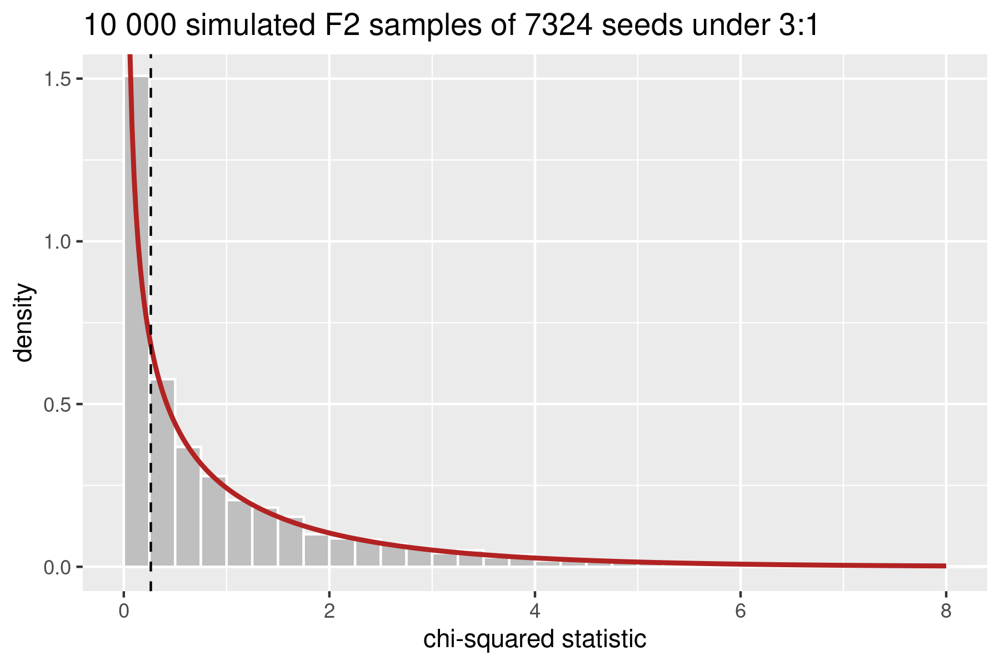

## Goal

By the end of this exercise you should be able to:

- run the same test in R with `chisq.test` and `pchisq`, and estimate a p-value by **simulation** with `replicate()`.

## Before you start

This page builds on the by-hand part of the [Exercise](exercise.qmd), so do that first. You need the packages ggplot2, readr and dplyr. Download [mendel_monohybrid.csv](data/mendel_monohybrid.csv) and save it in a `data/` folder of your R project.

## Tasks

R1–R3 check your hand calculations. R4–R6 introduce this unit's new idiom: **simulation under the null hypothesis with [`replicate()`](https://rdrr.io/r/base/lapply.html)**. `replicate(n, expr)` evaluates the expression `expr` n times and collects the results in a vector. If the expression contains random draws, every evaluation is a new random experiment. This lets you see the distribution of any statistic under H0, without a formula.

### R1. `chisq.test` on Mendel's data

[`chisq.test(x, p = ...)`](https://rdrr.io/r/stats/chisq.test.html) tests the counts in `x` against the proportions in `p`, which must sum to 1.

```r
obs <- c(round = 5474, wrinkled = 1850)
chisq.test(obs, p = c(3, 1) / 4)

dihybrid <- c(round_yellow = 315, round_green = 108,
              wrinkled_yellow = 101, wrinkled_green = 32)
chisq.test(dihybrid, p = c(9, 3, 3, 1) / 16)
```

Check the χ² values and df against the lecture. Then use `chisq.test` to check your answers to B6–B9 in the [exercise](exercise.qmd).

### R2. χ² by hand, then the p-value with `pchisq`

[`pchisq(q, df)`](https://rdrr.io/r/stats/Chisquare.html) gives the area to the **left** of q under the χ² curve. The p-value is the area to the right, so use `lower.tail = FALSE`. `qchisq` goes the other way and gives critical values.

```r
N    <- sum(obs)
expd <- N * c(3, 1) / 4
expd
chi2 <- sum((obs - expd)^2 / expd)
chi2
pchisq(chi2, df = 1, lower.tail = FALSE)
qchisq(0.95, df = 1:4)
```

Confirm that `chi2` and the p-value match `chisq.test`, and that `qchisq` reproduces the 5% row of the table in the [Background](exercise.qmd#background) of the exercise.

### R3. Family composition with `dbinom` and `pbinom`

[`dbinom(k, size, prob)`](https://rdrr.io/r/stats/Binomial.html) is P(exactly k), and `pbinom(k, size, prob)` is P(at most k).

```r
dbinom(2, size = 4, prob = 1/4)        # exactly 2 of 4 affected
dbinom(0:4, size = 4, prob = 1/4)      # the whole distribution
1 - dbinom(0, size = 4, prob = 1/4)    # at least one of 4
pbinom(1, size = 4, prob = 1/4)        # at most one of 4
```

Then answer: two carriers have **5** children. What is the probability that **at least 2** are affected? Check B4 in the [exercise](exercise.qmd) with `dbinom` as well.

### R4. Simulate 10 000 F2 samples under 3:1

First write a small function that computes χ² from counts and proportions. Then write a function that simulates **one** F2 of 7324 seeds under H0 with [`sample()`](https://rdrr.io/r/base/sample.html) and returns its χ². Finally, `replicate()` it 10 000 times.

```r
library(ggplot2)

chisq_stat <- function(obs, p) {
  expd <- sum(obs) * p
  sum((obs - expd)^2 / expd)
}
chisq_stat(c(5474, 1850), c(3, 1) / 4)

one_f2 <- function(N = 7324) {
  seeds <- sample(c("round", "wrinkled"), N, replace = TRUE, prob = c(3, 1) / 4)
  obs   <- table(factor(seeds, levels = c("round", "wrinkled")))
  chisq_stat(obs, c(3, 1) / 4)
}

set.seed(1866)
sims <- replicate(10000, one_f2())
length(sims)
summary(sims)
mean(sims >= 3.84)
```

The `factor(..., levels = ...)` makes sure that `table()` always reports both classes, even in the (unlikely) case that one is missing.

Now plot the simulated values as a histogram, on the density scale, with the χ² curve for df = 1 ([`dchisq`](https://rdrr.io/r/stats/Chisquare.html)) on top:

```r
sim_df   <- data.frame(chi2 = sims)
curve_df <- data.frame(x = seq(0.02, 8, by = 0.02))
curve_df$density <- dchisq(curve_df$x, df = 1)

ggplot(sim_df, aes(x = chi2)) +
  geom_histogram(aes(y = after_stat(density)), binwidth = 0.25, boundary = 0,
                 fill = "grey75", colour = "white") +
  geom_line(data = curve_df, aes(x = x, y = density), colour = "firebrick", linewidth = 1) +
  geom_vline(xintercept = 0.263, linetype = "dashed") +
  coord_cartesian(xlim = c(0, 8), ylim = c(0, 1.5)) +
  labs(x = "chi-squared statistic", y = "density",
       title = "10 000 simulated F2 samples of 7324 seeds under 3:1")
```

Does the curve describe the simulations? What fraction of the simulated χ² values are ≥ 3.84, and why is that the number you would expect?

### R5. How often is χ² at least as small as Mendel's?

A p-value looks at the right tail: how often is the fit **this bad or worse**? Fisher's question looks at the left tail: how often is the fit **this good or better**?

```r
mean(sims <= 0.263)
pchisq(0.263, df = 1)
```

For seed shape alone, is Mendel's fit suspiciously good?

### R6. All seven of Mendel's experiments together

The file [`data/mendel_monohybrid.csv`](data/mendel_monohybrid.csv) has Mendel's F2 counts for all seven traits (from Mendel's 1866 paper, as tabulated in Hartwell, Mendel's principles chapter). Compute χ² for each trait with your `chisq_stat` function, then add them up. The sum of independent χ² values is again χ², with df equal to the sum of the dfs (here 7 × 1 = 7).

```r
library(readr)
library(dplyr)
mendel <- read_csv("data/mendel_monohybrid.csv", show_col_types = FALSE)
mendel <- mendel |>
  rowwise() |>
  mutate(n    = dominant + recessive,
         chi2 = chisq_stat(c(dominant, recessive), c(3, 1) / 4)) |>
  ungroup()
mendel |> select(trait, dominant, recessive, n, chi2)

total <- sum(mendel$chi2)
total
pchisq(total, df = 7)
```

Now check the left-tail probability by simulation. This time [`rmultinom()`](https://rdrr.io/r/stats/Multinom.html) draws the counts for each experiment directly, which is faster than `sample()` for large N:

```r
one_mendel <- function(sizes) {
  chis <- sapply(sizes, function(N) {
    obs <- rmultinom(1, size = N, prob = c(3, 1) / 4)
    chisq_stat(obs, c(3, 1) / 4)
  })
  sum(chis)
}
set.seed(1936)
sims7 <- replicate(10000, one_mendel(mendel$n))
mean(sims7 <= total)
```

Which trait fits worst, and which fits best? How often would seven honest experiments of these sizes fit as well as Mendel's did? Relate your answer to Fisher's argument and to what you read in F1 in the [exercise](exercise.qmd).

## Solutions

::: {.callout-note collapse="true" title="Solutions: In R"}

**R1.** Output:

```
	Chi-squared test for given probabilities

data:  obs
X-squared = 0.26288, df = 1, p-value = 0.6081


	Chi-squared test for given probabilities

data:  dihybrid
X-squared = 0.47002, df = 3, p-value = 0.9254
```

These match the lecture: χ² = 0.263 (df 1) and 0.470 (df 3). For B6–B9:

```r
chisq.test(c(6022, 2001), p = c(3, 1) / 4)        # X-squared = 0.014999, p = 0.9025
chisq.test(c(230, 170))                           # X-squared = 9, p = 0.0027
chisq.test(c(52, 109, 39), p = c(1, 2, 1) / 4)    # X-squared = 3.31, df = 2, p = 0.1911
chisq.test(c(382, 269), p = c(3, 1) / 4)          # X-squared = 92.486, p < 2.2e-16
chisq.test(c(382, 269), p = c(9, 7) / 16)         # X-squared = 1.5607, p = 0.2116
```

Without `p`, `chisq.test` tests equal proportions, which is 1:1 for two classes.

**R2.**

```
[1] 5493 1831
[1] 0.26288
[1] 0.6081484
[1] 3.841459 5.991465 7.814728 9.487729
```

Same χ² and p-value as `chisq.test`, and the 5% critical values for df 1–4.

**R3.**

```
[1] 0.2109375
[1] 0.31640625 0.42187500 0.21093750 0.04687500 0.00390625
[1] 0.6835938
[1] 0.7382812
```

At least 2 of 5 affected: P(≥ 2) = 1 − P(≤ 1).

```r
1 - pbinom(1, size = 5, prob = 1/4)
```
```
[1] 0.3671875
```

For B4, `dbinom(2, size = 5, prob = 1/4)` gives 0.2636719, and `1 - dbinom(0, 5, 1/4)` gives 0.7626953.

**R4.**

```
[1] 0.26288
[1] 10000
   Min. 1st Qu.  Median    Mean 3rd Qu.    Max.
 0.0000  0.1049  0.4551  1.0042  1.3464 14.4773
[1] 0.0489
```

{width="80%" fig-align="center"}

The df = 1 curve describes the simulations very well. This is what the curve *means*: the distribution of χ² when H0 is true. The mean of the simulations is about 1.00, the df. About 4.9% of the simulated values are ≥ 3.84, close to 5%, because 3.84 is by definition the value that χ²(1) exceeds 5% of the time. In other words, an honest 3:1 experiment is "significant" about 1 time in 20.

**R5.**

```
[1] 0.394
[1] 0.3919334
```

About 39% of honest experiments fit at least as well as Mendel's seed-shape data. On its own, that is not suspicious at all.

**R6.**

```
# A tibble: 7 × 5
  trait            dominant recessive     n   chi2
  <chr>               <dbl>     <dbl> <dbl>  <dbl>
1 seed shape           5474      1850  7324 0.263
2 cotyledon colour     6022      2001  8023 0.0150
3 flower colour         705       224   929 0.391
4 pod shape             882       299  1181 0.0635
5 pod colour            428       152   580 0.451
6 flower position       651       207   858 0.350
7 stem length           787       277  1064 0.607
[1] 2.138868
[1] 0.04824407
[1] 0.0479
```

Stem length fits worst (χ² = 0.61), and cotyledon colour fits best (χ² = 0.015). Every one of the seven χ² values is below 1, the average under H0. Their sum is 2.14, while about 7 is expected. Both the χ² formula (`pchisq(2.14, 7)` = 0.048) and the simulation (0.048) say that seven honest experiments fit this well only about **1 time in 20**. No single experiment is suspicious, but together they fit better than chance usually allows. Fisher made the same argument over many more of Mendel's experiments and got a much smaller probability. As Weeden (F1) concludes, the bias is real, but its cause (misclassifying borderline seeds, leaving out experiments, or "tidying" the numbers) cannot be settled from the counts alone.
:::

## Where this leads

Simulation with `replicate()` comes back in **Drift and selection**, where no formula is available at all. In **Extensions to Mendel** you write your χ² function again, and apply it to a whole list of candidate ratios at once.
