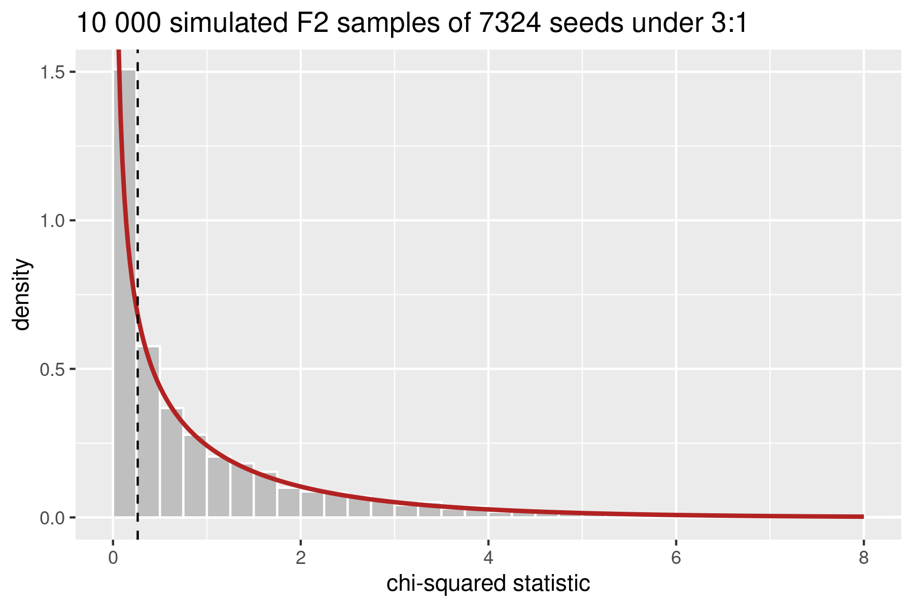

## Goal

By the end of this exercise you should be able to:

- use the **product rule** (independent events, multiply) and the **sum rule** (mutually exclusive events, add) on crosses with several genes;
- compute a **conditional probability**, such as the chance that an unaffected sibling is a carrier;
- compute the probability of a **family composition** with the binomial, and "at least one" with the complement;
- explain why observed counts deviate from the expected ratio even when the hypothesis is true;
- carry out a **χ² goodness-of-fit test** by hand: expected counts, χ², degrees of freedom, critical value, conclusion in words;
- run the same test in R with `chisq.test` and `pchisq`, and estimate a p-value by **simulation** with `replicate()`;
- find and read a modern paper on whether Mendel's data are "too good to be true" in **PubMed**.

Do the pen-and-paper parts first. The demo and R then let you check and extend your answers.

## Background

**Probability rules.**

- Product rule: P(A and B) = P(A) × P(B), if A and B are independent.
- Sum rule: P(A or B) = P(A) + P(B), if A and B are mutually exclusive.
- Conditional probability: P(B | C) = P(B and C) / P(C). In practice, cross out the outcomes that are ruled out, and count among the rest.
- Complement: P(at least one) = 1 − P(none).

**Binomial.** In n independent offspring, each with probability p of a given phenotype,

$$P(k \text{ of } n) = \binom{n}{k} p^k (1-p)^{n-k}, \qquad \binom{n}{k} = \frac{n!}{k!\,(n-k)!}.$$

$\binom{n}{k}$ ("n choose k") is the number of birth orders with exactly k affected children. For example $\binom{4}{2} = \frac{4 \times 3}{2 \times 1} = 6$.

**χ² goodness-of-fit test** against a ratio given in advance:

1. State H0 as a ratio, for example 3:1, and turn it into proportions (¾, ¼).
2. Expected counts: E = N × proportion, where N is the total observed count. Do not round E.
3. $\chi^2 = \sum (O - E)^2 / E$ over all classes.
4. df = number of classes − 1.
5. Compare with the critical value, or compute the p-value = P(χ² ≥ observed | H0).
6. Conclude in words: "reject H0" (p < 0.05) or "fail to reject H0: the data are consistent with …".

| df | 1 | 2 | 3 | 4 |
|---|---|---|---|---|
| 5% critical value | 3.84 | 5.99 | 7.81 | 9.49 |
| 1% critical value | 6.63 | 9.21 | 11.34 | 13.28 |

Use **counts**, never percentages, and make sure **every expected count is at least 5**.

## By hand

**B1. (product rule)** In *Drosophila*, the cross *AaBbCcDd* × *AaBbCcDd* involves four unlinked genes. What is the probability of an offspring that is
(a) *aabbccdd*;
(b) dominant in phenotype for all four traits;
(c) heterozygous at all four genes?

**B2. (sum rule)** From *Aa* × *Aa*, what is the probability that a child is homozygous (either *AA* or *aa*)? Which rule do you use, and why does it apply?

**B3. (conditional probability)** Cystic fibrosis is autosomal recessive. Anna is unaffected, as are both her parents, but her brother has cystic fibrosis.
(a) What is the probability that Anna is a carrier?
(b) Anna's partner has been tested and is a carrier. What is the probability that their first child has cystic fibrosis?

**B4. (binomial)** Two carriers of oculocutaneous albinism (autosomal recessive) plan five children.
(a) What is the probability that exactly 2 of the 5 children have albinism? Write out $\binom{5}{2}$ first.
(b) What is the probability that at least one child has albinism?

**B5. (binomial, sexes)** Assume each child is a girl with probability ½. In a family of 4 children, what is the probability of exactly 3 girls and 1 boy? Is it more or less likely than exactly 2 girls and 2 boys?

**B6. (χ², 3:1)** Mendel's F2 for cotyledon colour gave 6022 yellow and 2001 green seeds. Test H0: 3:1. Give E for each class, the χ² value, the df, and your conclusion.

**B7. (χ², test cross)** A *Drosophila* test cross *vg⁺/vg* × *vg/vg* gives 230 offspring with normal wings and 170 with vestigial wings. Test H0: 1:1. If you reject H0, suggest one biological reason.

**B8. (χ², three classes)** Flower colour in snapdragons (*Antirrhinum majus*) shows incomplete dominance. An F2 from red × white gives 52 red, 109 pink and 39 white plants. Test H0: 1:2:1. How many degrees of freedom does the test have?

**B9. (which ratio?)** An F2 from two white-flowered sweet pea (*Lathyrus odoratus*) lines gives 382 purple and 269 white plants (illustrative numbers). Test the data against 3:1 and against 9:7. Which hypothesis do you reject, and which is consistent with the data? (The 9:7 ratio comes from two genes that are both needed for colour; see Extensions to Mendel.)

## Explore {#explore}

Do the χ² problems by hand first. The demo starts with Mendel's seed-shape data (5474 round : 1850 wrinkled) tested against 3:1. Filled bars are the observed counts, and dashed outlines are the expected counts. Change a count with − and +, or drag the top of a bar. The right panel shows the χ² curve for the current df, with the observed χ² marked and the tail (the p-value) shaded.

```{=html}
<link rel="stylesheet" href="../demos/dist/demo.css">
<div data-demo="chisq" data-ratio="3:1" data-counts="5474 1850"></div>
<script src="../demos/dist/chisq.js"></script>
```

**E1.** Read off χ², df and p for Mendel's data. Which class contributes more to χ², and why, when both classes deviate from E by the same 19 seeds?

**E2.** Press **N: 100**. The counts are set to exactly 75 : 25. Now drag the *aa* bar upwards (or press +) until p drops below 0.05. How many *aa* do you need? Then go back to 25 and lower the *aa* count until p < 0.05. Does the ratio "look" wrong to you at these points?

**E3.** With 3:1 and N = 100, press **simulate under H0** ten times and write down p each time. How many of the ten are below 0.05? How many would you expect in the long run?

**E4.** Press **simulate 1000×**. Compare the grey histogram with the curve, and compare "% ≥ observed" with the p-value in the title. Then choose **9:3:3:1** and **N: 20** and simulate 1000× again. What warning appears, and why does the histogram no longer follow the curve as well?

**E5.** Choose **1:1** and **N: 20**, then make the counts 12 : 8 (60% : 40%). Note p. Now choose **N: 1000** and set 600 : 400 (drag the bars). Note p again. What does this tell you about using percentages in a χ² test?

::: {.callout-note collapse="true" title="Solutions: Explore"}

**E1.** χ² = 0.26, df = 1, p = 0.608, the same as on the lecture slide. The wrinkled class contributes 0.20 and the round class 0.07. The squared deviation is 361 in both, but it is divided by E: 361/1831 is larger than 361/5493. The same absolute deviation weighs more in a class where fewer seeds are expected.

**E2.** Note that N changes as you change a count, and E follows it. With 75 *A_*, p first drops below 0.05 at **37 *aa*** (75 : 37, χ² = 3.86, p = 0.0495). Going down, it drops below 0.05 at **14 *aa*** (75 : 14, p = 0.043). So with about 100 seeds, ratios from roughly 2:1 to 5:1 are all consistent with 3:1. Small samples cannot tell close ratios apart.

**E3.** Your ten values depend on how often you have clicked, but most will be well above 0.05; often none or one of the ten is below. In the long run **5%** of honest samples give p < 0.05: that is exactly what the 5% level means. Each of those is a "false rejection" of a true H0.

**E4.** For 3:1 and N = 100, the histogram follows the df = 1 curve closely, and the fraction of simulations with χ² ≥ the observed one is close to the p-value. This fraction is a p-value estimated by brute force. For 9:3:3:1 with N = 20, the note under the buttons turns red: the *aabb* class expects only 20/16 = 1.25 (and the 3/16 classes 3.75), which is below 5. The simulated χ² values are then lumpy (only a few distinct values are possible) and do not follow the smooth df = 3 curve well, so the curve's p-value is unreliable.

**E5.** 12 : 8 gives χ² = 0.80, p = 0.37 (fail to reject 1:1). 600 : 400 gives χ² = 40, p < 0.0001 (reject). The proportions are identical, but the evidence is not: χ² grows in proportion to N. Percentages throw N away, so χ² must always be computed from counts.
:::

## Find it

Mendel's numbers fit his ratios remarkably well. In 1936 the statistician R. A. Fisher argued that they fit **too** well. Fisher's paper appeared in *Annals of Science*, which is not indexed in [PubMed](https://pubmed.ncbi.nlm.nih.gov/), but the debate has continued in genetics journals that are. You will find some of these papers.

**PubMed search syntax.** Type into the search box at <https://pubmed.ncbi.nlm.nih.gov/>:

- `"Mendel's data"`: **quotes** search for the exact phrase, not the separate words.
- `Mendel AND Fisher`: **AND** requires both words. (OR accepts either; NOT excludes a word.)
- `Mendel[ti]`: the **field tag** `[ti]` searches only the **title**. Without a tag, PubMed searches all fields and maps your words to related terms.

Click a title to open the record. The abstract is under the title. The journal and year are in the line just above the title, and the PMID is listed below the abstract.

**F1.** Search for `"Mendel's data"[ti]`. You should get only a couple of hits. Open the one from the *Journal of Heredity*. Report its **title, year, journal and PMID**, and summarise its **conclusion** from the abstract in one or two sentences.

**F2.** Now search for `Mendel's data` without quotes and without `[ti]`. Look at the line "results" near the top of the page. Do you get more or fewer hits than in F1, and why? (Look at "Search details" under "Advanced", or just compare the titles.)

**F3.** Search for `Mendel[ti] AND Fisher[ti]`. Find the paper by E. Novitski in *Genetics* (2004). Report its title. Then find a hit in the list that has nothing to do with peas, and explain why it matched your search.

**F4.** Search for `"too good to be true" AND Mendel`. Find the 2022 paper by G. Radick. Report its title and journal, and, from the abstract, **when** the "too good to be true" problem became widely discussed.

::: {.callout-note collapse="true" title="Solutions: Find it"}

**F1.** Click path: PubMed → type `"Mendel's data"[ti]` → Search. The two hits are Weeden 2016 and Hartl & Fairbanks 2007. The *Journal of Heredity* paper is:

- **"Are Mendel's Data Reliable? The Perspective of a Pea Geneticist."** N. F. Weeden, *J Hered* **2016**;107(7):635–646. **PMID 27578843**.
- Conclusion (abstract): Mendel's data do show a bias towards the predicted ratios. Real pea crosses do *not* naturally give ratios closer to expectation than chance (if anything the opposite), and omitting some experiments cannot explain the close fit either. The author could not decide between misclassification of ambiguous phenotypes and deliberate falsification, and suggests that Mendel's paper is best read as a simplified, persuasive presentation of his model rather than an exact record of his methods.

The other hit is "Mud sticks: on the alleged falsification of Mendel's data", Hartl & Fairbanks, *Genetics* 2007 (PMID 17384156). It has no abstract in PubMed, but the full text is free in PubMed Central (PMC1840063).

**F2.** Without quotes and without the tag you get **more** hits. PubMed now searches all fields (title, abstract, keywords, MeSH terms) and maps "Mendel's" to variants such as "mendel", "mendels" and "mendelism". The quotes and `[ti]` together ask for the exact phrase in the title only, which is much stricter. (The exact numbers grow as new papers appear, so we do not give them.)

**F3.** Novitski's paper is **"On Fisher's criticism of Mendel's results with the garden pea."** *Genetics* 2004;166(3):1133–1136, PMID 15082533. An off-topic hit is "Bioactivation, toxicokinetics and acute effects of chloroform in Fisher 344 and Osborne Mendel male rats" (*J Appl Toxicol* 2004, PMID 15211614). Fisher 344 and Osborne-Mendel are names of laboratory rat strains. Field tags match **words**, not meanings, so always read the titles of your hits. You may also see "Programs for Pedigree Analysis: MENDEL, FISHER, and dGENE" (1988), where MENDEL and FISHER are names of computer programs.

**F4.** **"Mendel the fraud? A social history of truth in genetics."** G. Radick, *Studies in History and Philosophy of Science* 2022;93:39–46, PMID 35313209. The abstract says the too-good-to-be-true problem was understood almost immediately after the 1900 rediscovery of Mendel's work, but became **widely discussed only from the 1960s**, for reasons linked to Cold War geopolitics as much as to concerns about the objectivity of science.
:::

## In R

R1–R3 check your hand calculations. R4–R6 introduce this unit's new idiom: **simulation under the null hypothesis with [`replicate()`](https://rdrr.io/r/base/lapply.html)**. `replicate(n, expr)` evaluates the expression `expr` n times and collects the results in a vector. If the expression contains random draws, every evaluation is a new random experiment. This lets you see the distribution of any statistic under H0, without a formula.

### R1. `chisq.test` on Mendel's data

[`chisq.test(x, p = ...)`](https://rdrr.io/r/stats/chisq.test.html) tests the counts in `x` against the proportions in `p`, which must sum to 1.

```r
obs <- c(round = 5474, wrinkled = 1850)
chisq.test(obs, p = c(3, 1) / 4)

dihybrid <- c(round_yellow = 315, round_green = 108,
              wrinkled_yellow = 101, wrinkled_green = 32)
chisq.test(dihybrid, p = c(9, 3, 3, 1) / 16)
```

Check the χ² values and df against the lecture. Then use `chisq.test` to check your answers to B6–B9.

### R2. χ² by hand, then the p-value with `pchisq`

[`pchisq(q, df)`](https://rdrr.io/r/stats/Chisquare.html) gives the area to the **left** of q under the χ² curve. The p-value is the area to the right, so use `lower.tail = FALSE`. `qchisq` goes the other way and gives critical values.

```r
N    <- sum(obs)
expd <- N * c(3, 1) / 4
expd
chi2 <- sum((obs - expd)^2 / expd)
chi2
pchisq(chi2, df = 1, lower.tail = FALSE)
qchisq(0.95, df = 1:4)
```

Confirm that `chi2` and the p-value match `chisq.test`, and that `qchisq` reproduces the 5% row of the table in the Background.

### R3. Family composition with `dbinom` and `pbinom`

[`dbinom(k, size, prob)`](https://rdrr.io/r/stats/Binomial.html) is P(exactly k), and `pbinom(k, size, prob)` is P(at most k).

```r
dbinom(2, size = 4, prob = 1/4)        # exactly 2 of 4 affected
dbinom(0:4, size = 4, prob = 1/4)      # the whole distribution
1 - dbinom(0, size = 4, prob = 1/4)    # at least one of 4
pbinom(1, size = 4, prob = 1/4)        # at most one of 4
```

Then answer: two carriers have **5** children. What is the probability that **at least 2** are affected? Check B4 with `dbinom` as well.

### R4. Simulate 10 000 F2 samples under 3:1

First write a small function that computes χ² from counts and proportions. Then write a function that simulates **one** F2 of 7324 seeds under H0 with [`sample()`](https://rdrr.io/r/base/sample.html) and returns its χ². Finally, `replicate()` it 10 000 times.

```r
library(ggplot2)

chisq_stat <- function(obs, p) {
  expd <- sum(obs) * p
  sum((obs - expd)^2 / expd)
}
chisq_stat(c(5474, 1850), c(3, 1) / 4)

one_f2 <- function(N = 7324) {
  seeds <- sample(c("round", "wrinkled"), N, replace = TRUE, prob = c(3, 1) / 4)
  obs   <- table(factor(seeds, levels = c("round", "wrinkled")))
  chisq_stat(obs, c(3, 1) / 4)
}

set.seed(1866)
sims <- replicate(10000, one_f2())
length(sims)
summary(sims)
mean(sims >= 3.84)
```

The `factor(..., levels = ...)` makes sure that `table()` always reports both classes, even in the (unlikely) case that one is missing.

Now plot the simulated values as a histogram, on the density scale, with the χ² curve for df = 1 ([`dchisq`](https://rdrr.io/r/stats/Chisquare.html)) on top:

```r
sim_df   <- data.frame(chi2 = sims)
curve_df <- data.frame(x = seq(0.02, 8, by = 0.02))
curve_df$density <- dchisq(curve_df$x, df = 1)

ggplot(sim_df, aes(x = chi2)) +
  geom_histogram(aes(y = after_stat(density)), binwidth = 0.25, boundary = 0,
                 fill = "grey75", colour = "white") +
  geom_line(data = curve_df, aes(x = x, y = density), colour = "firebrick", linewidth = 1) +
  geom_vline(xintercept = 0.263, linetype = "dashed") +
  coord_cartesian(xlim = c(0, 8), ylim = c(0, 1.5)) +
  labs(x = "chi-squared statistic", y = "density",
       title = "10 000 simulated F2 samples of 7324 seeds under 3:1")
```

Does the curve describe the simulations? What fraction of the simulated χ² values are ≥ 3.84, and why is that the number you would expect?

### R5. How often is χ² at least as small as Mendel's?

A p-value looks at the right tail: how often is the fit **this bad or worse**? Fisher's question looks at the left tail: how often is the fit **this good or better**?

```r
mean(sims <= 0.263)
pchisq(0.263, df = 1)
```

For seed shape alone, is Mendel's fit suspiciously good?

### R6. All seven of Mendel's experiments together

The file [`data/mendel_monohybrid.csv`](data/mendel_monohybrid.csv) has Mendel's F2 counts for all seven traits (from Mendel's 1866 paper, as tabulated in Hartwell, Mendel's principles chapter). Compute χ² for each trait with your `chisq_stat` function, then add them up. The sum of independent χ² values is again χ², with df equal to the sum of the dfs (here 7 × 1 = 7).

```r
library(readr)
library(dplyr)
mendel <- read_csv("data/mendel_monohybrid.csv", show_col_types = FALSE)
mendel <- mendel |>
  rowwise() |>
  mutate(n    = dominant + recessive,
         chi2 = chisq_stat(c(dominant, recessive), c(3, 1) / 4)) |>
  ungroup()
mendel |> select(trait, dominant, recessive, n, chi2)

total <- sum(mendel$chi2)
total
pchisq(total, df = 7)
```

Now check the left-tail probability by simulation. This time [`rmultinom()`](https://rdrr.io/r/stats/Multinom.html) draws the counts for each experiment directly, which is faster than `sample()` for large N:

```r
one_mendel <- function(sizes) {
  chis <- sapply(sizes, function(N) {
    obs <- rmultinom(1, size = N, prob = c(3, 1) / 4)
    chisq_stat(obs, c(3, 1) / 4)
  })
  sum(chis)
}
set.seed(1936)
sims7 <- replicate(10000, one_mendel(mendel$n))
mean(sims7 <= total)
```

Which trait fits worst, and which fits best? How often would seven honest experiments of these sizes fit as well as Mendel's did? Relate your answer to Fisher's argument and to what you read in F1.

## Solutions

::: {.callout-note collapse="true" title="Solutions: By hand"}

**B1.** Take one gene at a time and multiply (the genes are unlinked, so independent).
(a) P(*aa*)⁴ = (¼)⁴ = **1/256**.
(b) P(*A_*)⁴ = (¾)⁴ = **81/256 ≈ 0.32**.
(c) P(*Aa*)⁴ = (½)⁴ = **1/16**.

**B2.** P(*AA* or *aa*) = ¼ + ¼ = **½**. The sum rule applies because a child cannot be both *AA* and *aa*: the events are mutually exclusive.

**B3.** (a) Both parents must be carriers (*Aa* × *Aa*), because they are unaffected and have an affected child. Anna is unaffected, so *aa* is ruled out, and of the three remaining equally likely cells two are carriers: P = **2/3**.
(b) The child is affected only if Anna is a carrier **and** passes on *a* **and** her partner passes on *a*: 2/3 × ½ × ½ = **1/6 ≈ 0.17**.

**B4.** p = ¼ per child.
(a) $\binom{5}{2} = \frac{5 \times 4}{2 \times 1} = 10$. P = 10 × (¼)² × (¾)³ = 10 × 1/16 × 27/64 = 270/1024 ≈ **0.264**.
(b) 1 − (¾)⁵ = 1 − 243/1024 = 781/1024 ≈ **0.763**.

**B5.** P(3 girls, 1 boy) = $\binom{4}{3}$ (½)⁴ = 4/16 = **¼**. P(2 girls, 2 boys) = $\binom{4}{2}$ (½)⁴ = 6/16 = **⅜**, which is more likely, because there are more birth orders with 2 and 2.

**B6.** N = 8023. E(yellow) = 8023 × ¾ = 6017.25, E(green) = 8023 × ¼ = 2005.75. Both deviations are ±4.75 (22.5625 when squared).
χ² = 22.5625/6017.25 + 22.5625/2005.75 = 0.0037 + 0.0112 = **0.015**, df = 1. This is far below 3.84 (p = 0.90). Fail to reject: the data are consistent with 3:1. (A χ² this close to 0 is also part of Fisher's point: see R6.)

**B7.** N = 400, E = 200 for each class. χ² = 30²/200 + 30²/200 = 4.5 + 4.5 = **9.0**, df = 1. This is above 3.84 and also above 6.63 (p = 0.0027). **Reject** 1:1. There are too few vestigial flies. A likely reason is that *vg/vg* flies survive less well (reduced viability) than *vg⁺/vg* flies, so some died before they were counted.

**B8.** N = 200, E = 50 : 100 : 50.
χ² = (52 − 50)²/50 + (109 − 100)²/100 + (39 − 50)²/50 = 0.08 + 0.81 + 2.42 = **3.31**. df = 3 − 1 = **2**, critical value 5.99. Fail to reject (p = 0.19): the data are consistent with 1:2:1.

**B9.** N = 651.
Against **3:1**: E = 488.25 and 162.75. χ² = 106.25²/488.25 + 106.25²/162.75 = 23.1 + 69.4 = **92.5**, df = 1. **Reject** (p ≈ 10⁻²¹).
Against **9:7**: E = 651 × 9/16 = 366.19 and 651 × 7/16 = 284.81. χ² = 15.81²/366.19 + 15.81²/284.81 = 0.68 + 0.88 = **1.56**, df = 1. Fail to reject (p = 0.21).
The data are consistent with 9:7, which fits a model where two genes are both needed for purple colour.
:::

::: {.callout-note collapse="true" title="Solutions: In R"}

**R1.** Output:

```
	Chi-squared test for given probabilities

data:  obs
X-squared = 0.26288, df = 1, p-value = 0.6081


	Chi-squared test for given probabilities

data:  dihybrid
X-squared = 0.47002, df = 3, p-value = 0.9254
```

These match the lecture: χ² = 0.263 (df 1) and 0.470 (df 3). For B6–B9:

```r
chisq.test(c(6022, 2001), p = c(3, 1) / 4)        # X-squared = 0.014999, p = 0.9025
chisq.test(c(230, 170))                           # X-squared = 9, p = 0.0027
chisq.test(c(52, 109, 39), p = c(1, 2, 1) / 4)    # X-squared = 3.31, df = 2, p = 0.1911
chisq.test(c(382, 269), p = c(3, 1) / 4)          # X-squared = 92.486, p < 2.2e-16
chisq.test(c(382, 269), p = c(9, 7) / 16)         # X-squared = 1.5607, p = 0.2116
```

Without `p`, `chisq.test` tests equal proportions, which is 1:1 for two classes.

**R2.**

```
[1] 5493 1831
[1] 0.26288
[1] 0.6081484
[1] 3.841459 5.991465 7.814728 9.487729
```

Same χ² and p-value as `chisq.test`, and the 5% critical values for df 1–4.

**R3.**

```
[1] 0.2109375
[1] 0.31640625 0.42187500 0.21093750 0.04687500 0.00390625
[1] 0.6835938
[1] 0.7382812
```

At least 2 of 5 affected: P(≥ 2) = 1 − P(≤ 1).

```r
1 - pbinom(1, size = 5, prob = 1/4)
```
```
[1] 0.3671875
```

For B4, `dbinom(2, size = 5, prob = 1/4)` gives 0.2636719, and `1 - dbinom(0, 5, 1/4)` gives 0.7626953.

**R4.**

```
[1] 0.26288
[1] 10000
   Min. 1st Qu.  Median    Mean 3rd Qu.    Max.
 0.0000  0.1049  0.4551  1.0042  1.3464 14.4773
[1] 0.0489
```

{width="80%" fig-align="center"}

The df = 1 curve describes the simulations very well. This is what the curve *means*: the distribution of χ² when H0 is true. The mean of the simulations is about 1.00, the df. About 4.9% of the simulated values are ≥ 3.84, close to 5%, because 3.84 is by definition the value that χ²(1) exceeds 5% of the time. In other words, an honest 3:1 experiment is "significant" about 1 time in 20.

**R5.**

```
[1] 0.394
[1] 0.3919334
```

About 39% of honest experiments fit at least as well as Mendel's seed-shape data. On its own, that is not suspicious at all.

**R6.**

```
# A tibble: 7 × 5
  trait            dominant recessive     n   chi2
  <chr>               <dbl>     <dbl> <dbl>  <dbl>
1 seed shape           5474      1850  7324 0.263
2 cotyledon colour     6022      2001  8023 0.0150
3 flower colour         705       224   929 0.391
4 pod shape             882       299  1181 0.0635
5 pod colour            428       152   580 0.451
6 flower position       651       207   858 0.350
7 stem length           787       277  1064 0.607
[1] 2.138868
[1] 0.04824407
[1] 0.0479
```

Stem length fits worst (χ² = 0.61), and cotyledon colour fits best (χ² = 0.015). Every one of the seven χ² values is below 1, the average under H0. Their sum is 2.14, while about 7 is expected. Both the χ² formula (`pchisq(2.14, 7)` = 0.048) and the simulation (0.048) say that seven honest experiments fit this well only about **1 time in 20**. No single experiment is suspicious, but together they fit better than chance usually allows. Fisher made the same argument over many more of Mendel's experiments and got a much smaller probability. As Weeden (F1) concludes, the bias is real, but its cause (misclassifying borderline seeds, leaving out experiments, or "tidying" the numbers) cannot be settled from the counts alone.
:::

## Where this leads

The χ² test returns in almost every unit of Part 1 and Part 2. In **Extensions to Mendel** you use it to choose between modified ratios such as 9:7 and 12:3:1, in **Linkage** a test against 1:1:1:1 is the first sign that two genes are linked, and in **Hardy–Weinberg** you lose one more degree of freedom because the allele frequency is estimated from the data. Simulation with `replicate()` comes back in **Drift and selection**, where no formula is available at all.
