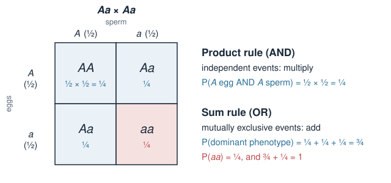
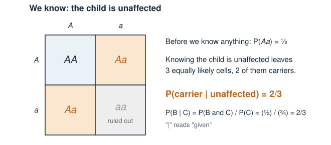
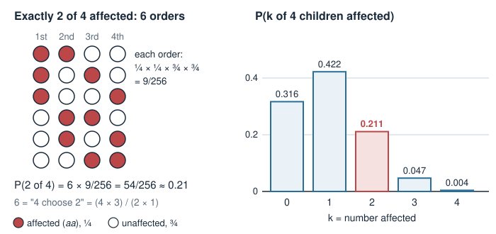
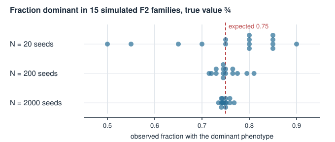
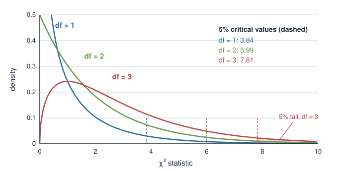
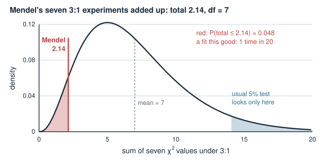

## About this lecture

Mendel's laws predict **ratios**, such as 3:1 or 9:3:3:1. Real crosses give **counts**, such as 5474 round and 1850 wrinkled seeds. Today we connect the two.

- **Probability rules**: the product rule (AND), the sum rule (OR) and conditional probability ("given that …").
- **Families**: the chance that 2 of 4 children are affected (the binomial), and "at least one".
- **Testing a ratio**: why observed counts never match the expected ones exactly, and the **χ² goodness-of-fit test**, which tells us whether the gap is bigger than chance would give. A six-step recipe, one example that fits, one that does not, and the common mistakes.
- **p-values**: what they mean, what "fail to reject" means, and Fisher's claim that Mendel's data fit *too* well.

Book: Hartwell, Mendel's principles chapter (the sections on probability and on the chi-square test).

::: notes
Set the scene: last lecture gave the laws of segregation and independent assortment and the ratios they predict. Today is about the bridge between a predicted ratio and a real pile of seeds or children. Two halves. First, probability rules, which they met at upper-secondary school: we recap them with genetics examples and add two new tools, conditional probability and the binomial. Second, the chi-square test, which most of them have only heard of by name. We build it from scratch, with Mendel's own numbers. Reassure them that the maths stays at fractions and squaring. The one formula to take away is the sum of (O minus E) squared over E.
:::

## A cross is a random experiment

Each child (or seed) of *Aa* × *Aa* is a fresh, independent draw:

- each parent passes on *A* or *a* with probability **½** each (segregation);
- the egg and the sperm are chosen **independently** of each other;
- one child's genotype says nothing about the next child's genotype.

So a **Punnett square is a probability table**: each cell is one equally likely outcome. "3:1" means P(dominant phenotype) = ¾ for **each** offspring. It is not a promise that exactly 3 out of every 4 will be dominant.

Two rules let us combine these probabilities, and we use them all through the course: in pedigrees, in mapping and in population genetics.

::: notes
Recap from upper-secondary school and from the Mendel lecture. The key reframe is that a ratio is a probability per offspring, not a quota for a family. Students often believe that if the first three children are unaffected the fourth "must" be affected. Kill this now: each child is an independent draw, and the coin has no memory. Mention that this simple model assumes complete dominance, no lethality and fair segregation. The Extensions to Mendel unit relaxes these assumptions.
:::

## Product rule and sum rule

{width="68%" fig-align="center"}

- **Product rule**: P(A **and** B) = P(A) × P(B), if A and B are **independent**.
- **Sum rule**: P(A **or** B) = P(A) + P(B), if A and B are **mutually exclusive** (cannot both happen).

::: notes
Walk through the square. Each cell is "this egg AND this sperm": the two gametes are independent, so we multiply, half times half is a quarter. The dominant phenotype is "AA OR Aa OR aA": these cells are mutually exclusive (a child has one genotype), so we add, giving three quarters. Point out the two conditions: multiply only for independent events, add only for events that cannot happen together. A common error is to add probabilities of events that overlap. Note also that all cells sum to 1, which is a free check on any calculation.
:::

## Using both rules: a dihybrid cross

*AaBb* × *AaBb*, with the two genes on different chromosomes (independent assortment):

- P(*aabb*) = P(*aa*) × P(*bb*) = ¼ × ¼ = **1/16**
- P(*A_B_*) = P(*A_*) × P(*B_*) = ¾ × ¾ = **9/16**
- P(*A_bb* **or** *aaB_*) = 3/16 + 3/16 = **6/16**

This works for any number of genes. For *AaBbCc* × *AaBbCc*:

$$P(aabbcc) = \tfrac14 \times \tfrac14 \times \tfrac14 = \tfrac{1}{64}$$

No 64-cell Punnett square is needed. Split the cross into one gene at a time, then multiply.

::: notes
This is the payoff of the product rule: the forked-line or "one gene at a time" method. Independent assortment is exactly the statement that the genes are independent events, so their probabilities multiply. Do the trihybrid on the board to show how much faster it is than a Punnett square. Warn: this only holds for unlinked genes. Linked genes break independence, and that is the Linkage unit. The 9/16 and 1/16 are the 9 and 1 of 9:3:3:1, which we test with chi-square later today.
:::

## Conditional probability: "given that …" {.smaller}

Two *Aa* carriers have a child who is **unaffected**. What is the chance that this child is a **carrier**?

{width="62%" fig-align="center"}

Knowing something **shrinks the table**. We only count the outcomes that are still possible:

$$P(\text{carrier} \mid \text{unaffected}) = \frac{P(\text{carrier and unaffected})}{P(\text{unaffected})} = \frac{1/2}{3/4} = \frac23$$

::: notes
This is the single most-used calculation in pedigree risk, and the classic exam trap: students answer one half, which is the carrier probability before we knew the phenotype. Once we know the child is unaffected, the aa cell is impossible, so we renormalise over the three remaining equally likely cells, two of which are carriers. Read the vertical bar as "given". The formula is just the picture written down: the share of the remaining area that is carrier. Preview: in the Pedigrees unit we chain this, for example the probability that two unaffected siblings of affected children have an affected child is 2/3 times 2/3 times 1/4.
:::

## Families: how many children are affected? {.smaller}

*Aa* × *Aa*, four children. Each child is affected (*aa*) with p = ¼. What is P(exactly 2 affected)?

{width="70%" fig-align="center"}

$$P(k \text{ of } n) = \binom{n}{k}\, p^k\, (1-p)^{n-k}, \qquad \binom{n}{k} = \frac{n!}{k!\,(n-k)!} \text{ ("$n$ choose $k$")}$$

::: notes
Build the binomial from the two rules. One particular birth order, such as affected, affected, unaffected, unaffected, has probability a quarter times a quarter times three quarters times three quarters by the product rule. There are 6 such orders, which are mutually exclusive, so by the sum rule we multiply by 6. The 6 is "4 choose 2": the number of ways to pick which 2 of the 4 children are the affected ones. Count them on the slide. Only then show the general formula, and say that n choose k is just that count. For small n they can list the orders by hand. Point out the bar chart: the most likely family has 1 affected child, not "exactly one quarter of 4". Bars sum to 1.
:::

## "At least one": use the complement

P(at least one of 4 children affected) has many cases (1, 2, 3 or 4). The opposite event has only one case:

$$P(\text{at least one}) = 1 - P(\text{none}) = 1 - \left(\tfrac34\right)^4 = 1 - \tfrac{81}{256} \approx 0.68$$

- "None affected" means every child is unaffected, so by the product rule it is (¾)⁴.
- **Not** 4 × ¼ = 1, which would make an affected child certain. Adding is wrong here, because "child 1 affected" and "child 2 affected" can both happen.

::: notes
The complement trick is a standard move. The wrong answer, 4 times a quarter equals 1, is worth showing because many students produce it: it adds events that are not mutually exclusive, which breaks the sum rule's condition. With 5 children the naive sum would exceed 1, which is an obvious absurdity. Check against the bar chart on the previous slide: 1 minus 0.316 is 0.684.
:::

## Real counts deviate from the ratio {.smaller}

{width="66%" fig-align="center"}

Every dot is a family **simulated with the 3:1 rule exactly true**. With 20 seeds the fraction ranges from 0.50 to 0.90. With 2000 seeds it stays close to 0.75.

- Deviation from the expected ratio is **normal**. It is sampling variation, or chance.
- Small samples deviate a lot (in proportion); large samples deviate little.
- The question is never "does it match exactly?" but "**is the deviation larger than chance would usually produce?**"

::: notes
This is the motivation for a statistical test. Everything here obeys 3:1 perfectly, and yet a family of 20 can come out 10 to 10, which looks like 1:1. So we cannot judge by eye. We need a yardstick for how big a deviation chance produces, and that yardstick depends on sample size. The chi-square test is that yardstick. Note the data were simulated in R with rbinom and a fixed seed; students simulate the same thing in the exercise.
:::

## The χ² statistic

Turn "how far is observed (O) from expected (E)?" into one number:

$$\chi^2 = \sum_{\text{classes}} \frac{(O - E)^2}{E}$$

Mendel's F2 seeds: 5474 round, 1850 wrinkled, total N = 7324. H0: 3:1.

| class | O | E = N × p | O − E | (O − E)²/E |
|---|---|---|---|---|
| round | 5474 | 7324 × ¾ = 5493 | −19 | 361/5493 = 0.066 |
| wrinkled | 1850 | 7324 × ¼ = 1831 | +19 | 361/1831 = 0.197 |
| | | | | **χ² = 0.263** |

- **Square**, so that positive and negative deviations do not cancel.
- **Divide by E**, so that a deviation of 19 counts for more when only 1831 were expected than when 5493 were.

::: notes
Do this slowly on the board. Expected counts come from the total times the hypothesised proportion, never from the ratio numbers themselves. The deviations always sum to zero, which is a useful check. Why square: otherwise plus and minus cancel. Why divide by E: a deviation of 19 is small relative to 5493 and relatively larger relative to 1831. Under the null hypothesis the counts vary by roughly the square root of E, so dividing the squared deviation by E puts every class on the same scale. A chi-square of 0 is a perfect fit; bigger means a worse fit. Now we need to know what values chance alone produces.
:::

## Degrees of freedom

The **degrees of freedom (df)** count how many classes are free to vary once the total is fixed.

- 2 classes (round, wrinkled): once N and the round count are known, the wrinkled count is fixed. **df = 1**.
- k classes, with the ratio given in advance: **df = k − 1**.

| hypothesis | classes k | df |
|---|---|---|
| 3:1, 1:1, 9:7 | 2 | 1 |
| 1:2:1 | 3 | 2 |
| 9:3:3:1, 1:1:1:1 | 4 | 3 |

More classes give more terms in the sum, so χ² tends to be bigger by chance alone. The df tells us which reference curve to use.

::: notes
Keep df concrete: it is the number of independent counts. With k classes and a fixed total, k minus 1 of them determine the last. That is the rule for a goodness-of-fit test against a ratio given in advance, which is every test today. Mention briefly that if you estimate a parameter from the data, as in the Hardy-Weinberg test, you lose another degree of freedom; that comes in the Hardy-Weinberg unit. The average value of chi-square under the null hypothesis is equal to df, which is a nice anchor: chi-square of 0.26 on 1 df is below average.
:::

## The χ² distribution

{width="72%" fig-align="center"}

If H0 is true, repeating the experiment many times gives χ² values that follow this curve. Most are small; large values are rare.

::: notes
The curve is what chance alone produces when the hypothesis is true and the counts are large enough. The df = 1 curve is piled up near zero; with more df the bulk moves right, and its average equals df. The dashed lines cut off the top 5% of each curve. A chi-square beyond that line would happen less than 1 time in 20 if H0 were true. In the exercise they simulate 10 000 F2 samples under 3:1 and see their histogram trace exactly the df = 1 curve. That is the honest meaning of this curve.
:::

## The p-value

**p-value** = P(χ² at least as large as the observed one, **if H0 is true**) = the area of the tail to the right of the observed χ².

| df | p = 0.10 | **p = 0.05** | p = 0.01 |
|---|---|---|---|
| 1 | 2.71 | **3.84** | 6.63 |
| 2 | 4.61 | **5.99** | 9.21 |
| 3 | 6.25 | **7.81** | 11.34 |
| 4 | 7.78 | **9.49** | 13.28 |

- **Rule**: if χ² > the 5% critical value (p < 0.05), **reject H0**: the deviation is too big to blame on chance.
- Mendel's seeds: χ² = 0.263 < 3.84, so p > 0.05 (exactly, p = 0.61). The data **are consistent with** 3:1.

::: notes
Define the p-value in words before showing any number: assuming the hypothesis is true, how often would chance give a fit this bad or worse? A small p-value means "rarely", so we doubt the hypothesis. The table is how this was done before computers, and it is still how they will do it in an exam: compare the statistic with the critical value for the right df. Read the table: going right gives stricter thresholds; going down, more df need a bigger chi-square. For Mendel's seeds, a p of 0.61 means that 61% of honest 3:1 experiments with 7324 seeds would deviate at least this much. Stress that 0.05 is a convention, not a law of nature.
:::

## "Fail to reject" is not "proven"

- **p < 0.05**: the data are unlikely under H0. We **reject** H0. (We may still be wrong in 1 in 20 tests of a true H0.)
- **p ≥ 0.05**: we **fail to reject** H0. The data are *consistent with* H0, but this does **not prove** it.
  - Other ratios may fit too: 5474:1850 is also consistent with 2.95:1.
  - Small samples can rarely reject anything. 6:4 seeds gives χ² = 1.2 against 3:1 (p = 0.27).
- A p-value is **not** the probability that H0 is true.

::: notes
This is the conceptual heart of the second half. Hypothesis tests are asymmetric: they can give evidence against a hypothesis, but a non-significant result is an absence of evidence, not proof. Use the 6:4 example: with 10 seeds even a ratio that looks like 1.5:1 cannot be told apart from 3:1. Mention the two errors in plain words: rejecting a true hypothesis (which happens 5% of the time by design) and failing to reject a false one (common in small samples). The last bullet is the most common misreading of p-values in published papers too.
:::

## Two rules for using χ²

**1. Use counts, never percentages or proportions.**

60% vs 40% against 3:1:

| data | χ² | p |
|---|---|---|
| 6 : 4 seeds | 1.2 | 0.27 |
| 60 : 40 seeds | 12 | 0.0005 |
| "60 : 40" as percentages | 12, whatever N really was | meaningless |

The same proportions are much stronger evidence when N is large. A percentage throws N away.

**2. Every expected count should be at least 5.** Otherwise the χ² curve is a poor approximation. Pool classes, collect more data, or use an exact test.

::: notes
Two practical rules, both frequent exam and lab-report errors. Percentages: chi-square scales with N, because the same proportional deviation is far more convincing with more data. Feeding percentages in silently pretends N is 100. Expected counts of at least 5: the smooth chi-square curve is an approximation to a discrete reality. With tiny expected counts the approximation fails, and R warns "Chi-squared approximation may be incorrect". In the demo, try N = 20 with 9:3:3:1: the aabb class expects 1.25, and the demo shows a warning.
:::

## The χ² test in six steps

1. **State H0 as a ratio** and turn it into proportions: 3 : 1 → ¾, ¼.
2. **Expected counts:** E = N × proportion, with N the total observed. Do **not** round E.
3. **Statistic:** χ² = Σ (O − E)²/E over all classes. Check: Σ O = Σ E, and Σ (O − E) = 0.
4. **Degrees of freedom:** df = number of classes − 1.
5. **Compare** χ² with the critical value for that df (3.84, 5.99, 7.81, …), or compute *p*.
6. **Conclude in words, about the biology:** "reject 3 : 1: there are too few recessives" or "consistent with 3 : 1".

The next two slides are two worked examples: one that fits, and one that does not.

::: notes
This collects the recipe that was spread over the last few slides into one list students can copy. Step 3 has two free checks that catch most arithmetic errors. Step 6 is where most marks are lost in exams: a bare "p < 0.05" is not a conclusion. Say what is rejected, in which direction the data deviate, and what that could mean biologically. Then two examples: Mendel's dihybrid cross, which fits, and a cross that does not, so they see the whole recipe end in both possible ways.
:::

## Worked example: Mendel's dihybrid cross

F2 of round yellow × wrinkled green: 556 seeds. H0: 9:3:3:1 (independent assortment).

| class | O | E | (O − E)²/E |
|---|---|---|---|
| round yellow | 315 | 556 × 9/16 = 312.75 | 0.016 |
| round green | 108 | 556 × 3/16 = 104.25 | 0.135 |
| wrinkled yellow | 101 | 556 × 3/16 = 104.25 | 0.101 |
| wrinkled green | 32 | 556 × 1/16 = 34.75 | 0.218 |
| | 556 | 556 | **χ² = 0.470** |

df = 4 − 1 = 3. The critical value is 7.81, and 0.470 is far below it (p = 0.93). **Fail to reject** 9:3:3:1. The data are consistent with independent assortment of seed shape and seed colour.

::: notes
Second full example, with four classes. Have students compute the expected counts themselves; they do not need to be whole numbers, and should not be rounded. Check that O and E both sum to 556. The biggest contribution comes from the smallest class, wrinkled green, because there the same absolute deviation weighs more. df is 3, so we use the 7.81 row. Conclusion in words: the deviations are well within what chance gives. Note also that p = 0.93 means 93% of honest experiments would fit worse. Keep that in mind for the Fisher slide.
:::

## Worked example: a ratio that does not fit

An F2 from *Aa* × *Aa* gives **290 dominant : 70 recessive** (N = 360; illustrative counts). H0: 3 : 1.

| class | O | E | O − E | (O − E)²/E |
|---|---|---|---|---|
| dominant | 290 | 360 × ¾ = 270 | +20 | 400/270 = 1.48 |
| recessive | 70 | 360 × ¼ = 90 | −20 | 400/90 = 4.44 |
| | 360 | 360 | 0 | **χ² = 5.93** |

df = 1. 5.93 > 3.84, so *p* < 0.05 (exactly, *p* = 0.015): **reject 3 : 1 at the 5% level**. (But 5.93 < 6.63, so not at the 1% level.)

**Now the biology.** Which way do the data deviate? **Too few recessives**: 70 instead of 90. Possible reasons:

- *aa* individuals **survive less well** (reduced viability), so some died before they were counted;
- *aa* is hard to score, and some were **misclassified** as dominant;
- the trait is not controlled by one gene in the way we assumed.

The test tells us **that** the model fails, not **why**. The next experiment has to decide.

::: notes
Students rarely see a worked rejection, so do this one in full. The arithmetic is the same as before; the new parts are the conclusion and the interpretation. Point out that the whole χ² comes mostly from the recessive class, where the expected count is smallest. The 1% remark is a reminder that the 5% level is a convention: here the evidence is moderate, not overwhelming. Then the biology: a deficit of recessives is the commonest real-life deviation, and reduced viability of the homozygous mutant is the usual explanation. The yellow mouse in the next unit is an extreme case, where the missing class is dead before birth. Stress the last line: χ² can reject a model, but it cannot tell you which alternative is right.
:::

## Common mistakes with χ²

| Mistake | Why it is wrong | Do instead |
|---|---|---|
| Using the ratio numbers as E (E = 3 and 1) | E must be counts on the same scale as O | E = N × ¾, N × ¼ |
| Using percentages or proportions as O | χ² grows with N; percentages pretend N = 100 | always use **counts** |
| Rounding E to whole numbers | E is an average, not a count; rounding changes χ² | keep E as decimals |
| df = number of classes | one count is fixed by the total | df = classes − 1 |
| "p = 0.3, so the ratio is proven" | failing to reject is not proof | "consistent with 3 : 1" |
| "p = 0.03, so the hypothesis has a 3% chance of being true" | *p* is computed **assuming** H0 | "data this far off happen 3% of the time if H0 is true" |
| Testing with a class that expects 1.2 | the χ² curve is a poor approximation | pool classes or get more data (E ≥ 5) |
| Picking the ratio **after** seeing the data, then testing it | the test assumes the ratio is given in advance | state H0 from the genetics first |

::: notes
These are the errors that show up again and again in exams and lab reports. Go through them quickly; most were already mentioned, so this is a checklist. The last row is subtle and worth a sentence: if you look at the data, find the ratio that fits best and then test it, you will almost always "fit". In the next unit we compare a handful of candidate ratios that each come from a genetic model, which is fine, as long as the model explains every class you can see.
:::

## Try it: χ² goodness of fit

```{=html}
<link rel="stylesheet" href="../demos/dist/demo.css">
<div data-demo="chisq" data-ratio="3:1" data-n="100"></div>
<script src="../demos/dist/chisq.js"></script>
```

::: notes
Live demo. Start at 3:1 with N = 100, where the counts sit exactly on the expected 75:25, so chi-square is 0 and p is 1. Drag the aa bar up slowly: watch the contributions, chi-square and the tail area. Ask the room to predict the count at which p drops below 0.05. With 75 A_ it happens at 37 aa (75:37 gives p = 0.0495), which surprises most people: 75:37 is about 2:1. Press "simulate under H0" a few times: these are honest 3:1 samples, and they still wobble. Then "simulate 1000×": the grey histogram follows the df = 1 curve, and the fraction of simulations beyond the observed value is the p-value, estimated by brute force. Switch to 9:3:3:1 and N = 20 to show the expected-count warning, and to N = 7324 to show how tightly large samples sit on the ratio.
:::

## Fisher: Mendel's data fit too well {.smaller}

:::: {.columns}
::: {.column width="68%"}
{width="100%"}
:::
::: {.column width="22%"}
{width="100%"}
[Photo: unknown author, public domain, via Wikimedia Commons](https://commons.wikimedia.org/wiki/File:Youngronaldfisher2.JPG){.photo-credit}

R. A. Fisher, 1913.
:::
::::

- In 1936 R. A. Fisher added up χ² over many of Mendel's experiments. The total was **smaller** than chance would usually allow.
- With honest sampling, p-values are spread evenly between 0 and 1. A whole series of p-values close to 1 is itself suspicious.
- Here: the 7 monohybrid experiments give a total of 2.14 on 7 df. A fit this close happens only about 1 time in 20.

Possible explanations include unconscious bias in classifying ambiguous seeds, selective reporting, or an assistant "helping". The debate continues; you will look up a modern analysis in the exercise.

::: notes
A lovely twist that shows the test cutting both ways. Under a true hypothesis, chi-square should average about df. Mendel's seven experiments sum to 2.14 when we expect about 7. Fisher's full analysis over all of Mendel's experiments gave an even more extreme left-tail probability. Present this fairly: nobody doubts Mendel's laws, which have been confirmed countless times; the question is how the published numbers came about. Explanations range from honest misclassification of borderline phenotypes, to stopping counting when the ratio looked right, to deliberate tidying. In the exercise students find a modern reanalysis in PubMed and estimate the left-tail probability by simulation in R.
:::

## Summary

| Concept | Key fact |
|---|---|
| Product rule | independent events, AND: multiply |
| Sum rule | mutually exclusive events, OR: add |
| Conditional | P(B given C): count only the outcomes still possible. P(carrier \| unaffected, *Aa* × *Aa*) = 2/3 |
| Binomial | P(k of n) = (n choose k) pᵏ (1 − p)ⁿ⁻ᵏ |
| At least one | 1 − P(none) |
| χ² | Σ (O − E)²/E, with E = N × expected proportion |
| df | k − 1 for k classes and a ratio given in advance |
| p-value | P(χ² this large or larger, if H0 is true). p < 0.05: reject H0 |
| Fail to reject | consistent with H0, not proof of it |
| Reject | say which way the data deviate, and suggest a biological reason (e.g. reduced viability) |
| Rules | counts not percentages; all E ≥ 5 |
| Too good | χ² far below df, repeatedly, is suspicious too |

::: notes
Revision sheet. Recite the chi-square recipe once more: state H0 as a ratio, compute expected counts from the total, sum (O minus E) squared over E, find df as classes minus one, compare with the critical value or compute the p-value, and conclude in words about the biology. The words matter: "consistent with 3:1", never "proves 3:1".
:::

## Where this leads

- **Extensions to Mendel**: modified ratios such as 9:7 and 12:3:1. You use χ² to decide which ratio fits.
- **Pedigrees**: conditional probability and the product rule give carrier and disease risks in families.
- **Linkage**: a χ² test against 1:1:1:1 is the first test for whether two genes are linked.
- **Hardy–Weinberg**: χ² again, with one df lost because the allele frequency is estimated from the data.
- **In R** (this unit's exercise): `chisq.test`, `pchisq`, `dbinom`, and simulation with `replicate()`.

::: notes
Chi-square is the workhorse statistic of transmission genetics, and it returns in nearly every unit of Part 1 and Part 2. Point out the new R idiom, simulation under the null hypothesis with replicate, because it is a general way to get a p-value for any statistic, even when no textbook curve exists. That idea comes back in drift simulations and in the Hardy-Weinberg unit.
:::
