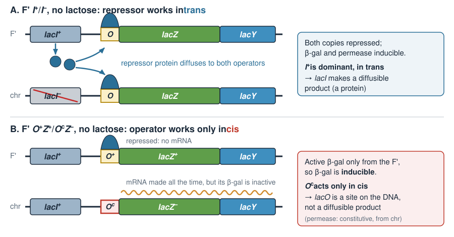
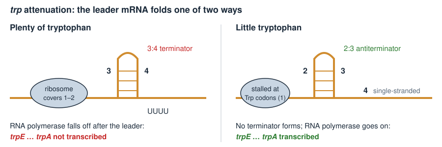

## About this lecture

**Recap from 5MO103.** You have met the lac operon in *Microbiology and basic molecular biology*: a repressor, an operator, three genes, and lactose as the switch. Today we look at it **as geneticists**. Jacob and Monod worked out the model in 1961 from mutants, before anyone had purified the repressor or sequenced the operator.

- The **mutant classes**: constitutive (*I*^−^, *O*^c^) and uninducible (*I*^s^).
- **Merodiploids** (partial diploids made with an F′ plasmid) to test **dominance**.
- **Cis vs trans**: a mutation that acts in trans changes a **diffusible product** (a protein); one that acts only in cis changes a **site on the DNA**.
- Complementation between *lacZ*^−^ and *lacY*^−^.
- Briefly: **attenuation** of the *trp* operon.

Book: Hartwell, *Genetics: From Genes to Genomes*, the chapter on gene regulation in prokaryotes.

::: notes
This is a recap unit, so keep it light on mechanism and heavy on reasoning. Students know the cartoon. What is new is the logic: how do you deduce from phenotypes alone that lacI makes a diffusible protein while lacO is a stretch of DNA? The tools are the same ones they used in Part 1 and Part 3: dominance (Extensions to Mendel), and the complementation test (Mutation unit). The F′ plasmid comes from the Bacterial genetics recap in Part 5. We simplify throughout: no CAP and cAMP, no leaky basal expression, and the inducer is IPTG, which works without permease or beta-galactosidase.
:::

## The lac operon in one picture {.smaller}

{width="78%" fig-align="center"}

- *lacZ* (β-galactosidase), *lacY* (permease) and *lacA* are transcribed together, as **one mRNA**, from one promoter (P).
- The **repressor** (LacI) is made all the time from its own gene. It binds the **operator** (O) and blocks transcription.
- The **inducer** (allolactose, made from lactose; or IPTG in the lab) binds the repressor, which then lets go of O.

::: notes
Quick recap only, two minutes. The operon idea: several genes, one promoter, one mRNA, one switch. The repressor is an allosteric protein: one site binds DNA, another binds the inducer, and binding the inducer changes the shape so that the DNA-binding site no longer fits the operator. We ignore CAP-cAMP (catabolite repression, glucose) today; it adds a second, positive switch on top. In the lab, Jacob and Monod used gratuitous inducers like TMG and later IPTG: they induce but are not broken down, so the lacZ genotype does not affect how much inducer there is. We assume that throughout the exercise and demo.
:::

## Jacob & Monod: hunting for regulatory mutants {.smaller}

Screen *E. coli* on indicator plates (e.g. X-gal, which turns blue when β-galactosidase cuts it), with and without inducer. Two odd kinds of mutants stood out:

| Phenotype | What it means | Mutations found |
|---|---|---|
| **Constitutive** | enzymes made **with or without** inducer | *lacI*^−^ (no working repressor); *lacO*^c^ (operator that repressor cannot bind) |
| **Uninducible** | enzymes **never** made, although *lacZ* and *lacY* are intact | *lacI*^s^ ("super-repressor": cannot bind inducer) |
| Structural | one enzyme missing, regulation normal | *lacZ*^−^, *lacY*^−^ |

Both *lacI*^−^ and *lacO*^c^ give the same phenotype in a haploid cell. **How can you tell them apart?** You need a second copy of the operon in the same cell.

::: notes
The genetic approach: find mutants with an interesting phenotype first, then ask what kind of thing is broken. Constitutive mutants were the clue that something actively keeps the genes off. Note that in a haploid, I minus and O c look identical: both are constitutive. Mapping showed them at slightly different positions, next to each other, which is not enough to say what they are. The decisive experiment is dominance in a partial diploid. The super-repressor I s was found a few years later (1964); it is an uninducible mutant that maps in lacI, not in lacZ or lacY.
:::

## Merodiploids: a second copy on an F′ {.smaller}

An **F′ plasmid** is an F factor that has picked up a piece of the chromosome (here the *lac* region). Transfer it by conjugation into a recipient, and the cell has **two copies** of the *lac* genes: a **partial diploid**, or **merodiploid**.

- Notation: **F′ genotype / chromosome genotype**, e.g. F′ *I*^+^ / *I*^−^.
- Now you can ask the questions from Part 1 and Part 3:
  - **Dominance**: in *I*^+^/*I*^−^, which phenotype wins? (Extensions to Mendel)
  - **Complementation**: do two mutations on different copies restore the wild type? (Mutation unit)
  - **Cis vs trans**: does the mutation affect only the genes on its own DNA molecule, or both copies?

::: notes
This is the same trick as in diploid organisms: put two alleles in one cell and see what happens. Bacteria are normally haploid, so Jacob and Monod used F-prime plasmids (from the Bacterial genetics recap in Part 5) to make them partially diploid for the lac region. "Cis" means on the same DNA molecule; "trans" means on the other molecule. The key insight is this: a product that diffuses through the cell, like a protein, can act on both copies, so it acts in trans. A site on the DNA can only affect what is physically next to it, so it acts only in cis.
:::

## Cis vs trans: the two decisive merodiploids {.smaller}

{width="72%" fig-align="center"}

- **A.** F′ *I*^+^ / *I*^−^ is **inducible**: *I*^+^ is **dominant** and works on **both** copies. The *lacI* product **diffuses**: it is a **protein**.
- **B.** F′ *O*^+^ *Z*^+^ / *O*^c^ *Z*^−^ is **inducible** for β-gal: the *O*^c^ mutation only affects the *lacZ* next to it. *lacO* is a **DNA site**.

::: notes
Walk through panel A. The chromosome makes no repressor, but the F-prime does, and that repressor reaches the operator on the chromosome as well. So I+ is dominant over I-, just as a working enzyme allele is usually dominant over a null allele (Extensions to Mendel: haplosufficiency). Panel B is the cleverer one. The Oc copy is always on, but it carries Z minus, so it makes only inactive beta-galactosidase. The F-prime copy has a normal operator and Z plus, and is properly repressed. So active beta-gal is made only with inducer. Oc did not help the lacZ+ gene on the other molecule: it acts only in cis. Put the other way round, F-prime O+ Z minus over Oc Z plus is constitutive: the working lacZ sits next to the broken operator. That pair of experiments is the cis-trans test.
:::

## The super-repressor *I*^s^ and the full logic {.smaller}

*I*^s^ makes a repressor that **binds the operator but not the inducer**. In F′ *I*^+^ / *I*^s^, the *I*^s^ repressor sits on **both** operators: *I*^s^ is **dominant**, in trans. Only an *O*^c^ in cis can escape it.

| Strain (F′ / chromosome) | β-gal | permease | Conclusion |
|---|---|---|---|
| *I*^+^ (haploid) | inducible | inducible | wild type |
| *I*^−^ (haploid) | constitutive | constitutive | repressor needed to turn genes off |
| F′ *I*^+^ / *I*^−^ | inducible | inducible | *I*^+^ dominant, acts in trans |
| F′ *I*^+^ / *I*^s^ | none | none | *I*^s^ dominant, acts in trans |
| F′ *I*^+^ *O*^c^ / *I*^s^ *O*^+^ | constitutive | constitutive | *O*^c^ escapes even *I*^s^, in cis |
| F′ *O*^+^ *Z*^+^ / *O*^c^ *Z*^−^ | inducible | constitutive | *O*^c^ acts only in cis |
| F′ *Z*^+^ *Y*^−^ / *Z*^−^ *Y*^+^ | inducible | inducible | *Z* and *Y* complement |

**Rule:** a mutation that is dominant **in trans** changes a diffusible product; one that acts **only in cis** changes a DNA site.

::: notes
I s is a dominant gain-of-function allele in the sense of Extensions to Mendel: the mutant repressor has lost the ability to respond, and it wins over the normal one because it keeps the operators blocked. Read the table row by row and ask the class to predict before revealing. The permease column in the Oc Z minus row: the chromosome copy is Oc and Y+, so permease is made all the time. This is exactly the table the R exercise rebuilds from a single function. A side note for the curious: some lacI mutations (I minus d) are dominant negative: the repressor is a tetramer, and poisoned subunits ruin mixed tetramers. That is the same idea as dominant-negative collagen mutations in Extensions to Mendel.
:::

## Try it: lac merodiploids {.smaller}

```{=html}
<link rel="stylesheet" href="../demos/dist/demo.css">
<div data-demo="lacoperon" data-preset="oc-trans"></div>
<script src="../demos/dist/lacoperon.js"></script>
```

::: notes
Interactive demo. It opens on F-prime O+ Z+ over Oc Z minus, without lactose: the F-prime copy is repressed, the chromosome copy is transcribed but has Z minus, so no active beta-gal; permease is made from the chromosome. Click "+ lactose": now beta-gal comes from the F-prime. Phenotype: beta-gal inducible, permease constitutive. Then try the presets in order: I minus (constitutive), F-prime I+ over I minus (inducible again: trans), I s (nothing), F-prime I+ over I s (still nothing: I s is trans-dominant), and finally put Oc on the F-prime in the I s cell to show that a cis-acting operator escapes even the super-repressor. Ask the class to predict before each click.
:::

## Complementation in the operon {.smaller}

F′ *Z*^+^ *Y*^−^ / *Z*^−^ *Y*^+^: each copy makes the protein the other cannot. The cell has **both** enzymes, **inducibly**. So *lacZ* and *lacY* are **different genes**, even though they share one promoter and one mRNA.

- This is the **complementation test** from the Mutation unit (Part 3), done in a bacterium.
- Benzer called the unit defined by the cis–trans test a **cistron**. In modern words: a gene that encodes one polypeptide.
- **Caveat: polarity.** A nonsense mutation early in *lacZ* also lowers *lacY* expression from that copy (transcription and translation are coupled in bacteria). Such *polar* mutations can fail to complement *lacY*^−^ although the *lacY* gene itself is fine.

::: notes
Link back to the complementation grid in the Mutation unit. Two recessive loss-of-function mutations complement when they are in different genes, because each copy supplies the missing product. Here the twist is that two genes share one transcription unit, and the test still separates them. Polarity is the classic complication: in bacteria, if ribosomes fall off the mRNA at an early stop codon, the downstream part of the mRNA is left bare and is degraded or terminated (Rho), so the downstream genes are also expressed poorly. Students only need to know that polarity exists and why it can fool a complementation test. That is why Jacob and Monod were careful to use missense alleles.
:::

## A second way to switch: *trp* attenuation {.smaller}

{width="70%" fig-align="center"}

The *trp* operon (tryptophan synthesis) has a repressor too (TrpR, active **with** tryptophan). On top of that, the **leader mRNA** senses tryptophan through translation of a short leader peptide with two Trp codons. Deletions of the attenuator region raise *trp* expression even with the repressor working: another **cis-acting** site.

::: notes
Keep this to one slide. The trp operon makes the enzymes for tryptophan synthesis, so it is on when tryptophan is scarce: a repressible rather than an inducible system. The repressor TrpR needs tryptophan as a corepressor. Attenuation is the second, finer control. Transcription and translation are coupled, so the position of the ribosome on the leader decides which hairpin forms in the RNA that RNA polymerase has just made. With lots of tryptophan, the ribosome zips through region 1, covers region 2, and the 3:4 terminator forms. With little tryptophan the ribosome stalls on the Trp codons in region 1, region 2 pairs with 3, and the terminator cannot form. Genetically, attenuator deletions act in cis, like Oc. Only bacteria can do this, because eukaryotes separate transcription (nucleus) from translation (cytoplasm).
:::

## Summary {.smaller}

| Concept | Key fact |
|---|---|
| Operon | several genes, one promoter, one mRNA; *lacZ*, *lacY*, *lacA* |
| Negative control | LacI repressor binds *lacO*; inducer releases it |
| Constitutive mutants | *I*^−^ (no repressor), *O*^c^ (operator cannot bind repressor) |
| Uninducible mutant | *I*^s^ (repressor cannot bind inducer) |
| Merodiploid | F′ / chromosome; a partial diploid to test dominance |
| Trans-acting | *I*^+^ over *I*^−^, and *I*^s^ over *I*^+^: the gene makes a diffusible protein |
| Cis-acting | *O*^c^ affects only genes on its own DNA molecule: a DNA site |
| Complementation | *Z*^−^ and *Y*^−^ on different copies give both enzymes (watch out for polarity) |
| Attenuation | *trp* leader hairpins; ribosome stalling on Trp codons decides termination |

::: notes
The one sentence to take away: dominance tells you which allele wins, and cis versus trans tells you whether the gene acts through a product that moves or through a place on the DNA. That logic carries straight over to eukaryotes, where enhancers are cis-acting sites and transcription factors are trans-acting proteins.
:::

## Where this leads

- **Next: Eukaryotic regulation & epigenetics.** Enhancers and promoters are **cis-acting** elements, and transcription factors are **trans-acting** proteins, the same logic as *lacO* and *lacI*. Chromatin adds a layer that bacteria do not have.
- **RNA-mediated regulation.** Small RNAs that turn genes down after transcription, discovered, like the lac mutants, through a genetic screen.
- **Development & model organisms.** Mutant screens like Jacob and Monod's, scaled up to find the genes that build an embryo.

::: notes
Point forward. In the exercise students predict merodiploid phenotypes by hand, then check their answers in the demo, and look up lacZ and lacI in NCBI Gene to see that lacI lies right next to the operon it controls but has its own promoter. In R they write the whole Jacob-Monod logic as one function and run it over every possible merodiploid with expand_grid.
:::
