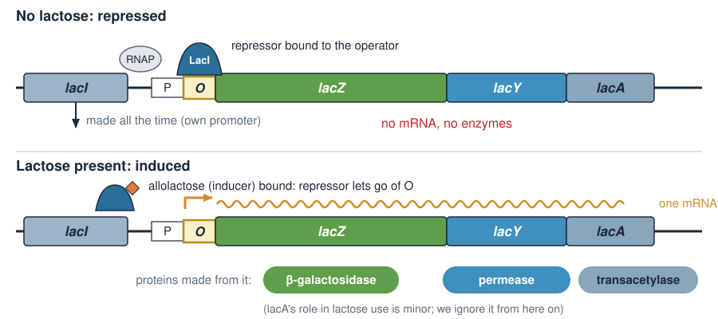
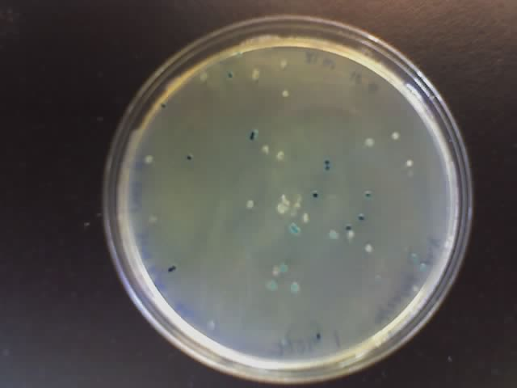
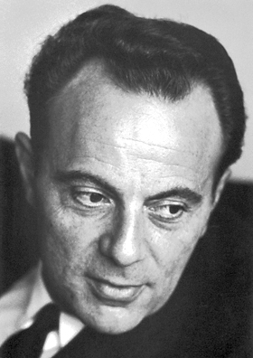
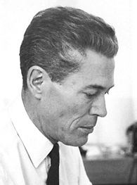
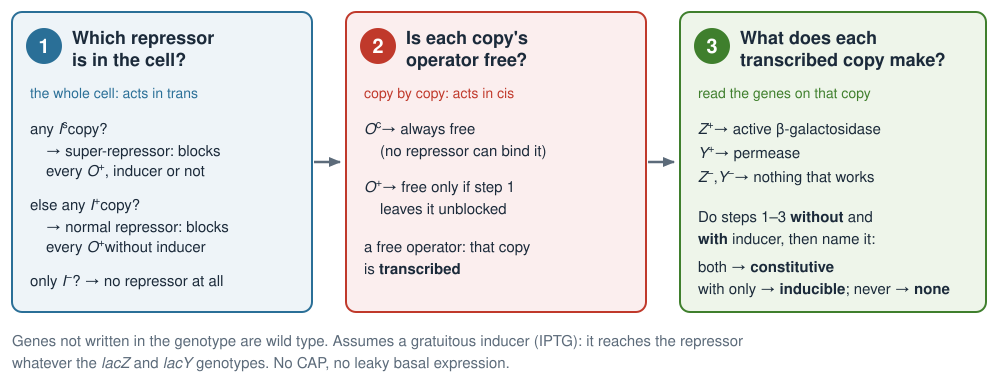

## About this lecture

**Recap from 5MO103.** You have met the lac operon in *Microbiology and basic molecular biology*: a repressor, an operator, three genes, and lactose as the switch. Today we look at it **as geneticists**. Jacob and Monod worked out the model in 1961 from mutants, before anyone had purified the repressor or sequenced the operator.

- The **mutant classes**: constitutive (*I*^−^, *O*^c^) and uninducible (*I*^s^, *P*^−^).
- **Merodiploids** (partial diploids made with an F′ plasmid) to test **dominance**.
- **Cis vs trans**: a mutation that acts in trans changes a **diffusible product** (a protein); one that acts only in cis changes a **site on the DNA**.
- A **three-step recipe** for predicting any merodiploid, with worked examples.
- Complementation between *lacZ*^−^ and *lacY*^−^, and the **polarity** trap.
- Briefly: **attenuation** of the *trp* operon.

Book: Hartwell, *Genetics: From Genes to Genomes*, the chapter on gene regulation in prokaryotes.

::: notes
This is a recap unit, so keep it light on mechanism and heavy on reasoning. Students know the cartoon. What is new is the logic: how do you deduce from phenotypes alone that lacI makes a diffusible protein while lacO is a stretch of DNA? The tools are the same ones they used in Part 1 and Part 3: dominance (Extensions to Mendel), and the complementation test (Mutation unit). The F′ plasmid comes from the Bacterial genetics recap in Part 5. We simplify throughout: no CAP and cAMP, no leaky basal expression, and the inducer is IPTG, which works without permease or beta-galactosidase. The middle of the lecture is a set of worked merodiploids: this is the core skill of the exercise, so take the time to do them with the class.
:::

## The lac operon in one picture {.smaller}

{width="78%" fig-align="center"}

- *lacZ* (β-galactosidase), *lacY* (permease) and *lacA* are transcribed together, as **one mRNA**, from one promoter (P).
- The **repressor** (LacI) is made all the time from its own gene. It binds the **operator** (O) and blocks transcription.
- The **inducer** (allolactose, made from lactose; or IPTG in the lab) binds the repressor, which then lets go of O.

::: notes
Quick recap only, two minutes. The operon idea: several genes, one promoter, one mRNA, one switch. The repressor is an allosteric protein: one site binds DNA, another binds the inducer, and binding the inducer changes the shape so that the DNA-binding site no longer fits the operator. We ignore CAP-cAMP (catabolite repression, glucose) today; it adds a second, positive switch on top. In the lab, Jacob and Monod used gratuitous inducers like TMG and later IPTG: they induce but are not broken down, so the lacZ genotype does not affect how much inducer there is. We assume that throughout the exercise and demo.
:::

## Jacob & Monod: hunting for regulatory mutants {.smaller}

:::: {.columns}
::: {.column width="64%"}
Screen *E. coli* on **indicator plates**. X-gal is colourless, but β-galactosidase cuts it into a blue dye: colonies that make the enzyme turn **blue**. Plate with and without inducer, and look for colonies that behave oddly.

| Phenotype | What it means | Mutations found |
|---|---|---|
| **Constitutive** | enzymes made **with or without** inducer | *lacI*^−^, *lacO*^c^ |
| **Uninducible** | enzymes **never** made, although *lacZ* and *lacY* are intact | *lacI*^s^ ("super-repressor"), promoter *P*^−^ |
| Structural | one enzyme missing, regulation normal | *lacZ*^−^, *lacY*^−^ |
:::
::: {.column width="36%"}
{width="92%" fig-align="center"}

[Photo: Roland Deschain, public domain, via Wikimedia Commons](https://commons.wikimedia.org/wiki/File:Blue_White_Screen.jpg){.photo-credit}
:::
::::

*lacI*^−^ and *lacO*^c^ give the **same** phenotype in a haploid cell. So do *lacI*^s^ and *P*^−^. **How can you tell them apart?** You need a second copy of the operon in the same cell.

::: notes
The genetic approach: find mutants with an interesting phenotype first, then ask what kind of thing is broken. The photo is a modern blue-white plate from a cloning experiment, which uses the same lacZ and X-gal; blue colonies make beta-galactosidase. Constitutive mutants were the clue that something actively keeps the genes off. In a haploid, I minus and O c look identical: both are constitutive. Mapping showed them at slightly different positions, next to each other, which is not enough to say what they are. The decisive experiment is dominance in a partial diploid. The super-repressor I s was found a few years later (1964); it is an uninducible mutant that maps in lacI. Promoter mutations, which RNA polymerase cannot use, are also uninducible; they map between lacI and lacZ.
:::

## The people {.smaller}

:::: {.columns}
::: {.column width="22%"}
{width="100%"}

[Photo: unknown author (Nobel Foundation), public domain, via Wikimedia Commons](https://commons.wikimedia.org/wiki/File:Fran%C3%A7ois_Jacob_nobel.jpg){.photo-credit}
:::
::: {.column width="22%"}
{width="100%"}

[Photo: unknown author (Nobel Foundation), public domain, via Wikimedia Commons](https://commons.wikimedia.org/wiki/File:Jacques_Monod_nobel_(cropped).jpg){.photo-credit}
:::
::: {.column width="56%"}
**François Jacob** (left), a bacterial geneticist, and **Jacques Monod** (right), a biochemist, worked at the Institut Pasteur in Paris.

- Monod had studied how *E. coli* switches to lactose; Jacob had built the tools of bacterial conjugation.
- Together they put *lac* mutations into partial diploids and read off **dominance** and **cis/trans** behaviour.
- From that alone they proposed the repressor, the operator and the mRNA (1961).
- Nobel Prize 1965, shared with André Lwoff.
:::
::::

::: notes
A one-minute human slide. The point to make is that the operon model was a genetic inference: the repressor protein was isolated only in 1966, by Gilbert and Müller-Hill, five years after the model was published. The model predicted that the repressor is a protein and the operator a DNA site; biochemistry later confirmed both. That is the power of the cis-trans test.
:::

## Merodiploids: a second copy on an F′

An **F′ plasmid** is an F factor that has picked up a piece of the chromosome (here the *lac* region). Transfer it by conjugation into a recipient, and the cell has **two copies** of the *lac* genes: a **partial diploid**, or **merodiploid**.

- Notation: **F′ genotype / chromosome genotype**, e.g. F′ *I*^+^ / *I*^−^. **Genes not written are wild type.**
- Now you can ask the questions from Part 1 and Part 3:
  - **Dominance**: in *I*^+^/*I*^−^, which phenotype wins? (Extensions to Mendel)
  - **Complementation**: do two mutations on different copies restore the wild type? (Mutation unit)
  - **Cis vs trans**: does the mutation affect only the genes on its own DNA molecule, or both copies?

::: notes
This is the same trick as in diploid organisms: put two alleles in one cell and see what happens. Bacteria are normally haploid, so Jacob and Monod used F-prime plasmids (from the Bacterial genetics recap in Part 5) to make them partially diploid for the lac region. "Cis" means on the same DNA molecule; "trans" means on the other molecule. The key insight is this: a product that diffuses through the cell, like a protein, can act on both copies, so it acts in trans. A site on the DNA can only affect what is physically next to it, so it acts only in cis. Stress the notation rule: anything not written is wild type. Many mistakes in the exercise come from forgetting a Y plus on the F-prime.
:::

## Cis vs trans: the two decisive merodiploids {.smaller}

{width="72%" fig-align="center"}

- **A.** F′ *I*^+^ / *I*^−^ is **inducible**: *I*^+^ is **dominant** and works on **both** copies. The *lacI* product **diffuses**: it is a **protein**.
- **B.** F′ *O*^+^ *Z*^+^ / *O*^c^ *Z*^−^ is **inducible** for β-gal: the *O*^c^ mutation only affects the *lacZ* next to it. *lacO* is a **DNA site**.

::: notes
Walk through panel A. The chromosome makes no repressor, but the F-prime does, and that repressor reaches the operator on the chromosome as well. So I+ is dominant over I-, just as a working enzyme allele is usually dominant over a null allele (Extensions to Mendel: haplosufficiency). Panel B is the cleverer one. The Oc copy is always on, but it carries Z minus, so it makes only inactive beta-galactosidase. The F-prime copy has a normal operator and Z plus, and is properly repressed. So active beta-gal is made only with inducer. Oc did not help the lacZ+ gene on the other molecule: it acts only in cis. Put the other way round, F-prime O+ Z minus over Oc Z plus is constitutive: the working lacZ sits next to the broken operator. That pair of experiments is the cis-trans test.
:::

## The super-repressor *I*^s^

*I*^s^ makes a repressor that **binds the operator but not the inducer**.

- In a haploid: the repressor never lets go. **Uninducible.**
- In F′ *I*^+^ / *I*^s^: the cell has **both** kinds of repressor. Inducer releases the normal one, but the *I*^s^ repressor stays on **both** operators. Still uninducible: *I*^s^ is **dominant**, and it acts **in trans**.
- *I*^−^ and *I*^s^ are both trans-acting, yet one is recessive and one dominant. **Trans says where a mutation acts; dominance says which allele wins.** They are separate questions.
- The only escape from *I*^s^ is a copy whose operator the repressor cannot bind: an *O*^c^, **in cis**.

::: notes
I s is a dominant gain-of-function allele in the sense of Extensions to Mendel: the mutant repressor has lost the ability to respond, and it wins over the normal one because it keeps the operators blocked. The third bullet is the single most common confusion in this topic: students equate trans with dominant and cis with recessive. Both I minus and I s act in trans, but I minus is recessive and I s dominant. And Oc acts in cis yet is dominant over O+ for the genes on its own copy. A side note for the curious: some lacI mutations (I minus d) are dominant negative: the repressor is a tetramer, and poisoned subunits ruin mixed tetramers. That is the same idea as dominant-negative collagen mutations in Extensions to Mendel.
:::

## Promoter mutations: uninducible, but in cis

A ***P*^−^** mutation changes the **promoter** so that RNA polymerase cannot start there. Like *I*^s^, it is **uninducible** in a haploid. Unlike *I*^s^, it is a **site**:

| | *I*^s^ | *P*^−^ |
|---|---|---|
| What is changed | the repressor protein | the DNA where polymerase binds |
| Haploid phenotype | uninducible | uninducible |
| Acts on | **every** copy in the cell (trans) | only **its own** copy (cis) |
| With a wild-type second copy | the wild-type copy is blocked too | the wild-type copy works normally |

So the same experimental logic separates the two uninducible classes as separates the two constitutive classes: give the cell a **wild-type second copy** and see whether it still works.

::: notes
Promoter mutations complete the picture: there are two kinds of DNA site in front of the lac genes, the promoter and the operator, and both act only in cis. A P minus mutation is cis-recessive in the sense that the other copy is unaffected, while Oc is cis-dominant: its own copy is on whatever the other copy carries. Ask the class: what merodiploid would you build to tell a new uninducible mutant apart as I s or P minus? Let them think; this is exercise B4, so do not give the full answer now.
:::

## How to read a merodiploid result

Put the unknown mutation in a cell with a **wild-type** second copy, and ask what happens to **each** copy:

| Result | Interpretation | Examples |
|---|---|---|
| The cell behaves as **wild type** | the mutant lost a **diffusible product**; the other copy supplies it in trans (**recessive**) | *I*^−^ |
| **Both** copies show the mutant phenotype | an altered **diffusible product** that wins (**dominant, in trans**) | *I*^s^ |
| **Only the mutant's own copy** is affected, whatever the other copy carries | a **DNA site** (**cis-acting**) | *O*^c^ (always on), *P*^−^ (always off) |

**Design rule:** you must be able to tell the two copies' products apart. Make sure that the enzyme you measure can only come from **one** copy, for example by putting *Z*^−^ on the other.

::: notes
This slide is the generalisation of the two decisive experiments. The design rule is subtle and is what the exercise problem B3 tests: if both copies are Z plus, you cannot tell which copy is making the beta-galactosidase, so a cis-acting mutation can be hidden by the wild-type copy's own inducible enzyme. Jacob and Monod always marked the copies with structural mutations for exactly this reason. Ask: in panel B of the cis-trans figure, which copy can make active beta-gal? Only the F-prime. That is why the result is readable.
:::

## A recipe for any merodiploid {.smaller}

{width="88%" fig-align="center"}

Step 1 is about the **cell** (trans). Step 2 is about **each copy** (cis). Step 3 reads off what each transcribed copy makes. Do it **twice**, without and with inducer.

::: notes
This is the algorithm students should use for every problem, and it is exactly what the R exercise turns into a function. Step 1: look at all lacI alleles in the cell together, because repressor diffuses. A super-repressor wins over a normal repressor, and a normal repressor wins over none. Step 2: go copy by copy. Oc is always free; O+ is free only if no repressor is blocking it. Step 3: a free copy is transcribed and makes whatever working proteins it encodes. A transcribed Z minus gene makes protein, but inactive protein: it does not count as beta-gal. Finally compare the no-inducer and with-inducer results to name the phenotype. The next three slides apply the recipe to strains that are not in the exercise.
:::

## Worked example 1: trans works both ways

**Strain: F′ *I*^−^ *Z*^+^ *Y*^−^ / *I*^+^ *Z*^−^ *Y*^+^**

**Step 1.** One copy is *I*^+^ (the chromosome): the cell has **normal repressor**. It blocks every *O*^+^ without inducer.

**Step 2.** Both operators are *O*^+^: free only **with** inducer.

**Step 3.**

| Copy | Transcribed? (− / + inducer) | Makes |
|---|---|---|
| F′ *I*^−^ *O*^+^ *Z*^+^ *Y*^−^ | no / yes | active β-gal; no permease |
| chr *I*^+^ *O*^+^ *Z*^−^ *Y*^+^ | no / yes | inactive β-gal; permease |

**Phenotype:** β-gal **inducible**, permease **inducible**.

Two lessons in one strain: repressor from the **chromosome** controls the **F′** (trans works in both directions), and *Z*^−^ and *Y*^−^ on different copies **complement**.

::: notes
Go slowly and write the table on the board. The trap is to think that the F-prime copy, being I minus, is uncontrolled. But I minus only means that this copy makes no repressor; the repressor from the chromosome reaches the F-prime operator. Repressor is a pool in the cell, not a property of a copy. Note also that both copies are transcribed with inducer, but each makes only one working enzyme; together the cell has both.
:::

## Worked example 2: one cell, two phenotypes

**Strain: F′ *I*^+^ *Z*^−^ / *I*^−^ *O*^c^ *Z*^+^ *Y*^−^**

**Step 1.** The F′ is *I*^+^: **normal repressor** in the cell.

**Step 2.** F′ operator *O*^+^: free only with inducer. Chromosome operator *O*^c^: **always free**.

**Step 3.**

| Copy | Transcribed? (− / + inducer) | Makes |
|---|---|---|
| F′ *I*^+^ *O*^+^ *Z*^−^ *Y*^+^ | no / yes | inactive β-gal; permease |
| chr *I*^−^ *O*^c^ *Z*^+^ *Y*^−^ | yes / yes | active β-gal; no permease |

**Phenotype:** β-gal **constitutive**, permease **inducible**.

The two enzymes of one cell have **different** phenotypes, because they come from different copies with different operators. Only a cis-acting site can do that.

::: notes
Point out that the F-prime is Y plus although it is not written: genes not mentioned are wild type. The striking result is that one enzyme is constitutive and the other inducible in the same cell. A trans-acting mutation could never split the two enzymes like this, because the repressor acts on both copies alike. Splitting the phenotypes of two copies is the signature of a cis-acting element.
:::

## Worked example 3: the super-repressor meets *O*^c^

**Strain: F′ *I*^s^ *O*^c^ *Z*^−^ / *I*^+^ *Z*^+^**

**Step 1.** One copy is *I*^s^: the cell has **super-repressor**. It blocks every *O*^+^, with or without inducer.

**Step 2.** F′ operator *O*^c^: **always free**, even of *I*^s^ repressor. Chromosome operator *O*^+^: **never free**.

**Step 3.**

| Copy | Transcribed? (− / + inducer) | Makes |
|---|---|---|
| F′ *I*^s^ *O*^c^ *Z*^−^ *Y*^+^ | yes / yes | inactive β-gal; permease |
| chr *I*^+^ *O*^+^ *Z*^+^ *Y*^+^ | no / no | (nothing) |

**Phenotype:** β-gal **none**, permease **constitutive**.

Notice that *I*^s^ and *O*^c^ sit on the **same** copy here, yet *I*^s^ shuts down the **other** copy. Where a *lacI* allele sits does not matter; where an operator sits does.

::: notes
This one tests whether students keep the two steps apart. The I s on the F-prime makes super-repressor, which diffuses and blocks the chromosome's normal operator forever: so the chromosome's perfectly good lacZ plus is never expressed. The F-prime's own operator is Oc, which no repressor can bind, so the F-prime copy is always on; but it is Z minus, so it only gives permease. Ask: what single change would make beta-gal constitutive? Answer: make the F-prime Z plus, or make the chromosome's operator Oc.
:::

## Try it: lac merodiploids {.smaller}

```{=html}
<link rel="stylesheet" href="../demos/dist/demo.css">
<div data-demo="lacoperon" data-preset="oc-trans"></div>
<script src="../demos/dist/lacoperon.js"></script>
```

::: notes
Interactive demo. It opens on F-prime O+ Z+ over Oc Z minus, without lactose: the F-prime copy is repressed, the chromosome copy is transcribed but has Z minus, so no active beta-gal; permease is made from the chromosome. Click "+ lactose": now beta-gal comes from the F-prime. Phenotype: beta-gal inducible, permease constitutive. Then try the presets in order: I minus (constitutive), F-prime I+ over I minus (inducible again: trans), I s (nothing), F-prime I+ over I s (still nothing: I s is trans-dominant), and finally put Oc on the F-prime in the I s cell to show that a cis-acting operator escapes even the super-repressor. Then set up the three worked examples from the last slides and check them. Ask the class to predict before each click.
:::

## Common mistakes

- **"Trans means dominant."** No. *I*^−^ acts in trans and is **recessive**; *I*^s^ acts in trans and is **dominant**.
- **"*O*^c^ makes the whole cell constitutive."** No. Only the genes on the **same** DNA molecule as the *O*^c^.
- **"An *I*^−^ copy is uncontrolled."** No. It is controlled by repressor made from **any** *I*^+^ copy in the cell.
- **"A *Z*^−^ copy that is transcribed gives β-gal."** No. It makes **inactive** protein. Count only *Z*^+^ copies.
- **Forgetting the unwritten genes.** F′ *O*^c^ *Z*^−^ is also *I*^+^ and *Y*^+^.
- **Naming a phenotype from one condition.** Always work out **both** no inducer and with inducer.

::: notes
These are the errors that show up again and again in exam answers. Read them out and ask the class for a strain that illustrates each one. The first is the deepest: dominance and cis/trans are two different questions. The cis-trans test asks where a mutation acts, and dominance asks which allele wins in a heterozygote.
:::

## Complementation in the operon

F′ *Z*^+^ *Y*^−^ / *Z*^−^ *Y*^+^: each copy makes the protein the other cannot. The cell has **both** enzymes, **inducibly**. So *lacZ* and *lacY* are **different genes**, even though they share one promoter and one mRNA.

- This is the **complementation test** from the Mutation unit (Part 3), done in a bacterium: two **recessive** loss-of-function mutations, one on each copy.
- **Fail to complement** → same gene. **Complement** → different genes.
- Benzer called the unit defined by this cis–trans test a **cistron**. In modern words: a gene that encodes one polypeptide.

::: notes
Link back to the complementation grid in the Mutation unit. Two recessive loss-of-function mutations complement when they are in different genes, because each copy supplies the missing product. Here the twist is that two genes share one transcription unit, and the test still separates them. The test only works with recessive mutations: a dominant mutation, like I s, cannot be put through a complementation test, because the cell is mutant whatever the other copy carries.
:::

## The polarity trap

In bacteria, ribosomes start translating the mRNA while it is still being made. A **nonsense** mutation early in *lacZ* makes ribosomes fall off; the downstream mRNA is left bare and is terminated or degraded. *lacY* and *lacA* on **that copy** are then expressed poorly.

| F′ / chromosome | β-gal | permease | Reading |
|---|---|---|---|
| F′ *Z*^−^(missense) / *Y*^−^ | yes | yes | complement: different genes ✓ |
| F′ *Z*^−^(early nonsense, polar) / *Y*^−^ | yes | **low** | seems **not** to complement: misleading |

A mutation that seems to fail to complement mutations in **two** neighbouring genes is either a **deletion** that removes both, or a **polar** mutation in the upstream gene.

::: notes
Polarity is the classic complication of complementation tests in operons. In the polar strain, the chromosome copy is Y minus, and the F-prime copy's lacY is intact but hardly expressed, because of the nonsense codon upstream in lacZ on the same mRNA. So permease is low and the cell grows poorly on lactose, which looks like failure to complement. This is a cis effect: the nonsense codon only affects the genes downstream on its own mRNA. That is why Jacob and Monod were careful to use missense alleles. The exercise has a complementation table with a warning about exactly this.
:::

## A repressible operon: *trp*

The *trp* operon makes the enzymes that **synthesise** tryptophan, so the cell wants it **on when tryptophan is scarce**. That is the reverse of *lac*.

| | *lac* | *trp* |
|---|---|---|
| Pathway | breaks down lactose | makes tryptophan |
| Kind of control | **inducible**: off unless lactose is present | **repressible**: on unless tryptophan is present |
| Small molecule | inducer releases the repressor | tryptophan **activates** the repressor (a **corepressor**) |
| Repressor gene | *lacI* | *trpR*, far from the operon (trans) |
| Second layer | CAP–cAMP (not today) | **attenuation**, in the leader mRNA (cis) |

::: notes
A quick contrast before attenuation. The logic of negative control is the same: a repressor binds an operator. What differs is whether the small molecule takes the repressor off (lac) or puts it on (trp). TrpR is encoded far away from the trp operon, which makes the point from the Find it task again: a trans-acting regulator can be anywhere in the genome. Mutations in trpR are constitutive and recessive, like lacI minus. The second layer, attenuation, is a cis-acting element in the RNA itself.
:::

## Attenuation: the ribosome reads the tryptophan level {.smaller}

{width="70%" fig-align="center"}

1. The **leader** mRNA encodes a short peptide with **two Trp codons** in a row (in region 1).
2. **Plenty of Trp:** charged tRNA^Trp^ is abundant; the ribosome runs through region 1 and covers region 2. Regions 3 and 4 pair: a **terminator**. Transcription stops.
3. **Little Trp:** the ribosome **stalls** at the Trp codons. Region 2 pairs with region 3 (**antiterminator**); 3:4 cannot form. Transcription continues.

::: notes
Go through the three steps with the figure. Transcription and translation are coupled, so the position of the ribosome on the leader decides which hairpin forms in the RNA that RNA polymerase has just made. The sensor is not the free amino acid but charged tRNA: the ribosome waits at a codon until a charged tRNA arrives. Only bacteria can do this, because eukaryotes separate transcription (nucleus) from translation (cytoplasm).
:::

## Attenuation as genetics

- The **codons** in the leader peptide decide **which** amino acid is sensed. Other amino-acid operons use the same trick: the *his* operon leader has **seven His codons in a row**.
- **Deletions of the attenuator** (region 3–4) raise *trp* expression even when the repressor works. They act only on their own copy: **cis-acting**, like *O*^c^.
- *trpR*^−^ and attenuator deletions add up: the two controls are **independent** layers.

So for any leader mutation, ask: where will the ribosome stall now, and which hairpin can form?

::: notes
Turn the mechanism into predictions. If you change the codons in the leader, you change which starvation causes stalling: that is exercise B6, so leave the specific answer to them. Attenuator deletions behave like Oc: cis, constitutive for their own copy. A strain with both trpR minus and an attenuator deletion has higher expression than either alone, which is how the two layers were shown to be separate.
:::

## Check yourself

Use the recipe. Answers in the notes.

1. F′ *I*^−^ / *I*^s^: β-gal and permease?
2. F′ *O*^c^ *Z*^+^ *Y*^−^ / *I*^−^ *Z*^+^: β-gal and permease?
3. A new mutation is **dominant** in a merodiploid. Can you conclude that it is cis-acting?
4. Why must one copy carry *Z*^−^ when you test whether a constitutive mutant is *I*^−^ or *O*^c^?

::: notes
Answers. 1: The cell has super-repressor; both operators are O+, so blocked always: beta-gal none, permease none. 2: The F-prime is I+, so normal repressor. The F-prime copy is Oc: always transcribed, makes beta-gal (Z+) but no permease (Y minus): beta-gal constitutive. The chromosome copy is O+, inducible, makes beta-gal and permease: permease inducible. Beta-gal is constitutive overall, because constitutive plus inducible is still made without inducer. 3: No. I s is dominant and trans-acting. Dominance and cis/trans are separate questions; you need to see whether the other copy is affected. 4: So that all active beta-gal comes from the copy with the unknown mutation; otherwise the wild-type copy's own inducible enzyme would hide or muddy the result.
:::

## Summary {.smaller}

| Concept | Key fact |
|---|---|
| Operon | several genes, one promoter, one mRNA; *lacZ*, *lacY*, *lacA* |
| Negative control | LacI repressor binds *lacO*; inducer releases it |
| Constitutive mutants | *I*^−^ (no repressor), *O*^c^ (operator cannot bind repressor) |
| Uninducible mutants | *I*^s^ (repressor cannot bind inducer), *P*^−^ (no promoter) |
| Merodiploid | F′ / chromosome; a partial diploid to test dominance and cis/trans |
| Trans-acting | *I*^+^ over *I*^−^ (recessive), *I*^s^ over *I*^+^ (dominant): a diffusible protein |
| Cis-acting | *O*^c^, *P*^−^, attenuator deletions: affect only their own DNA molecule |
| Recipe | 1 repressor in the cell; 2 free operators, copy by copy; 3 products; − and + inducer |
| Complementation | *Z*^−^ and *Y*^−^ on different copies give both enzymes; beware polar mutations |
| *trp* | repressible; TrpR + Trp; attenuation by ribosome stalling on Trp codons |

::: notes
The one sentence to take away: dominance tells you which allele wins, and cis versus trans tells you whether the gene acts through a product that moves or through a place on the DNA. That logic carries straight over to eukaryotes, where enhancers are cis-acting sites and transcription factors are trans-acting proteins.
:::

## Where this leads

- **Next: Eukaryotic regulation & epigenetics.** Enhancers and promoters are **cis-acting** elements, and transcription factors are **trans-acting** proteins, the same logic as *lacO* and *lacI*. Chromatin adds a layer that bacteria do not have.
- **RNA-mediated regulation.** Small RNAs that turn genes down after transcription, discovered, like the lac mutants, through a genetic screen. A 3′UTR site behaves like *O*^c^.
- **Development & model organisms.** Mutant screens like Jacob and Monod's, scaled up to find the genes that build an embryo, and *lacZ* reused as a reporter gene.

::: notes
Point forward. In the exercise students predict merodiploid phenotypes by hand with the recipe, then check their answers in the demo, and look up lacZ and lacI in NCBI Gene to see that lacI lies right next to the operon it controls but has its own promoter. In R they write the whole Jacob-Monod logic as one function and run it over every possible merodiploid with expand_grid.
:::
