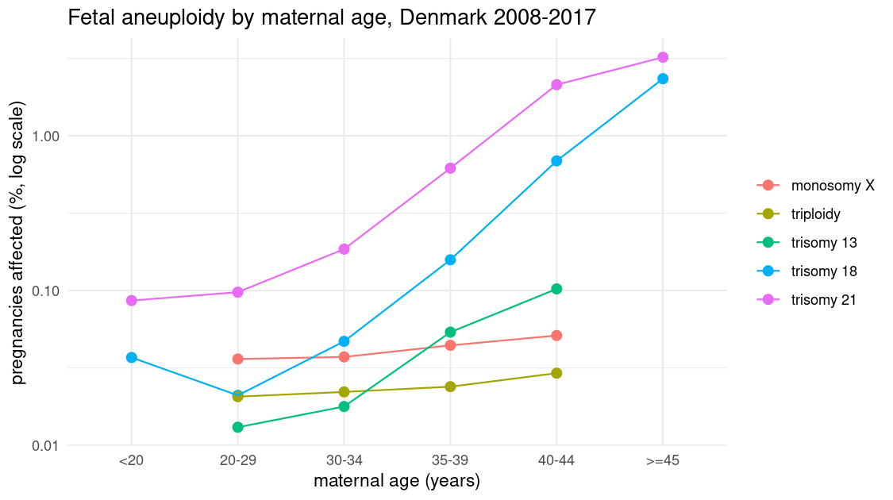

## Goal

By the end of this exercise you should be able to:

- read a published table of aneuploidy by maternal age, compute risks and relative risks, and plot them on a **log scale**;
- simulate the gametes of a reciprocal translocation carrier with `sample()` and `replicate()`, and compare with the by-hand answer;
- simulate gametes of a triploid with `rbinom()` and check the formula 2 × (½)^*x*^.

## Before you start

This page builds on the [Exercise](exercise.qmd), especially B4 (translocation gametes) and B9 (triploids). You need the packages dplyr, ggplot2 and readr.

Download [`data/aneuploidy_maternal_age_denmark.csv`](data/aneuploidy_maternal_age_denmark.csv) into a folder `data/` next to your script. It holds the real numbers from Table 2 of Elmerdahl Frederiksen L, et al. (2024) "Maternal age and the risk of fetal aneuploidy: A nationwide cohort study of more than 500 000 singleton pregnancies in Denmark from 2008 to 2017", *Acta Obstetricia et Gynecologica Scandinavica* 103:351–359, [doi:10.1111/aogs.14713](https://doi.org/10.1111/aogs.14713) (open access, [PMC10823394](https://pmc.ncbi.nlm.nih.gov/articles/PMC10823394/)). The data set has one row per age group and aneuploidy:

- `age_group`: maternal age group;
- `n_pregnancies`: all pregnancies in that age group;
- `aneuploidy`: which aneuploidy the row counts;
- `cases`: the number of affected pregnancies, diagnosed before or after birth; empty where the paper reports fewer than 3 cases;
- `source`: the citation, and the date the numbers were copied (2026-11-20).

```r
library(dplyr)
library(ggplot2)
library(readr)
```

## Tasks

**R1. (risk per age group)** Read the file, make `age_group` a factor in the right order, and compute the risk of trisomy 21 in each age group as a percentage and as "1 in N". What is the overall risk across all ages?

```r
aneu <- read_csv("data/aneuploidy_maternal_age_denmark.csv", show_col_types = FALSE) |>
  select(-source) |>
  mutate(age_group = factor(age_group, levels = c("<20", "20-29", "30-34", "35-39", "40-44", ">=45")))
aneu |> count(aneuploidy)
t21 <- aneu |>
  filter(aneuploidy == "trisomy 21") |>
  mutate(risk_percent = 100 * cases / n_pregnancies,
         one_in = round(n_pregnancies / cases))
t21
sum(t21$cases) / sum(t21$n_pregnancies) * 100
```

**R2. (a log-scale plot)** Plot the risk of every aneuploidy against age group, with one line per aneuploidy and a **log scale** on the y axis ([`scale_y_log10`](https://ggplot2.tidyverse.org/reference/scale_continuous.html)). Leave out rows with missing counts. Why is a log scale the right choice here? Which aneuploidies rise with maternal age, and which do not?

```r
aneu |>
  filter(!is.na(cases)) |>
  mutate(risk_percent = 100 * cases / n_pregnancies) |>
  ggplot(aes(x = age_group, y = risk_percent, colour = aneuploidy, group = aneuploidy)) +
  geom_point(size = 2.5) +
  geom_line() +
  scale_y_log10() +
  labs(x = "maternal age (years)", y = "pregnancies affected (%, log scale)",
       colour = NULL, title = "Fetal aneuploidy by maternal age, Denmark 2008-2017") +
  theme_minimal()
```

**R3. (relative risk)** For each aneuploidy, how many times higher is the risk at 40–44 than at 20–29? Make a small table of the reference risks at 20–29 and join it to the data with [`left_join`](https://dplyr.tidyverse.org/reference/mutate-joins.html). (The paper reports odds ratios, which are close to these relative risks because the risks are small.)

```r
ref <- aneu |> filter(age_group == "20-29") |>
  transmute(aneuploidy, ref_risk = cases / n_pregnancies)
aneu |>
  filter(age_group %in% c("20-29", "40-44")) |>
  left_join(ref, by = "aneuploidy") |>
  mutate(risk = cases / n_pregnancies,
         relative_risk = round(risk / ref_risk, 1)) |>
  filter(age_group == "40-44") |>
  select(aneuploidy, cases, relative_risk)
```

**R4. (a translocation carrier's gametes)** Simulate a reciprocal translocation carrier (exercise B4) whose four chromosomes N1, N2, T1 and T2 go two to each pole, all six combinations equally likely. `sample(x, 2)` picks 2 of the 4 **without** replacement, so a chromosome cannot be picked twice. Write a function for one gamete, classify 10 000 gametes with `replicate`, and compare the fraction of balanced gametes with your answer to B4(b).

```r
one_gamete <- function() {
  sort(sample(c("N1", "N2", "T1", "T2"), 2))
}
set.seed(1)
one_gamete(); one_gamete(); one_gamete()

classify <- function(g) {
  g <- paste(g, collapse = "+")
  if (g == "N1+N2") "normal"
  else if (g == "T1+T2") "balanced carrier"
  else if (g %in% c("N1+T2", "N2+T1")) "unbalanced (adjacent-1)"
  else "unbalanced (adjacent-2)"
}
set.seed(5)
gametes <- replicate(10000, classify(one_gamete()))
tibble(type = gametes) |> count(type) |> mutate(fraction = n / sum(n))
mean(gametes %in% c("normal", "balanced carrier"))
```

**R5. (triploid gametes)** In a triploid, each chromosome type sends 1 or 2 copies to a gamete, ½ each. `rbinom(x, size = 1, prob = 1/2) + 1` gives the number of copies for all `x` types in one gamete, and `replicate` makes many gametes, one per column (as for the families in the Part 1 pedigree unit). Write `balanced_triploid(n_types)` that returns the fraction of balanced gametes (all 1 copy or all 2 copies), and compare with 2 × (½)^*x*^ for *x* = 3 and for the banana's *x* = 11.

```r
balanced_triploid <- function(n_types, n_gametes = 10000) {
  copies <- replicate(n_gametes, rbinom(n_types, size = 1, prob = 1/2) + 1)
  # each column is one gamete: 1 or 2 copies of each chromosome type
  mean(colSums(copies == 1) == n_types | colSums(copies == 2) == n_types)
}
set.seed(6)
balanced_triploid(3)
2 * (1/2)^3
balanced_triploid(11)
2 * (1/2)^11
```

With *x* = 11, how many balanced gametes did you expect among 10 000? Is the simulated value close?

## Solutions

::: {.callout-note collapse="true" title="Solutions: In R"}

All output below is from `Rscript --vanilla` run in the unit folder.

**R1.**

```
# A tibble: 5 × 2
  aneuploidy     n
  <chr>      <int>
1 monosomy X     6
2 triploidy      6
3 trisomy 13     6
4 trisomy 18     6
5 trisomy 21     6
# A tibble: 6 × 6
  age_group n_pregnancies aneuploidy cases risk_percent one_in
  <fct>             <dbl> <chr>      <dbl>        <dbl>  <dbl>
1 <20                8115 trisomy 21     7       0.0863   1159
2 20-29            251756 trisomy 21   246       0.0977   1023
3 30-34            185025 trisomy 21   343       0.185     539
4 35-39             83485 trisomy 21   516       0.618     162
5 40-44             13652 trisomy 21   292       2.14       47
6 >=45                342 trisomy 21    11       3.22       31
[1] 0.2608896
```

The risk is about 1 in 1000 below 30, then rises steeply: **1 in 162** at 35–39, **1 in 47** at 40–44 and **1 in 31** at 45 or older. Overall, 0.26% of the pregnancies (1415 of 542 375) had trisomy 21. These are pregnancies, counted from the first-trimester scan and including diagnoses before birth; live-birth risks are lower, because many affected pregnancies miscarry or are terminated. The numbers for under-20s and over-45s rest on few cases (7 and 11), so they are uncertain.

**R2.**

{width="85%" fig-align="center"}

The risks range from about 0.01% to 3%, a factor of 300. On a linear scale the small values would all be squashed against zero. On a **log scale**, equal distances mean equal **ratios**, so a steady multiplication with age shows as a straight rise, and curves at very different levels can be compared. **Trisomies 21, 18 and 13** rise steeply with maternal age. **Monosomy X** and **triploidy** stay almost flat: 45,X usually results from loss of the father's sex chromosome, and triploidy mostly from two sperm fertilising one egg, so neither depends on the age of the oocyte.

**R3.**

```
# A tibble: 5 × 3
  aneuploidy cases relative_risk
  <chr>      <dbl>         <dbl>
1 trisomy 21   292          21.9
2 trisomy 18    94          32.7
3 trisomy 13    14           7.8
4 triploidy      4           1.4
5 monosomy X     7           1.4
```

At 40–44 the risk of trisomy 21 is **22 times** that at 20–29, and of trisomy 18 **33 times**. Triploidy and monosomy X are only 1.4 times higher, based on very few cases. (The paper's odds ratios for 40–44 are 22.35 for trisomy 21 and 32.93 for trisomy 18, very close to these relative risks.)

**R4.**

```
[1] "N1" "T1"
[1] "N1" "N2"
[1] "N1" "T1"
# A tibble: 4 × 3
  type                        n fraction
  <chr>                   <int>    <dbl>
1 balanced carrier         1694    0.169
2 normal                   1693    0.169
3 unbalanced (adjacent-1)  3289    0.329
4 unbalanced (adjacent-2)  3324    0.332
[1] 0.3387
```

**0.339** of the simulated gametes are balanced, close to the exact **1/3** from B4(b), and each of normal and balanced carrier is about **1/6**. Under this model adjacent-2 is as common as adjacent-1, but in real carriers adjacent-2 is rarer and alternate segregation more common, so this simulation is a **null model**: it shows what random segregation would give, and real sperm studies show how far carriers depart from it.

**R5.**

```
[1] 0.2597
[1] 0.25
[1] 8e-04
[1] 0.0009765625
```

For *x* = 3: simulated 0.260, exact 2/8 = **0.25**. For *x* = 11: simulated 0.0008, exact 2/2048 ≈ **0.00098**. We expected about 10 balanced gametes among 10 000 and got 8, which is well within chance for such a rare event. A banana flower makes almost no balanced gametes, so triploid bananas are seedless and are propagated by cuttings.
:::

## Where this leads

`sample`, `rbinom` and `replicate` come back in **Organelle inheritance**, where you simulate how the mitochondrial bottleneck spreads the heteroplasmy level among a mother's children, and in **Drift & selection** (Part 7), where a whole population is resampled every generation. The joining of a reference table with `left_join` is used again in **Bacterial genetics**.
