## About this lecture

The previous lecture built a normal chromosome: one centromere, two telomeres, a fixed band pattern. This one is about what happens when **structure** or **number** goes wrong, and why the consequences show up in the next generation.

- **Deletions** and **duplications**: dosage changes; recurrent ones caused by repeats; deletion mapping.
- **Inversions**: no DNA lost, yet crossovers inside them give unbalanced gametes. We work out the products step by step.
- **Translocations**: reciprocal and Robertsonian; how the carrier's chromosomes segregate, counted segment by segment; the Philadelphia chromosome.
- **Aneuploidy**: nondisjunction in meiosis I and II; finding the parent and the division with DNA markers; trisomy 21 and the **maternal age effect**.
- **Polyploidy**: crops with whole extra genomes, and why triploids are sterile.

Book: Hartwell, *Genetics: From Genes to Genomes*, the chapter on chromosomal rearrangements and changes in chromosome number.

::: notes
The genetic thread through the whole lecture is meiosis. A rearrangement or a missing chromosome in one cell is a cytology fact; what makes it genetics is what the carrier passes on. Many carriers of a balanced rearrangement are perfectly healthy, and the problem appears only in their children or as reduced fertility. Students know mitosis, meiosis and nondisjunction from Part 2 (chromosome theory); today's demo is the same meiosis demo, in its nondisjunction mode. Keep the key word "balanced" in view: does a cell or gamete have the right amount of every part of the genome, or not? Three parts of the lecture are built step by step because they are where students lose their way in the exercise: the products of a crossover inside an inversion, the gametes of a translocation carrier, and the marker logic for nondisjunction.
:::

## Four kinds of rearrangement {.smaller}

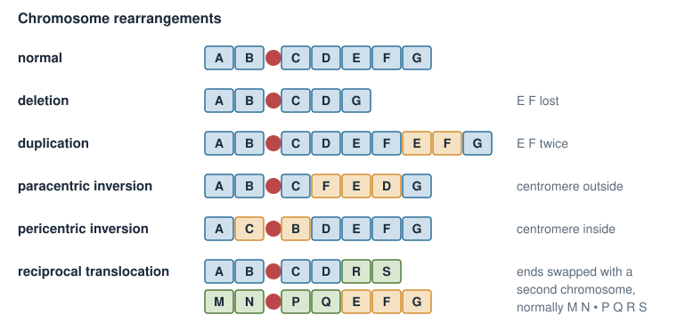{width="66%" fig-align="center"}

A rearrangement starts with **double-strand breaks** that are rejoined the wrong way, or with **recombination between repeats** at the wrong place. **Balanced** rearrangements (inversions, reciprocal translocations) keep every gene, just in a new order; **unbalanced** ones (deletions, duplications) change the amount.

::: notes
Read the figure row by row. The letters are blocks of genes; the red dot is the centromere. Deletion: a segment is missing. Duplication: a segment is present twice, here in tandem. Inversion: a segment is cut out and put back the other way round; paracentric if the centromere is outside the inverted segment, pericentric if it is inside (which can move the centromere and change the arm ratio). Reciprocal translocation: two non-homologous chromosomes swap ends. Ask the room which of these can be seen in a G-banded karyotype: those that change the band pattern by more than a few megabases.
:::

## Reading a rearrangement karyotype

The notation from the last lecture: **type(chromosome)(breakpoints)**. The breakpoints tell you what kind of change it is.

| Karyotype | Read it as | Kind |
|---|---|---|
| 46,XX,del(4)(p16.1) | chromosome 4 is missing everything from 4p16.1 to the end of 4p | **terminal** deletion, unbalanced |
| 46,XY,del(7)(q11.23q11.23) | a piece **inside** 7q11.23 is missing | **interstitial** deletion, unbalanced |
| 46,XX,inv(1)(q21q32) | both breakpoints on **q**: the centromere is outside | **paracentric** inversion, balanced |
| 46,XY,inv(5)(p13q31) | one breakpoint on **p**, one on **q**: the centromere is inside | **pericentric** inversion, balanced |
| 46,XX,t(11;22)(q23;q11.2) | 11q23→11qter and 22q11.2→22qter have swapped | reciprocal translocation, balanced |
| 45,XY,rob(14;21)(q10;q10) | 14q and 21q joined at the centromere; 45 chromosomes | Robertsonian, balanced |

**Rule of thumb:** an inversion with **both** breakpoints on the same arm letter is paracentric; with a **p and a q** it is pericentric.

::: notes
Work down the table aloud. The first number is still the chromosome count: a Robertsonian carrier has 45 chromosomes and is still balanced, which surprises students. q10 means the breakpoint is at the centromere itself. A deletion written with one breakpoint is terminal, running to the end of the arm (pter or qter); with two breakpoints it is interstitial. The 7q11.23 deletion is the Williams syndrome region that students look up in the exercise. The t(11;22)(q23;q11.2) is the most common recurrent constitutional reciprocal translocation in humans, and inversions of chromosome 1 and 5 are just examples of the format. The rule of thumb for paracentric versus pericentric is the one students need for B1 in the exercise.
:::

## Recurrent rearrangements come from repeats {.smaller}

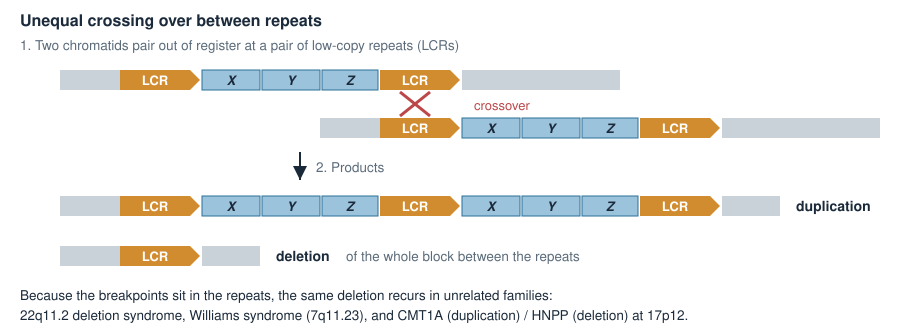{width="80%" fig-align="center"}

**Non-allelic homologous recombination** (NAHR): crossing over between two similar **low-copy repeats** that are not at the same position. It gives a **deletion** and a reciprocal **duplication** of exactly the segment between the repeats.

::: notes
Low-copy repeats, also called segmental duplications, are stretches of more than about 10 kb that are more than 95 percent identical and occur at several places in the genome. When homologous chromosomes pair at the wrong copy, a crossover between them is unequal. Because the breakpoints are set by the repeats, unrelated patients carry nearly identical deletions; that is why these are called recurrent genomic disorders and why they have fixed names. 22q11.2 deletion syndrome is the most common, around 1 in 3000 to 1 in 6000 births. The 17p12 pair is the cleanest example of reciprocity: the duplication of a 1.4 Mb segment containing PMP22 causes Charcot–Marie–Tooth disease type 1A, and the deletion of the same segment causes HNPP, a different nerve disease. One gene, three copies versus one copy, two diseases. Sturtevant's Bar eye in Drosophila (1925) was the first unequal crossing over to be studied.
:::

## Deletions {.smaller}

A heterozygote for a deletion has only **one** copy of the genes in the deleted segment.

- **Haploinsufficiency**: for some genes, one copy is not enough. Large deletions are usually harmful; homozygous deletions are usually lethal.
- **Pseudodominance**: a recessive allele on the normal homologue is **expressed**, because the deletion uncovers it.
- In meiosis, the normal homologue forms a **deletion loop** where it has no partner.

| Human deletion syndrome | Region | Typical size | Key gene(s) |
|---|---|---|---|
| Cri-du-chat | 5p15.2 → 5pter | varies | several |
| 22q11.2 deletion (DiGeorge) | 22q11.21 | ≈ 2.5–3 Mb | *TBX1* (heart, face) |
| Williams syndrome | 7q11.23 | ≈ 1.5–1.8 Mb | *ELN* (aortic stenosis) |

::: notes
Pseudodominance is the genetic signature of a deletion: a recessive phenotype appears in a heterozygote. The next slide turns it into a mapping method. In humans, the most common deletion syndromes arise by NAHR, as on the previous slide, mostly as new mutations. A deletion syndrome is a contiguous gene syndrome: many genes are lost, and some features can be traced to single genes, such as the narrowing of the aorta in Williams syndrome to the loss of one copy of the elastin gene ELN. Students find these in ClinVar and MedGen in the exercise. Deletions below about 5 Mb are invisible in a routine karyotype; they are found with microarrays or sequencing.
:::

## Deletion mapping, step by step {.smaller}

:::: {.columns}
::: {.column width="55%"}
*Drosophila* larval salivary glands have giant **polytene** chromosomes, about a thousand copies side by side, with a band pattern visible in a light microscope. A deletion shows up as missing bands.

**The test.** Cross a fly homozygous for recessive *m* with a fly carrying a deletion (*Df*). If some offspring are mutant, the deletion **uncovers** *m*: *m* lies inside it.

| | bands removed | uncovers *x*? | uncovers *y*? |
|---|---|:-:|:-:|
| *Df1* | 1–3 | yes | no |
| *Df2* | 3–5 | yes | yes |
| *Df3* | 5–6 | no | no |

- *x*: inside *Df1* **and** *Df2*, so in their overlap: **band 3**.
- *y*: inside *Df2* but **not** *Df1* or *Df3*: bands 3–5 minus 3 and 5: **band 4**.
:::
::: {.column width="45%"}
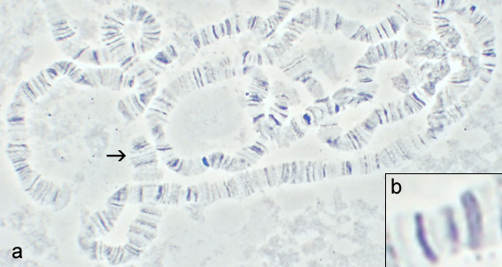{width="100%"}

[Photo: J. Albert Vallunen, CC BY-SA 2.5, via Wikimedia Commons](https://commons.wikimedia.org/wiki/File:Drosophila_polytene_chromosomes_2.jpg){.photo-credit}

*Drosophila* polytene chromosomes (phase contrast). Inset b: the dark bands up close.
:::
::::

::: notes
This is a small invented example to show the logic; the exercise has a bigger one. Two rules: a mutation lies inside every deletion that uncovers it, and outside every deletion that does not. Intersect the first set, then subtract the second. The polytene chromosomes are what made this so powerful in Drosophila: Bridges drew maps of the salivary-gland chromosomes in the 1930s, and a deletion could be seen as a stretch of missing bands, so a genetic interval could be tied to a physical one. The polytene chromosome forms when the DNA replicates many times without cell division and the copies stay aligned, which makes each band thick enough to see. Today Drosophila geneticists use a genome-wide collection of molecularly defined deletions, the "deficiency kit", in exactly this way.
:::

## Duplications {.smaller}

- **Dosage**: three copies of a gene instead of two can change the phenotype. *Drosophila* **Bar** eye is a tandem duplication; flies with the segment three times on one chromosome (double-Bar) have even smaller eyes. Human **CMT1A** is a duplication of *PMP22*.
- In meiosis, the duplicated segment forms a **duplication loop**, and the repeat makes further **unequal crossing over** possible: duplications beget duplications.
- **Evolution**: a duplicated gene is free to change. One copy keeps the old job, the other can gain a new one. Gene families arose like this, for example the **α- and β-globin** genes, and the red and green opsin genes on the X.

Duplications are usually less harmful than deletions of the same size: having a little too much is better tolerated than too little.

::: notes
Bar is the classic: Sturtevant showed that Bar reverted and also gave double-Bar at a low rate, and explained both by unequal crossing over between the tandem copies; Bridges later saw the duplicated bands in salivary gland chromosomes. The dosage point links to aneuploidy later today: a trisomy is a duplication of a whole chromosome. The evolutionary point links back to the T2T genome: many of the new protein-coding genes in T2T-CHM13 are in recent segmental duplications that the old reference could not resolve. Red–green colour blindness often results from unequal crossing over between the tandem opsin genes on the X, which is why it is so common in men.
:::

## Inversions {.smaller}

An inversion **loses nothing**: an inversion homozygote, or a heterozygote, usually has a normal phenotype. Exceptions: a breakpoint inside a gene, or a gene moved next to heterochromatin (position-effect variegation, previous lecture).

| | **Paracentric** | **Pericentric** |
|---|---|---|
| Centromere | outside the inverted segment | inside it |
| Band pattern | changes within one arm | can change the arm ratio |
| Crossover in the loop gives | a **dicentric** + an **acentric** | two chromosomes with a **duplication** and a **deficiency** |

The trouble starts in a **heterozygote** at meiosis: the next four slides build it up step by step.

A common harmless human variant is the pericentric inversion of chromosome 9, inv(9)(p12q13), found in about 1–3% of people.

::: notes
The genetic problem with inversions arises in heterozygotes during meiosis. Inversion homozygotes pair normally and have no problem. Over evolution, inversions are common differences between species: humans and chimpanzees differ by several pericentric inversions, and many Drosophila populations carry inversion polymorphisms that keep favourable combinations of alleles together. Inversions are usually detected by a change in band order, or today by sequencing with long reads. The table is the conclusion; now we derive it.
:::

## Step 1: pairing makes a loop

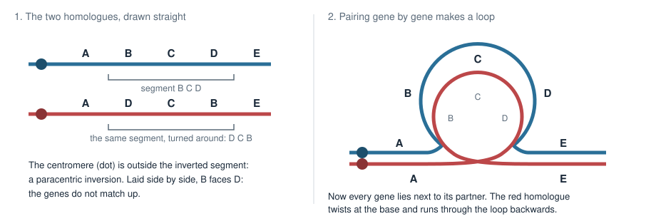{width="96%" fig-align="center"}

Homologues pair **gene by gene**. Where one of them has a segment the other way round, the only way to bring B next to B and D next to D is for one homologue to form an **inversion loop**. (In a cell the loop can be made by either homologue.)

::: notes
Draw this on the board as you talk. On the left the two homologues are laid straight: the inverted segment B C D reads D C B on the red one, so B faces D. Pairing in prophase I is driven by sequence matching, so the chromosomes contort until every gene lies next to its partner. The result on the right: the blue homologue forms the outer loop, and the red one runs through it backwards, twisting at the base. Inversion loops were seen directly in Drosophila polytene chromosomes, which pair in somatic cells. Nothing has gone wrong yet: if no crossover happens inside the loop, the two chromatids segregate normally and both gametes are balanced.
:::

## Step 2: one crossover in a paracentric loop {.smaller}

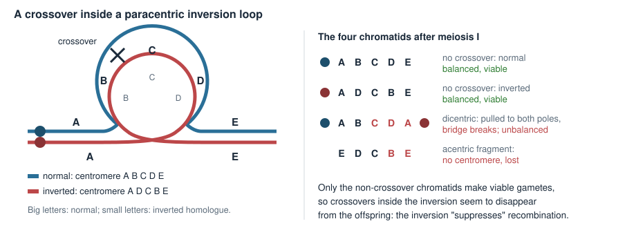{width="88%" fig-align="center"}

- The crossover chromatids become a **dicentric** (A B C D A, with a centromere at each end) and an **acentric** fragment (E D C B E).
- At anaphase I the dicentric is pulled to both poles and **breaks**; the acentric has no kinetochore and is **lost**.

::: notes
Now put a crossover in the loop, between B and C, involving one chromatid of each homologue. The other two chromatids are untouched: one normal, one inverted, both balanced. Read off the two recombinant products on the right, and let students check them with the recipe on the next slide. The dicentric forms a bridge between the two poles at anaphase I; it breaks at a random point, giving broken chromosomes with deletions. The acentric fragment is left behind. In animals the cell often directs the dicentric into the polar body, so the egg can be fine, but in plants and in males fertility drops.
:::

## How to work out the products: a recipe

A crossover between genes **X** and **Y** joins two pieces:

1. Write both chromatids, with the centromere: normal **• A B C D E**, inverted **• A D C B E**.
2. Find the crossover in **both**: here between B and C. In the inverted chromatid, B and C are neighbours too (…C B…).
3. **Product 1** = the normal piece that contains **B** + the inverted piece that contains **C**.
   - normal piece with B: **• A B**; inverted piece with C, read away from B: **C D A •**
   - joined: **• A B C D A •**: two centromeres, A twice, no E: a **dicentric**.
4. **Product 2** = the normal piece that contains **C** + the inverted piece that contains **B**.
   - normal piece with C: **C D E**; inverted piece with B: **B E**
   - join the crossover ends (C meets B): **E D C B E**: no centromere: an **acentric**.
5. **Check**: count every letter and every centromere across the two products. Together they have exactly what the two parental chromatids had.

::: notes
This recipe works for any single crossover between two chromatids, inside an inversion or not, so it is worth practising. The key move is in step 3: after the crossover you keep going on the partner chromatid, away from the crossover. Students often write the inverted piece in the wrong direction; the check in step 5 catches that, because the letters no longer add up. Without an inversion the recipe gives the familiar recombinant chromatids from Part 2. In the exercise, B3 asks for exactly this with a different chromosome and crossover; the pericentric case is on the next slide.
:::

## Step 3: one crossover in a pericentric loop {.smaller}

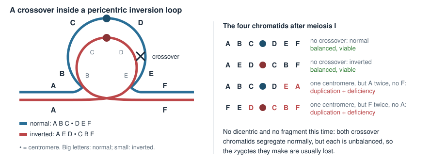{width="88%" fig-align="center"}

Same recipe, crossover between D and E. Normal piece with D (**A B C • D**) + inverted piece with E (**E A**) = **A B C • D E A**. Normal piece with E (**E F**) + inverted piece with D (**D • C B F**), joined where E meets D = **F E D • C B F**.

::: notes
This time the centromere is inside the loop, so it is drawn at the top, where the two centromeres pair. Apply the recipe and show that each crossover chromatid gets exactly one centromere: there is no bridge and no fragment, and both segregate normally at anaphase. But each is unbalanced: one has A twice and no F, the other F twice and no A, a duplication of one end and a deficiency of the other. Zygotes from such gametes usually die, or, if the duplicated and missing ends are small, can survive with an unbalanced karyotype; that is how some children of inv carriers are born with a "recombinant" chromosome. Compare with the paracentric case side by side: different products, same outcome for the offspring.
:::

## What inversions do to recombination

A worked example, with round numbers to show the logic:

- In an inversion heterozygote, suppose **40%** of meioses have one crossover inside the loop.
- Each such meiosis gives **2 of 4** unbalanced products (the crossover chromatids).
- Unbalanced gametes: 0.40 × ½ = **20%**. Viable gametes are all **non-crossover** chromatids.

Consequences:

- Among the surviving offspring, **no recombinants** for genes inside the inversion: recombination looks **suppressed**. Crossing over happens; its products die.
- **Reduced fertility** in heterozygotes, especially plants and males.
- **Balancer chromosomes** in *Drosophila* use this: several overlapping inversions, a dominant visible marker and a recessive lethal keep a mutation on the other homologue intact for generations.

::: notes
The 40 percent is not a measured value; it is there to show how the fractions combine. The general rule: the fraction of unbalanced gametes is half the fraction of meioses with a single crossover in the loop. Longer inversions have more crossovers inside them, so they cost more fertility. Double crossovers inside the loop can give viable recombinant products, which is why suppression is strong but not absolute. Balancers are the practical tool: because recombinants are not recovered, a lethal mutation kept over a balancer stays on its own chromosome, and the balancer's dominant marker tells you which flies carry it. Evolutionary biologists see the same thing in nature: an inversion keeps a block of alleles together, a "supergene".
:::

## Reciprocal translocations: step 1, pairing {.smaller}

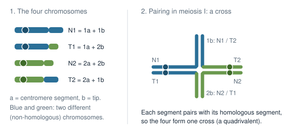{width="72%" fig-align="center"}

Name the segments: chromosome 1 = **1a** (with the centromere) + **1b** (the tip); chromosome 2 = **2a** + **2b**. The carrier has N1 = 1a·1b, N2 = 2a·2b, **T1 = 1a·2b** and **T2 = 2a·1b**: every segment exactly twice. A balanced carrier is usually healthy.

::: notes
Labelling segments is the trick that makes the rest mechanical. The carrier has two copies of every segment, so is balanced; but the segments sit on four different chromosomes, and none of them has a normal partner along its whole length. At meiosis I each segment pairs with its homologous segment: 1a of N1 with 1a of T1, 1b of N1 with 1b of T2, and so on. The only shape that satisfies all four pairings is a cross, called a quadrivalent. In real cells the cross often opens into a ring or a chain of four after chiasmata resolve, which is what you see at metaphase I.
:::

## Step 2: two of the four go to each pole {.smaller}

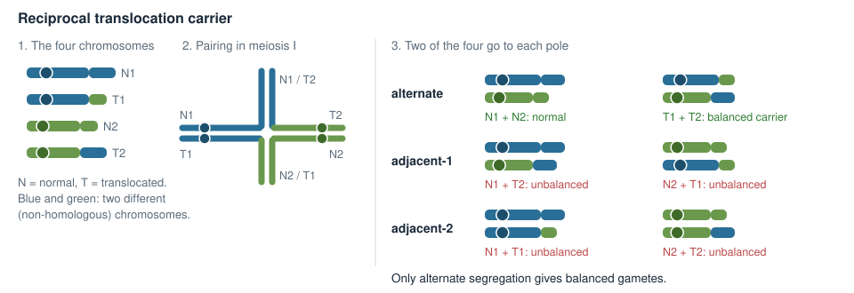{width="86%" fig-align="center"}

The four centromeres are shared out two and two. **Alternate**: N1 + N2 / T1 + T2. **Adjacent-1**: homologous centromeres go apart, N1 + T2 / N2 + T1. **Adjacent-2**: homologous centromeres go together, N1 + T1 / N2 + T2.

::: notes
The cross faces the spindle with its four centromeres. In alternate segregation the cross twists into a figure of eight so that the two normal chromosomes go one way and the two translocated ones the other. In adjacent-1, the neighbours in the cross go together, but homologous centromeres still go to opposite poles, which is what normally happens in meiosis I. Adjacent-2 sends homologous centromeres to the same pole; it is rarer. In plants this shows up as semisterility: about half of the pollen and ovules abort. In human carriers it shows up as recurrent miscarriage or a child with an unbalanced karyotype. Translocations also cause pseudolinkage: genes near the breakpoints on the two different chromosomes are inherited together, because only alternate gametes survive.
:::

## Step 3: count the segments

A gamete is **balanced** if it has every segment exactly **once**.

| Mode | Gamete | 1a | 1b | 2a | 2b | Result |
|---|---|:-:|:-:|:-:|:-:|---|
| alternate | N1 + N2 | 1 | 1 | 1 | 1 | balanced, **normal** |
| alternate | T1 + T2 | 1 | 1 | 1 | 1 | balanced, **carrier** |
| adjacent-1 | N1 + T2 | 1 | **2** | 1 | **0** | dup 1b, def 2b |
| adjacent-1 | N2 + T1 | 1 | **0** | 1 | **2** | dup 2b, def 1b |
| adjacent-2 | N1 + T1 | **2** | 1 | **0** | 1 | dup 1a, def 2a |
| adjacent-2 | N2 + T2 | **0** | 1 | **2** | 1 | dup 2a, def 1a |

- Only **alternate** gametes are balanced, and half of those carry the translocation on.
- Adjacent-1 products duplicate and lose **tips** (often small); adjacent-2 products duplicate and lose the large **centromeric** segments, so they are almost always lethal.

::: notes
This table is the whole logic of translocation carriers, and the same counting works for any rearrangement: add up the copies of each segment. Adjacent-1 is the source of most liveborn unbalanced children, because the duplicated and missing pieces are the translocated tips, which may be small. How often each mode happens is measured, not predicted from first principles; the R exercise simulates what happens if all six ways of choosing two of the four were equally likely, and the by-hand exercise asks what fraction would then be balanced. Real carriers usually do better, because alternate segregation is favoured and many unbalanced embryos are lost before a pregnancy is recognised.
:::

## Robertsonian translocations {.smaller}

Two **acrocentric** chromosomes (13, 14, 15, 21, 22) fuse at or near their centromeres. The long arms survive as one chromosome; the tiny short arms (repeats and rDNA) are lost without harm.

- A carrier has **45 chromosomes**, e.g. 45,XX,rob(14;21), and is healthy. About **1 in 1000** people carry a Robertsonian translocation.
- Their gametes, from a trivalent (14, 21, rob):

| Gamete | Zygote with a normal gamete | Outcome |
|---|---|---|
| 14 + 21 | 46, normal | healthy |
| rob(14;21) | 45, balanced carrier | healthy |
| rob(14;21) + 21 | 46, but **three copies of 21q** | **translocation Down syndrome** |
| 14 alone | monosomy 21 | lethal |
| rob(14;21) + 14 | trisomy 14 | lethal |
| 21 alone | monosomy 14 | lethal |

About **4%** of Down syndrome is translocation Down syndrome, and it can **recur** in a family.

::: notes
Students met acrocentric chromosomes last lecture; the five pairs carry the rDNA on their short arms, so losing two short arms is harmless. The trivalent in the carrier can send the three chromosomes to the poles in several ways; the table lists the six two-plus-one outcomes. Count segments as on the last slide: rob plus 21 gives 14q once and 21q twice in the gamete, so three copies in the child. The important clinical difference from ordinary trisomy 21: a translocation trisomy has 46 chromosomes, and one of the parents may be a carrier, so the recurrence risk is much higher than for free trisomy 21. Empirically, the risk of a child with Down syndrome is about 10 to 15 percent when the mother carries rob(14;21), and about 1 percent when the father does. A carrier of rob(21;21) can only make gametes with two copies of 21q or none, so every pregnancy that survives has Down syndrome. That is why a karyotype is done for every child with Down syndrome: it tells the family whether the risk can recur.
:::

## The Philadelphia chromosome {.smaller}

:::: {.columns}
::: {.column width="64%"}
**Chronic myeloid leukaemia (CML)**: in most patients, the leukaemic cells carry **t(9;22)(q34;q11)**.

- The small derivative chromosome 22, **der(22)**, is the **Philadelphia chromosome** (Nowell and Hungerford, 1960; shown to be a translocation by Janet Rowley in 1973).
- The breakpoints fall inside two genes: ***BCR*** on 22q11 and ***ABL1*** on 9q34. The joint makes a **fusion gene**, *BCR*::*ABL1*.
- The fusion protein is a tyrosine kinase that is **always on**, and drives the cells to divide.
- **Imatinib** (2001) blocks the kinase: one of the first drugs designed against the product of a specific mutation.

This is a **somatic** rearrangement in blood stem cells: it is not inherited.
:::
::: {.column width="36%"}
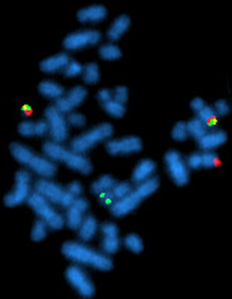{width="78%" fig-align="center"}

[Image: Pmx, CC BY-SA 3.0, via Wikimedia Commons](https://commons.wikimedia.org/wiki/File:Fish_2_fusion_signals.png){.photo-credit}

FISH on a metaphase with *BCR*::*ABL1*: a red and a green probe; where they sit together (yellow), the two genes are fused.
:::
::::

::: notes
This is the clearest case of a rearrangement whose effect comes from the breakpoint itself rather than from dosage. Neither BCR nor ABL1 alone is the problem; the fusion is a new gene, with the start of BCR (which makes it dimerise) and the kinase domain of ABL1 (which normally is tightly regulated). The modern notation BCR::ABL1 with a double colon means a fusion. The image is fluorescence in situ hybridisation: chromosomes stained blue, one probe for each gene. Normal chromosomes 9 and 22 show a single colour; the two derivative chromosomes, der(9) and der(22), each carry a joined red-and-green signal. The short one is the Philadelphia chromosome. FISH, or RT-PCR for the fusion transcript, is how CML is diagnosed and followed during treatment. Students look up both genes in NCBI Gene in the exercise; BCR lies only about 2 Mb from the 22q11.2 deletion region. Cancer genetics in Part 7 comes back to fusion genes and oncogenes.
:::

## Aneuploidy

:::: {.columns}
::: {.column width="48%"}
**Euploid**: whole sets of chromosomes (n, 2n, 3n…).

**Aneuploid**: one or a few chromosomes too many or too few:

- **monosomy** (2n − 1)
- **trisomy** (2n + 1)
- nullisomy (2n − 2), tetrasomy (2n + 2)

Most aneuploidy comes from **nondisjunction**: chromosomes that fail to separate in meiosis.

How would you write the karyotype on the right? (Count, then look at the sex chromosomes.)
:::
::: {.column width="52%"}
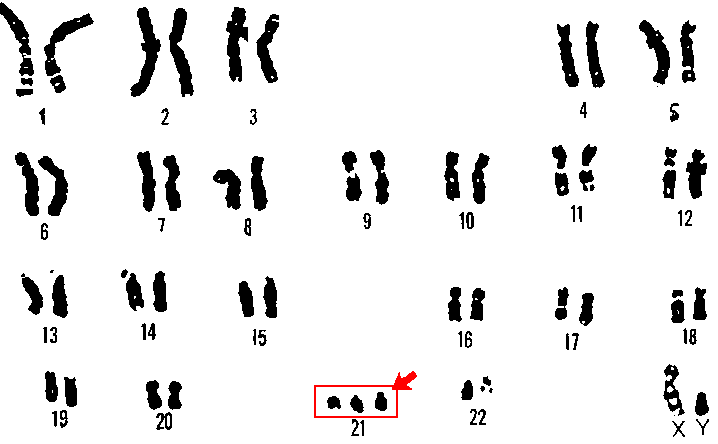{width="100%"}

[Image: U.S. Department of Energy Human Genome Program, public domain, via Wikimedia Commons](https://commons.wikimedia.org/wiki/File:21_trisomy_-_Down_syndrome.png){.photo-credit}

A karyotype with trisomy 21 (boxed).
:::
::::

::: notes
The terms first, then where aneuploidy comes from. Ask the class to count: 47 chromosomes, X and Y, three 21s, so 47,XY,+21. Trisomy is a whole-chromosome duplication; monosomy is a whole-chromosome deletion; dosage again. Polyploidy, at the end of the lecture, is a change of whole sets and is euploid. Note that "aneuploid" describes a cell or person; a gamete with an extra chromosome is n + 1, and it makes a 2n + 1 zygote.
:::

## Nondisjunction in meiosis I and II

| Error in | What fails to separate | Gametes from that meiosis |
|---|---|---|
| **Meiosis I** | the **homologues** | 2 × n + 1 (one copy from each grandparent), 2 × n − 1 |
| **Meiosis II** | the **sister chromatids** in one cell | 1 × n + 1 (two identical copies), 1 × n − 1, 2 × n |

A trisomic zygote from an MI error has **two different** homologues from that parent; one from an MII error has **two copies of the same** homologue (apart from crossovers). DNA markers near the centromere tell which division failed.

::: notes
Students met nondisjunction with Bridges' X chromosomes in Drosophila in Part 2; now we use it on autosomes and in humans. Count the gametes on the board, or use the demo on the next slide. Crossing over makes the MI/MII rule apply to centromere-near markers only, because a crossover can make the two sister chromatids differ further out. Mitotic nondisjunction after fertilisation gives mosaics, with normal and aneuploid cell lines side by side; about 1 to 2 percent of Down syndrome is mosaic.
:::

## Try it: nondisjunction in meiosis I and II {.smaller}

```{=html}
<link rel="stylesheet" href="../demos/dist/demo.css">
<div data-demo="meiosis" data-mode="nondisjunction" data-names="21,2" data-division="1"></div>
<script src="../demos/dist/meiosis.js"></script>
```

::: notes
Interactive demo from Part 2 (chromosome theory), here in its nondisjunction mode with two chromosome pairs, labelled 21 and 2; only chromosome 21 nondisjoins. Blue is the homologue this person got from their father, red the one from their mother. Step through with Next. In meiosis I mode, both homologues go to the same pole at anaphase I, and the four gametes are two with both a blue and a red 21 (labelled n + 1 = 3) and two with none (n − 1 = 1). Switch to meiosis II mode and step again: meiosis I is normal, then in one cell the sister chromatids stay together, giving one gamete with two identical copies, one with none and two normal ones. Ask: if this person is a woman and the egg with two 21s is fertilised by a normal sperm, which grandparent's chromosome 21 does the child carry in each case? Point out that chromosome 2 segregates normally, so each gamete is n + 1 or n − 1 for chromosome 21 only. The demo has no crossing over, which is a simplification.
:::

## Which parent, which division? A worked example

A short tandem repeat marker near the centromere of chromosome 21. Each number is an allele (repeat count).

| Family | Mother | Father | Child | Reasoning |
|----|-----|-----|-----|----------------------------------------|
| 1 | 5, 8 | 6, 9 | 5, 8, 9 | 9 is from the father; **5 and 8** are both from the mother: two **different** maternal homologues → **maternal MI** |
| 2 | 5, 8 | 6, 9 | 8, 8, 6 | 6 from the father; **8, 8** from the mother: two copies of **one** homologue → **maternal MII** |
| 3 | 5, 8 | 5, 9 | 5, 8, 9 | 8 must be maternal, 9 paternal, but 5 could be from either: **not informative** |

**The method.** (1) Assign each allele in the child to a parent. (2) The parent with two alleles in the child made the disomic gamete. (3) Different alleles = MI, same allele twice = MII. (4) If the parents share alleles, use more markers.

::: notes
These are invented allele numbers to show the method; the exercise has three families of its own. Step through each row slowly. Row 3 is the one students forget: when a parent's alleles overlap, a single marker cannot decide, so real studies type several markers along chromosome 21. Why near the centromere: a crossover in meiosis I can make the two sister chromatids differ further along the arm, so an MII error can look like MI at a distal marker, and vice versa. With markers like these, large studies found that about 90 percent of trisomy 21 is maternal, most of it from meiosis I, which leads to the maternal age effect in a few slides.
:::

## Human aneuploidies {.smaller}

| Karyotype | Name | Approximate frequency | Notes |
|---|---|---|---|
| 47,+21 | **Down syndrome** | ≈ 1 in 700 births without screening | the most common viable autosomal trisomy |
| 47,+18 | Edwards syndrome | ≈ 1 in 5000 births | most die in the first year |
| 47,+13 | Patau syndrome | ≈ 1 in 10 000 births | most die in the first year |
| 45,X | **Turner** syndrome | ≈ 1 in 2500 girls | ≈ 99% of 45,X conceptions miscarry |
| 47,XXY | **Klinefelter** syndrome | ≈ 1 in 600 boys | tall, infertile; often undiagnosed |
| 47,XYY | | ≈ 1 in 1000 boys | usually few signs |
| 47,XXX | triple X | ≈ 1 in 1000 girls | usually few signs |

- **No autosomal monosomy** survives to birth, and of the autosomal trisomies only 13, 18 and 21 (the chromosomes with the fewest genes) do.
- About **half** of first-trimester miscarriages are chromosomally abnormal; trisomy 16 is the most common, and is never born alive.
- Sex-chromosome aneuploidies are tolerated because **extra X chromosomes are inactivated**, and the Y carries few genes.

::: notes
The frequencies are rounded and vary between studies and with maternal age and prenatal screening; the point is the order of magnitude and the pattern. Gene dosage explains the pattern: chromosome 21 is one of the smallest and most gene-poor, so three copies are survivable; the gene-rich chromosomes are not. Chromosome 16 trisomy, the most common trisomy in miscarriages, shows how often aneuploid embryos form, and how strongly selection removes them; aneuploidy in human eggs is far more frequent than in most other species studied. For the sex chromosomes, X inactivation (Part 6) silences all but one X, so 47,XXY and 47,XXX are mild. Turner syndrome is the only viable monosomy, but even it is mostly lethal before birth: survivors are thought to be often mosaic.
:::

## Sex-chromosome aneuploidy: whose error?

The same reasoning, using what each parent can give:

| Karyotype | Possible origins | What we can say |
|---|---|---|
| 47,XYY | sperm **YY** | only the father has a Y, and two Ys are sister chromatids: **paternal meiosis II**, always |
| 47,XXY | sperm **XY** (father, MI), or egg **XX** (mother, MI or MII) | either parent; X-linked markers decide. Roughly half of cases are paternal |
| 47,XXX | egg **XX**, or sperm **XX** | mostly maternal |
| 45,X | sperm or egg with **no** sex chromosome, or loss after fertilisation | the single X is usually the **mother's**: the paternal sex chromosome is the one lost |

A father's XY sperm can only come from **meiosis I**, because X and Y are homologues that should separate there.

::: notes
This slide applies the logic of the last worked example to the sex chromosomes, where the Y makes some cases unambiguous. YY in a sperm means the two sister chromatids of the Y failed to separate in meiosis II. XY in a sperm means the X and Y, which pair at the pseudoautosomal regions and normally separate at anaphase I, went together. For XXY, both routes are common, which is why paternal age matters little and maternal age somewhat. For 45,X, typing X-linked markers shows that the remaining X is usually maternal, which is why Turner syndrome shows no maternal age effect, next slide. The exercise asks you to list the gametes and zygotes for each case.
:::

## The maternal age effect {.smaller}

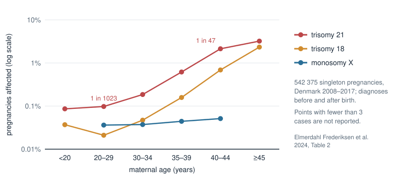{width="72%" fig-align="center"}

The risk of trisomy 21 is ≈ 1 in 1000 pregnancies for mothers aged 20–29 and ≈ 1 in 47 at 40–44. Monosomy X shows **no** such rise.

::: notes
The data are from a Danish nationwide registry of more than half a million pregnancies followed after first-trimester screening, including diagnoses made before birth, so the numbers are higher than live-birth figures (many affected pregnancies end in miscarriage or termination). On a log scale the trisomy 21 curve rises more than twenty-fold from the twenties to the early forties; trisomy 18 rises even more steeply. Monosomy X is flat: most 45,X cases have lost the paternal sex chromosome, so the mother's age does not matter. Triploidy, mostly from two sperm fertilising one egg, is flat too. The students reproduce this plot in R. Why the mother? About 90 percent of trisomy 21 is maternal in origin, most of it from meiosis I. Human oocytes enter meiosis I before the mother is born and stay arrested in prophase I, with homologues held together by crossovers and cohesin, for up to 50 years. The cohesin is not renewed, so it wears out with age, and the homologues come apart early or go to the same pole. Sperm are made continuously from stem cells, and paternal age has little effect on trisomy.
:::

## Polyploidy {.smaller}

**Polyploids** have three or more complete sets: triploid (3n), tetraploid (4n) and so on. Rare in animals, common in plants: much of our food is polyploid.

| Crop | Ploidy | Origin |
|---|---|---|
| Bread wheat | 6x = 42 (AABBDD) | **allo**polyploid: three ancestral species |
| Cotton, rapeseed | 4x | allopolyploid of two species |
| Potato | 4x = 48 | **auto**polyploid: doubled sets of one species |
| Cultivated strawberry | 8x = 56 | allopolyploid |
| Banana (Cavendish), seedless watermelon | **3x** | sterile triploids, seedless |

- **Autopolyploid**: extra sets from the same species. **Allopolyploid**: sets from two or more species, after hybridisation and chromosome doubling.
- Polyploids are often bigger (larger cells), and allopolyploids are fertile because each chromosome has a partner from its own species.

::: notes
Most flowering plants have a polyploid ancestor somewhere in their history. Bread wheat combines the genomes of three wild grasses, through two rounds of hybridisation and doubling; each of its 21 chromosome types comes in an A, a B and a D version, and they pair only with their exact partner, so meiosis works like a diploid's. Polyploidy can be induced with colchicine, which blocks the spindle so the chromosomes double without cell division. Seedless watermelons are made by crossing a tetraploid with a diploid: the triploid offspring are sterile, which is the point. In animals, polyploidy is rare, partly because it disturbs sex determination; triploid human conceptions occur in about 1 to 2 percent of pregnancies and miscarry. Farmed triploid oysters are sterile and put their energy into growth rather than spawning.
:::

## Why triploids are sterile {.smaller}

In a triploid, each chromosome has **three** homologues. At meiosis I, a trivalent sends **2** copies to one pole and **1** to the other, at random.

For each chromosome type, the gamete gets 1 or 2 copies with probability ½ each. With *x* chromosome types, a gamete is **balanced** (euploid: all 1 or all 2) with probability

$$P(\text{balanced}) = 2 \times \left(\tfrac{1}{2}\right)^x$$

| | *x* | *P*(balanced gamete) |
|---|---:|---:|
| a toy triploid | 3 | 2/8 = 0.25 |
| banana, 2n = 3x = 33 | 11 | 2/2048 ≈ 0.001 |
| triploid watermelon, 2n = 3x = 33 | 11 | ≈ 0.001 |

Almost every gamete is aneuploid, so triploids are (nearly) **sterile**. Bananas are propagated by cuttings.

::: notes
This is the product rule from Part 1 at work. Each trivalent is an independent event, so the probability that all x chromosome types happen to give one copy is one half to the power x, and the same for all giving two copies; add them. Do the toy case on the board: with three chromosome types there are eight equally likely combinations of 1s and 2s, and only 111 and 222 are balanced. With 11 chromosome types it is about one in a thousand, so seeds almost never form; the black specks in a banana are aborted ovules. The same calculation explains why autotetraploids have reduced fertility, and why allopolyploids, which pair as bivalents, do not. The R exercise checks the formula by simulation with rbinom and replicate. The assumption that the extra copy goes to either pole at random is a simplification; trivalents can also fall apart into a bivalent and an unpaired univalent, which makes things worse rather than better.
:::

## Check yourself: common mistakes

| Mistake | Better |
|---|---|
| "A balanced carrier makes balanced gametes." | The carrier is balanced; many of their **gametes** are not. |
| "Inversions stop crossing over." | Crossovers happen in the loop; their **products die**, so recombinants are not recovered. |
| "Pericentric inversions give dicentrics." | **Paracentric** → dicentric + acentric. **Pericentric** → one centromere each, but dup + def. |
| "inv(3)(q21q26) is pericentric because it is long." | Look at the **arms**: q and q = paracentric; p and q = pericentric. |
| "Down syndrome means 47 chromosomes." | Translocation Down syndrome has **46**; a rob carrier parent has **45**. |
| "Two maternal alleles in the child = MII." | Two **different** maternal alleles = MI; the **same** allele twice = MII (near the centromere). |
| "Polyploid and aneuploid are the same." | Polyploid = whole **extra sets** (euploid); aneuploid = single chromosomes. |

::: notes
Go through these as a quick quiz: read the left column and ask the room what is wrong before showing the right. Each line is a mistake that turns up in exam answers. The inversion and translocation lines are the reason for the step-by-step slides earlier; if students can write the products with the recipe and count segments, they will not make them.
:::

## Summary {.smaller}

| Concept | Key fact |
|---|---|
| Deletion / duplication | unbalanced; dosage effects; recurrent ones by NAHR between low-copy repeats (22q11.2, 7q11.23, 17p12) |
| Pseudodominance | a deletion uncovers a recessive allele on the other homologue: overlapping deletions map genes |
| Inversion | balanced; pairing makes a loop; crossover in the loop → dicentric + acentric (paracentric) or dup + def (pericentric); recombinants "suppressed" |
| Crossover products | normal piece with the gene before the crossover + partner's piece with the gene after it; check by counting |
| Reciprocal translocation | balanced carrier; quadrivalent; count segments: only alternate segregation gives balanced gametes |
| Robertsonian translocation | two acrocentrics fuse; carrier has 45 chromosomes; can give translocation Down syndrome |
| Philadelphia chromosome | t(9;22) in CML; *BCR*::*ABL1* fusion kinase; somatic |
| Nondisjunction | MI: n + 1 gametes carry both homologues; MII: two copies of one; centromere markers tell which |
| Trisomy 21 | ≈ 90% maternal, mostly MI; risk rises steeply with maternal age |
| Sex-chromosome aneuploidy | 45,X; 47,XXY; 47,XYY (always paternal MII); 47,XXX; tolerated thanks to X inactivation |
| Polyploidy | auto- and allopolyploids; triploids sterile: P(balanced) = 2 · (½)^*x*^ |

::: notes
The revision sheet. The common thread: balanced versus unbalanced. A balanced rearrangement is usually harmless for its carrier, but meiosis turns it into unbalanced gametes, so the problems show up as reduced fertility, miscarriages and affected children. Aneuploidy and polyploidy are the same principle at the level of whole chromosomes and whole sets.
:::

## Where this leads

- **Next: Bacterial genetics (recap).** A very different kind of chromosome: one circle, no meiosis, but genes moved between cells by conjugation, transduction and transformation.
- **Organelle inheritance.** Mitochondria have their own chromosome, inherited only through the egg, and their own kind of dosage: heteroplasmy.
- **Part 6: Eukaryotic regulation.** X inactivation, the dosage compensation that makes sex-chromosome aneuploidy survivable.
- **Part 7: Cancer genetics.** Fusion genes like *BCR*::*ABL1* and the loss of chromosome segments in tumours.
- **Ethics.** Prenatal screening for trisomies raises its own questions.

::: notes
Point forward. The exercise has pen-and-paper problems on karyotypes, deletion mapping, the products of inversion and translocation heterozygotes, nondisjunction, and the triploid formula; the meiosis demo in nondisjunction mode; database tasks on 22q11.2 deletion, Williams syndrome and BCR and ABL1. The R part plots the Danish maternal-age data on a log scale and simulates the gametes of a translocation carrier and a triploid.
:::
