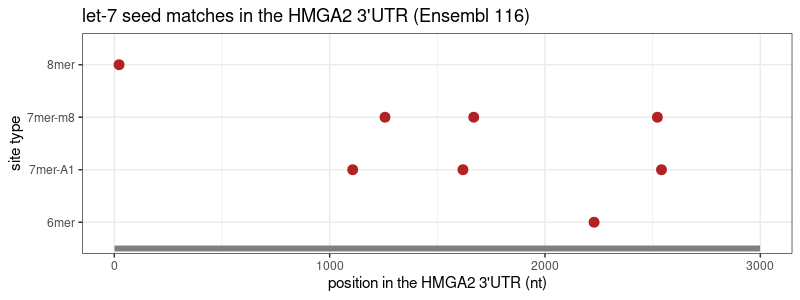

## Goal

By the end of this exercise you should be able to:

- read a sequence from a FASTA file and extract a miRNA **seed** with stringr;
- find every **seed match** in a 3′UTR with `str_locate_all()`, classify the sites with `case_when()`, and plot their positions;
- compare the number of sites with what **chance** predicts, and with control miRNAs.

## Before you start

This page builds on the by-hand part of the [Exercise](exercise.qmd), so do that first. You need the packages dplyr, stringr and ggplot2. Download [HMGA2_3UTR.fa](data/HMGA2_3UTR.fa) and save it in a `data/` folder of your R project. It is the 3′UTR of the human *HMGA2* canonical transcript (ENST00000403681.7) from **Ensembl release 116**, 2999 nt, downloaded on 2026-11-20; see the [data README](data/README.md) for how it was cut out. The miRNA sequences are from **miRBase release 23.1** and are typed into the code below.

```r
library(dplyr)
library(stringr)
library(ggplot2)
```

## Tasks

The R in this unit reuses idioms from Part 3 and Part 4: reading FASTA by hand, `chartr()` for complementing, and [`str_locate_all()`](https://stringr.tidyverse.org/reference/str_locate.html) for finding every match of a pattern. One new helper: [`case_when()`](https://dplyr.tidyverse.org/reference/case_when.html) from dplyr, a vectorised "if … else if … else" that gives each row the value of the **first** condition that is true.

**R1. (read the UTR)** Read the FASTA file with `readLines()`, keep the header, and paste the remaining lines into one string `utr`. How long is it? Print the first 60 nt.

**R2. (seed and site)** Store let-7a-5p (miRBase MIMAT0000062) as `let7a <- "UGAGGUAGUAGGUUGUAUAGUUU"`. Convert U to T so it matches the DNA in the file, take nt 2–8 with `str_sub()`, and write a function `revcomp()` that returns the reverse complement of a DNA string. What is the 7mer-m8 site?

```r
revcomp <- function(s) {
  # complement with chartr(), then reverse the letters
}
```

**R3. (find and classify the sites)** Use `str_locate_all()` to list every 7mer-m8 match. Then do a better job: find every match to the **6-nt core** (the site without its first letter: it pairs with nt 2–7), and for each one look at the base just **before** it (a C there pairs with nt 8) and just **after** it (an A there sits opposite nt 1). Use `case_when()` to label each site 8mer, 7mer-m8, 7mer-A1 or 6mer, and count the types. Compare with TargetScan's numbers from the Find it task.

```r
core6 <- str_sub(site7, 2)
hits <- tibble(start = str_locate_all(utr, core6)[[1]][, "start"]) |>
  mutate(before = str_sub(utr, start - 1, start - 1),
         after  = str_sub(utr, start + 6, start + 6),
         type   = case_when(...))
```

**R4. (plot)** Plot the sites along the UTR: position on the x axis, site type on the y axis, one point per site, and a grey bar for the UTR itself (`annotate("segment", ...)`). Are the sites clustered or spread out?

**R5. (chance and controls)** a) How many 7mer-m8 matches to one seed would you expect by chance in 2999 nt? And 6-nt matches? b) Write `seed_sites(mirna, utr)`, which returns the number of 7mer-m8 matches for a miRNA, and apply it with `sapply()` to let-7a, miR-1 (UGGAAUGUAAAGAAGUAUGUAU) and miR-21 (UAGCUUAUCAGACUGAUGUUGACU). What do the controls tell you?

## Solutions

::: {.callout-note collapse="true" title="Solutions: In R"}

**R1.**

```r
lines <- readLines("data/HMGA2_3UTR.fa")
lines[1]
```
```
[1] ">HMGA2_3UTR ENST00000403681.7 (HMGA2-204, canonical) 3'UTR, 2999 nt, Ensembl release 116, GRCh38; cut from the cDNA after the CDS stop codon; downloaded 2026-11-20 via rest.ensembl.org/sequence/id"
```
```r
utr <- paste(lines[-1], collapse = "")
nchar(utr)
```
```
[1] 2999
```
```r
str_sub(utr, 1, 60)
```
```
[1] "GGGGCGCCAACGTTCGATTTCTACCTCAGCAGCAGTTGGATCTTTTGAAGGGAGAAGACA"
```

You can already see a site by eye: CTACCTCA at positions 21–28.

**R2.**

```r
revcomp <- function(s) {
  paste(rev(strsplit(chartr("ACGT", "TGCA", s), "")[[1]]), collapse = "")
}
let7a <- "UGAGGUAGUAGGUUGUAUAGUUU"
let7a_dna <- chartr("U", "T", let7a)
seed <- str_sub(let7a_dna, 2, 8)
seed
```
```
[1] "GAGGTAG"
```
```r
site7 <- revcomp(seed)
site7
```
```
[1] "CTACCTC"
```

**R3.**

```r
str_locate_all(utr, site7)[[1]]
```
```
     start  end
[1,]    21   27
[2,]  1256 1262
[3,]  1668 1674
[4,]  2521 2527
```
```r
core6 <- str_sub(site7, 2)
core6
```
```
[1] "TACCTC"
```
```r
hits <- tibble(start = str_locate_all(utr, core6)[[1]][, "start"]) |>
  mutate(before = str_sub(utr, start - 1, start - 1),
         after  = str_sub(utr, start + 6, start + 6),
         type   = case_when(before == "C" & after == "A" ~ "8mer",
                            before == "C" ~ "7mer-m8",
                            after == "A" ~ "7mer-A1",
                            TRUE ~ "6mer"))
hits
```
```
# A tibble: 8 × 4
  start before after type
  <int> <chr>  <chr> <chr>
1    22 C      A     8mer
2  1107 T      A     7mer-A1
3  1257 C      T     7mer-m8
4  1619 G      A     7mer-A1
5  1669 C      C     7mer-m8
6  2228 A      T     6mer
7  2522 C      T     7mer-m8
8  2541 A      A     7mer-A1
```
```r
count(hits, type)
```
```
# A tibble: 4 × 2
  type        n
  <chr>   <int>
1 6mer        1
2 7mer-A1     3
3 7mer-m8     3
4 8mer        1
```

Eight seed matches: **1 8mer, 3 7mer-m8, 3 7mer-A1** and one 6mer. The first seven are exactly the seven conserved sites that TargetScan reports for *HMGA2* (F3); the 6mer at 2228 is the weakest type and TargetScan does not count it. Note that a simple search for the 7mer (the first command) finds only four sites, and counts the 8mer as a 7mer-m8: the core-plus-flanks approach classifies each site once. (`start` here is the position of the 6-nt core; a 7mer-m8 or 8mer starts one base earlier.)

**R4.**

```r
ggplot(hits, aes(x = start, y = type)) +
  annotate("segment", x = 1, xend = nchar(utr), y = 0.5, yend = 0.5, colour = "grey50", linewidth = 2) +
  geom_point(size = 3, colour = "firebrick") +
  scale_y_discrete(limits = c("6mer", "7mer-A1", "7mer-m8", "8mer")) +
  labs(x = "position in the HMGA2 3'UTR (nt)", y = "site type",
       title = "let-7 seed matches in the HMGA2 3'UTR (Ensembl 116)") +
  theme_bw()
```

{width="80%" fig-align="center"}

The sites are spread over the whole UTR: one 8mer right at the start (just 20 nt after the stop codon), then sites at 1107 and 1257, a pair 50 nt apart (1619, 1669), the lone 6mer at 2228, and a close pair at 2522 and 2541. Sites that lie close together (roughly 10–40 nt apart) can act cooperatively, so the pair at the end may count for more than two separate sites.

**R5.**

```r
L <- nchar(utr)
c(expected7 = (L - 6) / 4^7, expected6 = (L - 5) / 4^6)
```
```
expected7 expected6
0.1826782 0.7309570
```
```r
seed_sites <- function(mirna, utr) {
  seed <- str_sub(chartr("U", "T", mirna), 2, 8)
  str_count(utr, revcomp(seed))
}
mirnas <- c(let7a = "UGAGGUAGUAGGUUGUAUAGUUU",
            miR1  = "UGGAAUGUAAAGAAGUAUGUAU",
            miR21 = "UAGCUUAUCAGACUGAUGUUGACU")
sapply(mirnas, seed_sites, utr = utr)
```
```
let7a  miR1 miR21
    4     0     0
```

a) By chance we expect about **0.18** 7mer-m8 matches and **0.73** 6mer matches to one given seed in 2999 nt. *HMGA2* has 4 7mer-m8 matches (expected 0.18) and 8 6-nt core matches (expected 0.73): about 20 and 11 times more than chance. b) The two control miRNAs have **no** 7mer-m8 site in this UTR, as you would expect by chance. So the *let-7* sites are not a property of the UTR's base composition: *HMGA2* has been selected to carry many *let-7* sites. (A stricter control would shuffle the UTR many times, keeping its base composition, and count *let-7* sites each time.)
:::

## Where this leads

In **Development & model organisms** you go from one gene to many species: you join an ortholog table to a gene list with `left_join()` and draw a presence/absence heat map of developmental genes across yeast, worm, fly, fish and mouse.
