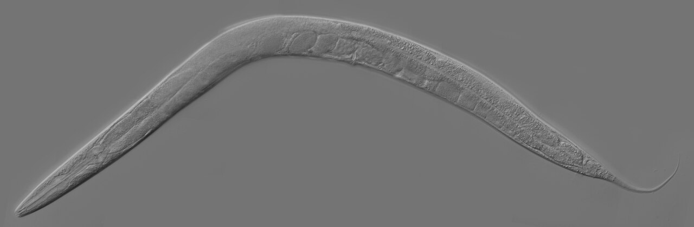
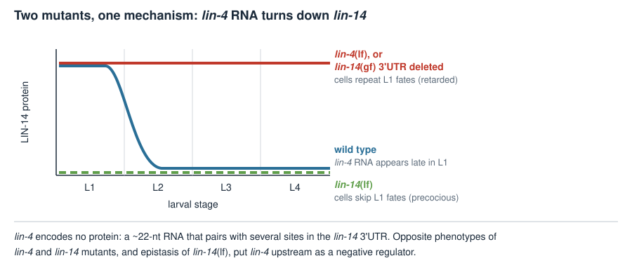
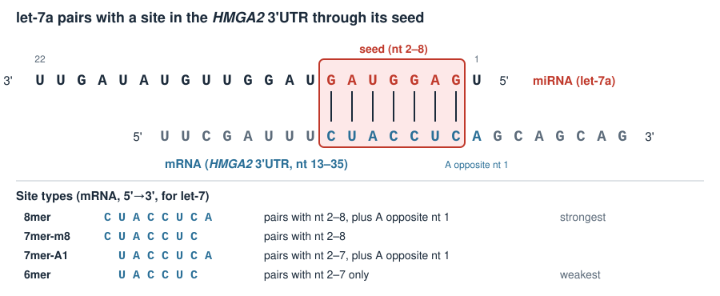

## About this lecture

Transcription is not the last word. Small RNAs, about 22 nucleotides long, pair with mRNAs and turn them down. They were found twice: once by **geneticists** studying worm larvae that developed at the wrong pace, and once by researchers trying to switch genes off with antisense RNA.

- **lin-4 and let-7**: how a genetic screen found the first microRNAs, and how to read its genetics.
- **RNA interference** (RNAi): double-stranded RNA silences genes.
- **miRNA biogenesis**: Drosha, Dicer, RISC.
- **Seed matching**: from a miRNA to its target site, step by step; site types; how often sites occur by chance.
- **siRNA vs miRNA**; designing an siRNA; **long non-coding RNAs** such as *XIST*.
- **RNAi as a lab tool** for reverse genetics, and how to interpret it.

Book: Hartwell, *Genetics: From Genes to Genomes*, the chapter on RNA-based regulation (non-coding RNAs).

::: notes
The unit has a genetics story at its centre: the lin-4 and lin-14 mutants of C. elegans, analysed with the same tools as the lac mutants (dominance, gain and loss of function, epistasis). The mechanism then comes from biochemistry, and the practical payoff is RNAi as a tool, which leads into reverse genetics in the next unit. In the middle we do the sequence work by hand, seed to site, because the exercise and the R page depend on it. The R exercise finds let-7 seed matches in the HMGA2 3'UTR, a real oncology example.
:::

## A post-transcriptional layer {.smaller}

| RNA | Size | Made from | Acts on | Effect |
|---|---|---|---|---|
| **miRNA** | ~22 nt | its own gene (hairpin) | many mRNAs, partial pairing via the **seed** | less translation, mRNA decay |
| **siRNA** | ~21 nt | long double-stranded RNA (virus, transposon, or the experimenter) | mRNAs with **perfect** complementarity | cleavage of the target |
| **piRNA** | 24–31 nt | piRNA clusters, germ line | transposon RNAs | silences transposons in the germ line |
| **lncRNA** | > 200 nt | its own gene | chromatin, other RNAs, proteins | many; e.g. *XIST* silences an X |

Humans have about two thousand miRNA genes in miRBase; a typical miRNA has hundreds of predicted targets, and most human mRNAs carry at least one conserved miRNA site.

::: notes
Give students the map before the details. The rule of thumb: siRNAs come from long double-stranded RNA and pair perfectly, so they cut their target. miRNAs come from the genome's own hairpins and pair imperfectly, mainly through the seed, so they turn many targets down a little each. piRNAs protect the germ line against transposons; we mention them only for completeness. lncRNAs are a heterogeneous group defined by length and lack of protein-coding potential; XIST from the last unit is the best understood one. The numbers are deliberately rough: miRBase's count changes between releases and many annotated miRNAs are doubtful.
:::

## A genetic screen in a worm {.smaller}

{width="62%" fig-align="center"}

[Photo: Zeynep F. Altun (WormAtlas), CC BY-SA 2.5, via Wikimedia Commons](https://commons.wikimedia.org/wiki/File:Adult_Caenorhabditis_elegans.jpg){.photo-credit}

*C. elegans* is about 1 mm long and transparent, so every cell can be followed under the microscope. Each cell division in the larva happens at a fixed **stage** (L1 to L4, then adult). **Heterochronic** mutants do the right things at the **wrong time**:

- ***lin-4*(lf)**: cells **repeat** L1-type divisions in later stages (**retarded**). Recessive.
- ***lin-14*(lf)**: cells **skip** L1 fates and jump ahead (**precocious**): the **opposite** phenotype.
- ***lin-14*(gf)**: dominant alleles that look like *lin-4*(lf). They **delete part of the *lin-14* 3′UTR**; the protein is normal.

::: notes
The photo is an adult hermaphrodite seen with differential interference contrast: you can see the pharynx at the left, the gut and the eggs. Because the cell lineage is known (next unit), a heterochronic phenotype can be scored cell by cell: does this seam cell divide like an L1 cell or like an L2 cell? Opposite phenotypes suggest opposite roles. Keep the dominance pattern in mind: two recessive losses of function and one dominant allele that maps to a non-coding part of the gene. Ask the class which lac allele the lin-14 gf alleles remind them of. Answer: Oc.
:::

## Reading the heterochronic genetics

| Genotype | LIN-14 protein after L1 | Phenotype |
|---|---|---|
| wild type | **low** (turned down when *lin-4* RNA appears) | normal timing |
| *lin-4*(lf) | stays **high** | retarded: repeats L1 fates |
| *lin-14*(lf) | **none**, even in L1 | precocious: skips L1 fates |
| *lin-14*(gf), 3′UTR deleted | stays **high** | retarded |
| *lin-4*(lf); *lin-14*(lf) | **none** | precocious, like *lin-14*(lf) |

- **Epistasis:** opposite single-mutant phenotypes, and the double looks like *lin-14*. So *lin-14* acts **downstream**, and *lin-4* is a **negative regulator** of *lin-14*: *lin-4* ⊣ *lin-14* → L1 fates.
- **Dominance:** *lin-14*(gf) escapes regulation on **its own** mRNA, whatever the other allele does: dominant and **cis-acting**, like *O*^c^. One copy of *lin-4* makes enough RNA to act on both *lin-14* alleles **in trans**.

::: notes
This is the same reasoning as in the Extensions to Mendel and lac units. The table makes the logic explicit: the phenotype follows the level of LIN-14 protein after L1. High LIN-14 means "still L1": retarded. No LIN-14 means "L1 is already over": precocious. The double mutant cannot have high LIN-14, because it has no working lin-14 gene; so it is precocious. That puts lin-14 downstream. The rule from Extensions to Mendel: when single mutants have opposite phenotypes, the double mutant shows the phenotype of the downstream gene. The exercise asks you to apply this to heterozygotes as well.
:::

## *lin-4* is a small RNA

:::: {.columns}
::: {.column width="68%"}
In 1993 the **Ambros** and **Ruvkun** labs cloned *lin-4* and found that it **makes no protein**: only a ~22-nt RNA.

- The *lin-4* RNA is **partly complementary** to repeated sites in the *lin-14* **3′UTR**: exactly the region deleted in the dominant *lin-14*(gf) alleles.
- LIN-14 **protein** falls in late L1, while *lin-14* **mRNA** stays much the same: regulation **after transcription**.
- For seven years this looked like a worm curiosity. Nobel Prize 2024.
:::
::: {.column width="16%"}
{width="100%"}

[Photo: Arthur Petron, CC BY-SA 4.0, via Wikimedia Commons](https://commons.wikimedia.org/wiki/File:Victor_Ambros,_2024_Nobel_Prize_Laureate_in_Medicine_(cropped).jpg){.photo-credit}
:::
::: {.column width="16%"}
{width="100%"}

[Photo: John Sears, CC BY-SA 4.0, via Wikimedia Commons](https://commons.wikimedia.org/wiki/File:Gary_Ruvkun,_2024_Nobel_Prize_Laureate_in_Medicine_4_(cropped_3x4).jpg){.photo-credit}
:::
::::

::: notes
Victor Ambros (left photo) and Gary Ruvkun (right photo), at the Nobel week in Stockholm in 2024. When Victor Ambros' lab cloned lin-4, they found no open reading frame, only a 22-nt and a 61-nt RNA (the mature miRNA and its hairpin precursor). Gary Ruvkun's lab showed that the lin-14 3'UTR has sites complementary to lin-4, and that the 3'UTR is enough to put a reporter gene under lin-4 control. The genetics had already predicted that the 3'UTR contains a cis-acting site through which lin-4 acts; the molecular result confirmed it.
:::

## *lin-4* turns down *lin-14* {.smaller}

{width="72%" fig-align="center"}

The *lin-14* 3′UTR is a **cis-acting** element, like *lacO*: deleting it makes the gene escape regulation, dominantly. The *lin-4* RNA is the **trans-acting** factor.

::: notes
Walk through the curves. In the wild type, LIN-14 protein is high in L1 and falls when lin-4 RNA appears late in L1, although lin-14 mRNA levels stay much the same. That is post-transcriptional regulation: same mRNA, less protein. Without lin-4, or without the sites in the lin-14 3'UTR, LIN-14 stays high, and the cells think they are still in L1. Without lin-14, cells act as if L1 were already over. Ask: why is lin-14(gf) dominant while lin-4(lf) is recessive? Because the gf allele's own mRNA escapes regulation in cis, regardless of the other allele; while one copy of lin-4 makes enough RNA to regulate both lin-14 alleles in trans.
:::

## *let-7*: the first conserved microRNA

In 2000, *let-7* was found by the same kind of screen: another heterochronic gene, again a ~22-nt RNA, acting on the 3′UTRs of later-stage regulators (*lin-41*, *hbl-1*).

- *let-7* turned out to be **conserved**: the mature *let-7* of worms, flies and humans is **identical** over its first 22 nucleotides, and it is expressed at the same transition, from larval/embryonic to adult fates.
- Suddenly small regulatory RNAs were not a worm oddity. Cloning projects found hundreds in animals and plants: they were named **microRNAs**.
- Human *let-7* targets include *HMGA2*, *LIN28B* and *RAS* genes; *let-7* is often low in tumours, and *HMGA2* is a growth-promoting oncogene.

::: notes
The conservation result is what changed the field. Pasquinelli and colleagues showed that the let-7 RNA sequence is identical in many bilaterian animals, including humans, and that its expression is timed with the larval-to-adult switch in worms and flies. In the Find it task students compare worm and human let-7 in miRBase and see this for themselves. The human connection: LIN28 binds let-7 precursors and blocks their processing, while let-7 represses LIN28: a double-negative loop that keeps stem cells young or lets them mature. HMGA2 has seven let-7 sites in its 3'UTR, which students count in R.
:::

## RNA interference

Fire, Mello and colleagues (1998) injected RNA into worms to silence the *unc-22* gene (loss of *unc-22* makes worms **twitch**):

| Injected RNA | Silencing |
|---|---|
| sense strand | weak |
| antisense strand | weak |
| **double-stranded RNA** | **strong**, with only a few molecules per cell, spreading through the body and into the progeny |

Double-stranded RNA is cut by **Dicer** into ~21-nt **siRNAs**; one strand guides **Argonaute** (in RISC) to cut any mRNA that matches **perfectly**. Natural roles: defence against viruses and transposons. (Nobel Prize 2006.)

::: notes
The surprise in the 1998 paper was that the earlier antisense experiments worked because the antisense preparations were contaminated with some double-stranded RNA. Only a few molecules of dsRNA per cell were enough: catalytic, not stoichiometric. The twitching phenotype made the readout easy: you could score silencing by watching the worms move. In worms the silencing signal is amplified by RNA-dependent RNA polymerases and spreads between cells and even to the next generation. Plants had shown the effect earlier as "co-suppression": adding extra copies of a petunia pigment gene made some flowers white instead of darker purple. The shared machinery between RNAi and miRNAs is Dicer and Argonaute.
:::

## How a microRNA is made {.smaller}

{width="76%" fig-align="center"}

**Drosha** cuts the hairpin out in the nucleus; **Dicer** cuts off the loop in the cytoplasm; the guide strand goes into **Argonaute** (RISC). siRNAs use the same Dicer and Argonaute, but start from long double-stranded RNA.

::: notes
Keep it to the names and the order. Drosha with its partner DGCR8 is the nuclear processor; Exportin-5 carries the pre-miRNA out; Dicer makes the duplex; one strand, the guide, is kept, usually the one whose 5' end is less tightly paired. The guide is the mature miRNA you see in miRBase, named 5p or 3p after the arm of the hairpin it comes from, for example hsa-let-7a-5p. Genetic note: Dicer mutant mice die early in development, and Dicer mutant worms are sterile with heterochronic defects: the miRNA pathway is essential.
:::

## Seed matching {.smaller}

{width="66%" fig-align="center"}

Animal miRNAs find targets mainly through the **seed**, nucleotides **2–8** from the 5′ end. A target site in the mRNA (usually the 3′UTR) is the **reverse complement** of the seed, sometimes with an A opposite nucleotide 1.

::: notes
Read the figure: let-7a is drawn 3' to 5' so it lines up antiparallel with the mRNA. The seed GAGGUAG (nt 2 to 8) pairs with CUACCUC in the mRNA, followed by an A opposite nt 1: an 8mer, the strongest site type. This is the real site at UTR positions 21 to 28 of HMGA2, the first of the seven let-7 sites. The rest of the miRNA pairs only partly, which is why one miRNA can regulate hundreds of mRNAs. TargetScan, which students use in the Find it task, ranks targets by site type, number of sites, and whether the sites are conserved across species.
:::

## From seed to site, step by step

Worked example: human **let-7a-5p**, written 5′→3′.

```
miRNA      5'-U GAGGUAG UAGGUUGUAUAGUUU-3'
position      1 2345678
seed          GAGGUAG            (nt 2-8)
complement    CUCCAUC            (A<->U, G<->C, same order)
reverse       CUACCUC            (read backwards: now 5'->3')
site in mRNA  5'-...CUACCUC...-3'   7mer-m8
              5'-...CUACCUCA...-3'  8mer (plus an A opposite nt 1)
```

1. Count from **1** at the 5′ end; the seed starts at **2**.
2. **Complement** each base (in RNA: A↔U, G↔C).
3. **Reverse** it, so that the site is written 5′→3′ like the mRNA.

::: notes
Do this on the board and have the class do it with you. The reverse step is where most errors come from: the complement alone, CUCCAUC, is written 3' to 5', and you will not find it in an mRNA sequence written the normal way. Check the result by lining the two up antiparallel, as in the figure on the previous slide. In the exercise students do this for miR-21, miR-1 and lin-4; in R they write a revcomp function that does steps 2 and 3. If the UTR sequence comes as DNA, as in a FASTA file from Ensembl, write T instead of U.
:::

## Four kinds of site

| Site | mRNA pairs with | Example for *let-7* (seed GAGGUAG) | Strength |
|---|---|---|---|
| **8mer** | nt 2–8, plus an A opposite nt 1 | CUACCUC**A** | strongest |
| **7mer-m8** | nt 2–8 | CUACCUC | strong |
| **7mer-A1** | nt 2–7, plus an A opposite nt 1 | UACCUC**A** | weaker |
| **6mer** | nt 2–7 only | UACCUC | marginal |

- All four share the **6-nt core** that pairs with nt 2–7 (here UACCUC).
- To classify a match, look at the base **before** the core (a **C** pairs with nt 8) and the base **after** it (an **A** sits opposite nt 1).
- The A opposite nt 1 does not base-pair; Argonaute has a pocket that prefers an A there.

::: notes
This is the classification that TargetScan uses, and the R exercise implements it with case_when: find the 6-nt core, then look one base to the left (5') and one to the right (3'). The base before the core in the mRNA pairs with nucleotide 8 of the miRNA, because the strands are antiparallel. Strength here means the average size of the repression effect measured on many targets; the ranking 8mer > 7mer-m8 > 7mer-A1 > 6mer is robust, but the effect of one site on one gene is usually modest, often less than twofold.
:::

## How often does a site turn up by chance?

A site is a fixed word of *k* nucleotides. In random sequence with equal base frequencies, a given word occurs about once every **4^*k*^** nucleotides.

| Site length | Chance of a match at one position | Expected per 1000 nt of 3′UTR |
|---|---|---|
| 6 nt | 1/4^6^ = 1/4096 | ≈ 0.24 |
| 7 nt | 1/4^7^ = 1/16 384 | ≈ 0.06 |
| 8 nt | 1/4^8^ = 1/65 536 | ≈ 0.015 |

- An mRNA is **single-stranded**: count **one** strand only (for a transcription-factor motif in DNA you count both).
- Over thousands of genes, chance alone gives **many** matches per miRNA. A single 7-nt match means little.
- More convincing: a **conserved** site, **several** sites in one UTR, a stronger site type, and miRNA and mRNA made in the **same cells**.

::: notes
Work the middle row out loud: 4 to the power 7 is 16384, so in 1000 nucleotides you expect 1000 divided by 16384, about 0.06 matches. Scale it up yourself for a whole UTR or a whole transcriptome; the exercise asks you to. The strand point is a nice contrast with the motif counting in the Eukaryotic regulation unit: a transcription factor reads double-stranded DNA, so a motif can be on either strand, while a miRNA reads the mRNA, which has only one sequence. HMGA2 has seven conserved let-7 sites in about 3 kb, far more than chance predicts: that is why it is a believable target.
:::

## Check yourself: seeds and sites

Answers in the notes.

1. A miRNA starts 5′-UAAGGCACGCGG…-3′. What is its seed, and what is its 7mer-m8 site?
2. A student writes the *let-7* site as **CUCCAUC**. What went wrong?
3. In a 3′UTR you find 5′-…G**UACCUC**A…-3′. Which kind of *let-7* site is this?
4. Why is one 7-nt match in a long 3′UTR weak evidence that the gene is a target?

::: notes
Answers. 1: This is the start of miR-124 (UAAGGCACGCGGUGAAUGCC). Seed nt 2-8: AAGGCAC. Complement: UUCCGUG. Reverse: GUGCCUU. The 7mer-m8 site is GUGCCUU. 2: The student complemented but did not reverse; CUCCAUC is the site written 3' to 5'. The correct site, 5' to 3', is CUACCUC. 3: The core UACCUC is preceded by G, not C, so nt 8 is not paired; it is followed by A, opposite nt 1: a 7mer-A1. 4: A 7-nt word turns up about once every 16 kb by chance, so across many genes there are many chance matches; you want conservation, several sites, a strong site type, or expression in the same cells.
:::

## siRNA vs miRNA

| | siRNA | miRNA |
|---|---|---|
| Source | long dsRNA (virus, transposon, experiment) | genome-encoded hairpin |
| Processing | Dicer | Drosha, then Dicer |
| Pairing with target | full length, perfect | mostly the seed (nt 2–8) |
| Typical outcome | target mRNA **cut** by Argonaute | translation down, mRNA decay |
| Targets per small RNA | one (the matching gene) | hundreds |
| Natural role | defence (viruses, transposons) | gene regulation, development |
| As a lab tool | knock down a chosen gene | — (but siRNAs can act like miRNAs: **off-target** effects via their seed) |

::: notes
The last row is the practical warning: an siRNA designed against one gene also has a seed, and it can turn down hundreds of other mRNAs that happen to carry a seed match. That is the main source of off-target effects in RNAi screens. The standard control is to use two or more siRNAs with different sequences against the same gene: a real phenotype should be reproduced by all of them; an off-target phenotype will not.
:::

## Designing an siRNA

The **guide** (antisense) strand must pair perfectly with the target mRNA, so it is the target's **reverse complement**. Worked example with a made-up 19-nt target stretch:

```
target mRNA   5'-GAUCCAGUUCGAAGCAUCU-3'
complement       CUAGGUCAAGCUUCGUAGA      (3'->5')
guide strand  5'-AGAUGCUUCGAACUGGAUC-3'   (reversed)
guide seed        GAUGCUU                 (nt 2-8)
off-target site   AAGCAUC                 (any mRNA with this 7-mer)
```

- The guide **cuts** the intended mRNA, which matches all 19 nt.
- Its **seed** can also pair, miRNA-style, with any 3′UTR that has the seed's site: **off-target** knockdown of many genes, each a little.

::: notes
Go through the lines. The guide is the reverse complement of the target, just like a miRNA site is the reverse complement of the seed, but here over the whole length. Then treat the guide as if it were a miRNA: its nucleotides 2 to 8 are a seed, and the reverse complement of that seed is a 7-nt site that will occur by chance in many 3'UTRs. Check: the off-target site AAGCAUC also occurs in the target itself, of course, near its 3' end. The sequence is made up for teaching; real design tools also avoid seeds that match many UTRs and check the whole guide against the transcriptome. The exercise has a design problem of the same kind with a different sequence.
:::

## Regulatory RNA in genetics and disease

- **Target-site mutations act in cis.** Chromosomal rearrangements in benign tumours (e.g. lipomas) cut *HMGA2* off from its 3′UTR. The truncated mRNA loses its seven *let-7* sites, escapes repression, and makes too much protein: a **dominant gain of function**, like *lin-14*(gf).
- **miRNA mutations act in trans.** A point mutation in the **seed** of *MIR96* causes dominant progressive **hearing loss** in humans (and in the *diminuendo* mouse). The mutant miRNA loses its normal targets and gains new ones.
- **The miRNA pathway is a drug target.** Patisiran, an siRNA drug approved in 2018, silences the *TTR* gene in hereditary transthyretin amyloidosis.

::: notes
Three examples, one for each of: cis-acting sites, trans-acting regulators, and therapy. HMGA2: in many lipomas and other tumours a translocation breaks HMGA2 between its coding exons and the 3'UTR; the fused or truncated mRNA lacks the let-7 sites, and experiments showed that the loss of let-7 regulation alone is enough to make HMGA2 oncogenic (Mayr, Hemann and Bartel, 2007). MIR96: the mutations are in the seed and act dominantly, because the mutant miRNA from one allele is a new, wrong regulator in the hair cells. Patisiran is delivered in lipid nanoparticles to the liver, which makes most TTR; it is a direct application of the 1998 RNAi discovery.
:::

## miRNA genes: dominance and redundancy

- **Loss of one copy** of a miRNA gene is usually **recessive**: the other copy makes enough RNA to act on all targets in trans.
- A **seed mutation** can be **dominant**: the mutant miRNA from one allele stops repressing its old targets **and** represses new ones (*MIR96*).
- Many miRNAs come in **families** that share a seed (the *let-7* family: let-7a to let-7i and miR-98 in humans). Members target the **same** sites, so they can **cover for each other**.
- So deleting one miRNA gene often gives **no visible phenotype**: in *C. elegans*, most miRNA genes deleted one at a time showed no obvious defect (Miska et al., 2007). Removing the whole family does.

This is **genetic redundancy**, as with the duplicate genes behind a 15 : 1 ratio (Extensions to Mendel).

::: notes
The dominance pattern of miRNA genes follows the same logic as transcription-factor genes: loss of function is usually recessive, but a change in what the product recognises can be dominant, because it creates a new wrong function. The family point explains a surprise from the early knockout work: Miska and colleagues deleted most known worm miRNAs one by one and found that most individual deletions had no obvious developmental or viability defect. Many of those miRNAs turned out to be needed when combined with other mutations or under stress, or when the whole family was removed. lin-4 and let-7 are the exceptions that let the screens find them. Link forward to the next unit: redundancy is the main reason a reverse-genetics knockout can show no phenotype.
:::

## Long non-coding RNAs

**lncRNAs** are transcripts longer than 200 nt that do not encode a protein. Some work **in cis**, on the chromosome they are made from; others **in trans**.

- ***XIST*** (from the last unit): made from the X that will be silenced; coats that X **in cis** and recruits silencing complexes. Deleting *XIST* on one X means that X cannot be inactivated.
- Many lncRNAs act as scaffolds for chromatin complexes, or as decoys that soak up miRNAs or proteins.
- Many more are **transcribed but of unknown function**. Genetics is the test: does deleting it, or its promoter, change a phenotype?

::: notes
Keep the lncRNA part short and honest: there are tens of thousands of annotated lncRNA genes, and for most we do not know if the RNA itself does anything. Some act through the act of transcription, not through the RNA. XIST is the clearest case and links back. The cis/trans question applies again: XIST acts only on the chromosome it comes from, which can be shown genetically by putting an XIST transgene on an autosome: that autosome becomes silenced.
:::

## RNAi as a tool for reverse genetics

**Forward genetics** goes from a phenotype to the gene. **Reverse genetics** starts from a gene and asks: what happens if I remove it? RNAi made this easy.

- **Worms**: feed them *E. coli* that make dsRNA against a gene. A library covering about 86 % of predicted *C. elegans* genes allowed **genome-wide RNAi screens** (2003).
- **Flies**: transgenic hairpin RNAs (often combined with tissue-specific GAL4 drivers, next unit).
- **Mammalian cells**: transfect siRNAs or express shRNAs.

Today **CRISPR–Cas9 knockouts** are often preferred, but RNAi remains useful for genes whose knockout is lethal, and for tuning dosage.

::: notes
This bridges to Development and model organisms. The worm feeding library (Kamath and colleagues, Ahringer lab, 2003) was one of the first genome-wide reverse-genetic screens in an animal. Feeding works because worms take up dsRNA from the gut and spread it through the body, the same spreading seen in the 1998 injection experiments. In mammalian cells long dsRNA triggers an interferon response, so 21-nt siRNAs are delivered directly instead.
:::

## Interpreting an RNAi phenotype

| | RNAi knockdown | Mutant allele (e.g. CRISPR null) |
|---|---|---|
| What it changes | the **mRNA**, in trans, all copies at once | the **gene**, one allele at a time |
| Strength | partial: a **hypomorph**; varies between cells and experiments | can be a clean **null** |
| Lethal genes | can still study later roles | null may die early |
| Complementation test | **not possible**: there is no allele to put in trans | possible |
| Main pitfall | **off-target** effects through the seed | linked background mutations |

**Controls** for an RNAi result: two or more **independent** siRNAs against the same gene; show that the target mRNA or protein went down; **rescue** with a version of the gene that the siRNA cannot match (silent changes in the target site).

::: notes
Genetically, an RNAi phenotype is like a hypomorphic allele: partial loss of function. That has advantages (you can see phenotypes for genes whose null alleles die early) and disadvantages (a weak knockdown can miss a phenotype). The complementation point is subtle and is asked in the exercise: complementation needs two mutations in the same organism, one on each homologue, to see whether they restore function together. A knockdown acts on all copies of the mRNA, so there is nothing to test it against. The rescue control is the strongest: if a version of the gene that the siRNA cannot touch restores the phenotype, the phenotype was due to that gene.
:::

## Common mistakes

- **Counting the seed from 0, or from nt 1.** The seed is nt **2–8**; nt 1 is not part of it.
- **Complementing without reversing.** A site written 5′→3′ is the **reverse** complement of the seed.
- **Mixing DNA and RNA letters.** A UTR from a FASTA file has **T**; a miRNA in miRBase has **U**.
- **Counting both strands for a miRNA site.** The mRNA is single-stranded.
- **"An siRNA hits only its target."** Its seed can act on hundreds of mRNAs.
- **"A miRNA mutation must be recessive."** Seed mutations can be dominant (*MIR96*); site deletions in the target are dominant and cis (*lin-14*(gf), *HMGA2*).
- **"No knockout phenotype means no function."** Family members with the same seed may cover for it.

::: notes
These are the errors that appear most often in the exercise and on exams. Ask the class to give an example of each from the lecture. The cis/trans point ties the whole of Part 6 together: sites act in cis and are often dominant when lost; regulators act in trans, and their loss of function is usually recessive.
:::

## Summary {.smaller}

| Concept | Key fact |
|---|---|
| *lin-4* / *lin-14* | first miRNA (1993); *lin-14*(gf) = 3′UTR deletions, dominant, cis; *lin-4* acts in trans; *lin-14* epistatic |
| *let-7* | first conserved miRNA (2000); identical in worm and human |
| RNAi | dsRNA → Dicer → siRNA → Argonaute cuts the perfectly matching mRNA |
| Biogenesis | pri-miRNA → Drosha → pre-miRNA → Exportin-5 → Dicer → RISC (Argonaute) |
| Seed and site | nt 2–8; site = reverse complement; 8mer > 7mer-m8 > 7mer-A1 > 6mer |
| Chance | a *k*-nt site every 4^*k*^ nt, one strand; 7mer ≈ every 16 kb |
| siRNA vs miRNA | perfect pairing, one target, cleavage vs seed pairing, many targets, repression |
| siRNA design | guide = reverse complement of the target; its seed gives off-targets |
| Disease | *HMGA2* 3′UTR loss (cis, oncogenic); *MIR96* seed mutation (trans, deafness) |
| Redundancy | miRNA families share seeds; single knockouts often have no phenotype |
| lncRNA | > 200 nt, no protein; *XIST* acts in cis |
| RNAi as a tool | knockdown = hypomorph; no complementation; controls: several siRNAs, rescue |

::: notes
Revision sheet. The connecting idea with the previous two units: regulatory sites (operators, enhancers, 3'UTR sites) act in cis, and regulators (repressors, transcription factors, miRNAs) act in trans. Mutations in each behave predictably in dominance tests.
:::

## Where this leads

- **Next: Development & model organisms.** Forward screens like the heterochronic screen, reverse genetics with RNAi and CRISPR, and the transcription-factor cascades that build the fly embryo. Redundancy returns with the four mammalian Hox clusters.
- **Part 7: Cancer genetics.** *let-7* and *HMGA2* are one example of how loss of regulation makes an oncogene.

::: notes
Point forward. In the exercise, students extract seeds and predict site types by hand, look up let-7 in miRBase and its targets in TargetScan, and in R they find and plot the let-7 sites in the HMGA2 3'UTR with str_locate_all, then compare with what chance alone would give.
:::
