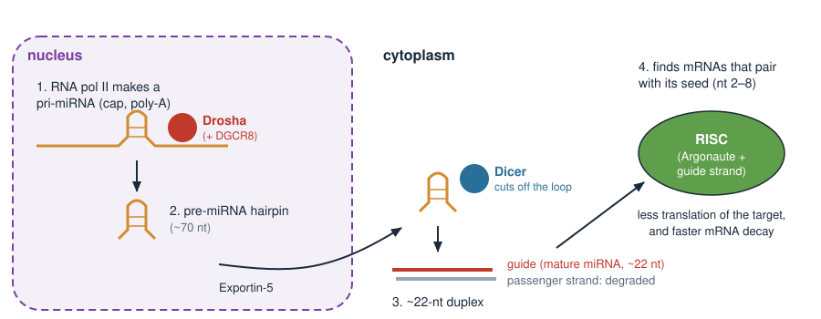

## About this lecture

Transcription is not the last word. Small RNAs, about 22 nucleotides long, pair with mRNAs and turn them down. They were found twice: once by **geneticists** studying worm larvae that developed at the wrong pace, and once by researchers trying to switch genes off with antisense RNA.

- **lin-4 and let-7**: how a genetic screen found the first microRNAs.
- **RNA interference** (RNAi): double-stranded RNA silences genes.
- **miRNA biogenesis**: Drosha, Dicer, RISC.
- **Seed matching**: why nucleotides 2–8 matter, and how to find target sites.
- **siRNA vs miRNA**; **long non-coding RNAs** such as *XIST*.
- **RNAi as a lab tool** for reverse genetics.

Book: Hartwell, *Genetics: From Genes to Genomes*, the chapter on RNA-based regulation (non-coding RNAs).

::: notes
The unit has a genetics story at its centre: the lin-4 and lin-14 mutants of C. elegans, analysed with the same tools as the lac mutants (dominance, gain and loss of function, epistasis). The mechanism then comes from biochemistry, and the practical payoff is RNAi as a tool, which leads into reverse genetics in the next unit. The R exercise finds let-7 seed matches in the HMGA2 3'UTR, a real oncology example.
:::

## A post-transcriptional layer {.smaller}

| RNA | Size | Made from | Acts on | Effect |
|---|---|---|---|---|
| **miRNA** | ~22 nt | its own gene (hairpin) | many mRNAs, partial pairing via the **seed** | less translation, mRNA decay |
| **siRNA** | ~21 nt | long double-stranded RNA (virus, transposon, or the experimenter) | mRNAs with **perfect** complementarity | cleavage of the target |
| **piRNA** | 24–31 nt | piRNA clusters, germ line | transposon RNAs | silences transposons in the germ line |
| **lncRNA** | > 200 nt | its own gene | chromatin, other RNAs, proteins | many; e.g. *XIST* silences an X |

Humans have about two thousand miRNA genes in miRBase; a typical miRNA has hundreds of predicted targets, and most human mRNAs carry at least one conserved miRNA site.

::: notes
Give students the map before the details. The rule of thumb: siRNAs come from long double-stranded RNA and pair perfectly, so they cut their target. miRNAs come from the genome's own hairpins and pair imperfectly, mainly through the seed, so they turn many targets down a little each. piRNAs protect the germ line against transposons; we mention them only for completeness. lncRNAs are a heterogeneous group defined by length and lack of protein-coding potential; XIST from the last unit is the best understood one. The numbers are deliberately rough: miRBase's count changes between releases and many annotated miRNAs are doubtful.
:::

## A genetic screen finds *lin-4* {.smaller}

In *C. elegans*, each cell division in the larva happens at a fixed **stage** (L1–L4). **Heterochronic** mutants do the right things at the wrong time.

- ***lin-4*(lf)**: cells **repeat** L1-type divisions in later stages (retarded). Recessive.
- ***lin-14*(lf)**: cells **skip** L1 fates and jump ahead (precocious): the **opposite** phenotype.
- ***lin-14*(gf)**: dominant alleles that look like *lin-4*(lf). They **delete part of the *lin-14* 3′UTR**; the protein is normal.
- Double mutant *lin-4*(lf); *lin-14*(lf) is **precocious**: *lin-14* is **epistatic**, so *lin-4* acts upstream as a **negative regulator** of *lin-14*.

In 1993 the Ambros and Ruvkun labs found that ***lin-4* makes no protein**: only a ~22-nt RNA, complementary to repeated sites in the *lin-14* 3′UTR. (Nobel Prize 2024.)

::: notes
This is the same reasoning as in the Extensions to Mendel and lac units. Opposite phenotypes suggest opposite roles. The double mutant shows the phenotype of lin-14 loss, so lin-14 is downstream, and lin-4 must negatively regulate it. The gain-of-function lin-14 alleles are the clincher: they are dominant (cis-acting, like Oc!), and map to the 3'UTR, not the coding sequence. So the 3'UTR contains a site through which lin-4 acts. When Victor Ambros' lab cloned lin-4, they found no open reading frame, only a 22-nt and a 61-nt RNA. Gary Ruvkun's lab showed that the lin-14 3'UTR has seven sites complementary to lin-4. For seven years this looked like a worm curiosity.
:::

## *lin-4* turns down *lin-14* {.smaller}

{width="72%" fig-align="center"}

The *lin-14* 3′UTR is a **cis-acting** element, like *lacO*: deleting it makes the gene escape regulation, dominantly. The *lin-4* RNA is the **trans-acting** factor.

::: notes
Walk through the curves. In the wild type, LIN-14 protein is high in L1 and falls when lin-4 RNA appears late in L1, although lin-14 mRNA levels stay much the same. That is post-transcriptional regulation: same mRNA, less protein. Without lin-4, or without the sites in the lin-14 3'UTR, LIN-14 stays high, and the cells think they are still in L1. Without lin-14, cells act as if L1 were already over. Ask: why is lin-14(gf) dominant while lin-4(lf) is recessive? Because the gf allele's own mRNA escapes regulation in cis, regardless of the other allele; while one copy of lin-4 makes enough RNA to regulate both lin-14 alleles in trans.
:::

## *let-7*: the first conserved microRNA {.smaller}

In 2000, *let-7* was found by the same kind of screen: another heterochronic gene, again a ~22-nt RNA, acting on the 3′UTRs of later-stage regulators (*lin-41*, *hbl-1*).

- *let-7* turned out to be **conserved**: the mature *let-7* of worms, flies and humans is **identical** over its first 22 nucleotides, and it is expressed at the same transition, from larval/embryonic to adult fates.
- Suddenly small regulatory RNAs were not a worm oddity. Cloning projects found hundreds in animals and plants: they were named **microRNAs**.
- Human *let-7* targets include *HMGA2*, *LIN28B* and *RAS* genes; *let-7* is often low in tumours, and *HMGA2* is a growth-promoting oncogene.

::: notes
The conservation result is what changed the field. Pasquinelli and colleagues showed that the let-7 RNA sequence is identical in many bilaterian animals, including humans, and that its expression is timed with the larval-to-adult switch in worms and flies. In the Find it task students compare worm and human let-7 in miRBase and see this for themselves. The human connection: LIN28 binds let-7 precursors and blocks their processing, while let-7 represses LIN28: a double-negative loop that keeps stem cells young or lets them mature. HMGA2 has seven let-7 sites in its 3'UTR, which students count in R.
:::

## RNA interference {.smaller}

Fire, Mello and colleagues (1998) injected RNA into worms to silence the *unc-22* gene:

| Injected RNA | Silencing |
|---|---|
| sense strand | weak |
| antisense strand | weak |
| **double-stranded RNA** | **strong**, with only a few molecules per cell, spreading through the body and into the progeny |

Double-stranded RNA is cut by **Dicer** into ~21-nt **siRNAs**; one strand guides **Argonaute** (in RISC) to cut any mRNA that matches **perfectly**. Natural roles: defence against viruses and transposons. (Nobel Prize 2006.)

::: notes
The surprise in the 1998 paper was that the earlier antisense experiments worked because the antisense preparations were contaminated with some double-stranded RNA. Only a few molecules of dsRNA per cell were enough: catalytic, not stoichiometric. In worms the silencing signal is amplified by RNA-dependent RNA polymerases and spreads between cells and even to the next generation. Plants had shown the effect earlier as "co-suppression": adding extra copies of a petunia pigment gene made some flowers white instead of darker purple. The shared machinery between RNAi and miRNAs is Dicer and Argonaute.
:::

## How a microRNA is made {.smaller}

{width="76%" fig-align="center"}

**Drosha** cuts the hairpin out in the nucleus; **Dicer** cuts off the loop in the cytoplasm; the guide strand goes into **Argonaute** (RISC). siRNAs use the same Dicer and Argonaute, but start from long double-stranded RNA.

::: notes
Keep it to the names and the order. Drosha with its partner DGCR8 is the nuclear processor; Exportin-5 carries the pre-miRNA out; Dicer makes the duplex; one strand, the guide, is kept, usually the one whose 5' end is less tightly paired. The guide is the mature miRNA you see in miRBase, named 5p or 3p after the arm of the hairpin it comes from, for example hsa-let-7a-5p. Genetic note: Dicer mutant mice die early in development, and Dicer mutant worms are sterile with heterochronic defects: the miRNA pathway is essential.
:::

## Seed matching {.smaller}

{width="66%" fig-align="center"}

Animal miRNAs find targets mainly through the **seed**, nucleotides **2–8** from the 5′ end. A target site in the mRNA (usually the 3′UTR) is the **reverse complement** of the seed, sometimes with an A opposite nucleotide 1.

::: notes
Read the figure: let-7a is drawn 3' to 5' so it lines up antiparallel with the mRNA. The seed GAGGUAG (nt 2 to 8) pairs with CUACCUC in the mRNA, followed by an A opposite nt 1: an 8mer, the strongest site type. This is the real site at UTR positions 21 to 28 of HMGA2, the first of the seven let-7 sites. The rest of the miRNA pairs only partly, which is why one miRNA can regulate hundreds of mRNAs. TargetScan, which students use in the Find it task, ranks targets by site type, number of sites, and whether the sites are conserved across species. A 7-nt site occurs by chance about once every 16 kb (4 to the 7th), so a single site means little; conserved and multiple sites mean more.
:::

## siRNA vs miRNA {.smaller}

| | siRNA | miRNA |
|---|---|---|
| Source | long dsRNA (virus, transposon, experiment) | genome-encoded hairpin |
| Processing | Dicer | Drosha, then Dicer |
| Pairing with target | full length, perfect | mostly the seed (nt 2–8) |
| Typical outcome | target mRNA **cut** by Argonaute | translation down, mRNA decay |
| Targets per small RNA | one (the matching gene) | hundreds |
| Natural role | defence (viruses, transposons) | gene regulation, development |
| As a lab tool | knock down a chosen gene | — (but siRNAs can act like miRNAs: **off-target** effects via their seed) |

::: notes
The last row is the practical warning: an siRNA designed against one gene also has a seed, and it can turn down hundreds of other mRNAs that happen to carry a seed match. That is the main source of off-target effects in RNAi screens. The standard control is to use two or more siRNAs with different sequences against the same gene: a real phenotype should be reproduced by all of them; an off-target phenotype will not.
:::

## Regulatory RNA in genetics and disease {.smaller}

- **Target-site mutations act in cis.** Chromosomal rearrangements in benign tumours (e.g. lipomas) cut *HMGA2* off from its 3′UTR. The truncated mRNA loses its seven *let-7* sites, escapes repression, and makes too much protein: a **dominant gain of function**, like *lin-14*(gf).
- **miRNA mutations act in trans.** A point mutation in the **seed** of *MIR96* causes dominant progressive **hearing loss** in humans (and in the *diminuendo* mouse). The mutant miRNA loses its normal targets and gains new ones.
- **The miRNA pathway is a drug target.** Patisiran, an siRNA drug approved in 2018, silences the *TTR* gene in hereditary transthyretin amyloidosis.

::: notes
Three examples, one for each of: cis-acting sites, trans-acting regulators, and therapy. HMGA2: in many lipomas and other tumours a translocation breaks HMGA2 between its coding exons and the 3'UTR; the fused or truncated mRNA lacks the let-7 sites, and experiments showed that the loss of let-7 regulation alone is enough to make HMGA2 oncogenic (Mayr, Hemann and Bartel, 2007). MIR96: the mutations are in the seed and act dominantly, because the mutant miRNA from one allele is a new, wrong regulator in the hair cells. Patisiran is delivered in lipid nanoparticles to the liver, which makes most TTR; it is a direct application of the 1998 RNAi discovery.
:::

## Long non-coding RNAs {.smaller}

**lncRNAs** are transcripts longer than 200 nt that do not encode a protein. Some work **in cis**, on the chromosome they are made from; others **in trans**.

- ***XIST*** (from the last unit): made from the X that will be silenced; coats that X **in cis** and recruits silencing complexes. Deleting *XIST* on one X means that X cannot be inactivated.
- Many lncRNAs act as scaffolds for chromatin complexes, or as decoys that soak up miRNAs or proteins.
- Many more are **transcribed but of unknown function**. Genetics is the test: does deleting it, or its promoter, change a phenotype?

::: notes
Keep the lncRNA part short and honest: there are tens of thousands of annotated lncRNA genes, and for most we do not know if the RNA itself does anything. Some act through the act of transcription, not through the RNA. XIST is the clearest case and links back. The cis/trans question applies again: XIST acts only on the chromosome it comes from, which can be shown genetically by putting an XIST transgene on an autosome: that autosome becomes silenced.
:::

## RNAi as a tool for reverse genetics {.smaller}

**Forward genetics** goes from a phenotype to the gene. **Reverse genetics** starts from a gene and asks: what happens if I remove it? RNAi made this easy.

- **Worms**: feed them *E. coli* that make dsRNA against a gene. A library covering about 86 % of predicted *C. elegans* genes allowed **genome-wide RNAi screens** (2003).
- **Flies**: transgenic hairpin RNAs (often combined with tissue-specific GAL4 drivers, next unit).
- **Mammalian cells**: transfect siRNAs or express shRNAs.

Limits: RNAi gives a **knockdown** (a hypomorph), not a null; efficiency varies; off-target effects via the seed. Today **CRISPR–Cas9 knockouts** are often preferred, but RNAi remains useful for genes whose knockout is lethal, and for tuning dosage.

::: notes
This bridges to Development and model organisms. The worm feeding library (Kamath and colleagues, Ahringer lab, 2003) was one of the first genome-wide reverse-genetic screens in an animal. Genetically, an RNAi phenotype is like a hypomorphic allele: partial loss of function. That has advantages (you can see phenotypes for genes whose null alleles die early) and disadvantages (a weak knockdown can miss a phenotype; you cannot do clean complementation tests). Controls: several independent siRNAs, and rescue with a version of the gene that the siRNA cannot target (silent changes in the target site).
:::

## Summary {.smaller}

| Concept | Key fact |
|---|---|
| *lin-4* / *lin-14* | first miRNA (1993); *lin-14*(gf) = 3′UTR deletions, dominant, cis; *lin-4* acts in trans |
| *let-7* | first conserved miRNA (2000); identical in worm and human |
| RNAi | dsRNA → Dicer → siRNA → Argonaute cuts the perfectly matching mRNA |
| Biogenesis | pri-miRNA → Drosha → pre-miRNA → Exportin-5 → Dicer → RISC (Argonaute) |
| Seed | nt 2–8; site = reverse complement; 8mer > 7mer-m8 > 7mer-A1 > 6mer |
| siRNA vs miRNA | perfect pairing, one target, cleavage vs seed pairing, many targets, repression |
| Disease | *HMGA2* 3′UTR loss (cis, oncogenic); *MIR96* seed mutation (trans, deafness) |
| lncRNA | > 200 nt, no protein; *XIST* acts in cis |
| RNAi as a tool | knockdown, reverse genetics, genome-wide screens; watch for off-targets |

::: notes
Revision sheet. The connecting idea with the previous two units: regulatory sites (operators, enhancers, 3'UTR sites) act in cis, and regulators (repressors, transcription factors, miRNAs) act in trans. Mutations in each behave predictably in dominance tests.
:::

## Where this leads

- **Next: Development & model organisms.** Forward screens like the heterochronic screen, reverse genetics with RNAi and CRISPR, and the transcription-factor cascades that build the fly embryo.
- **Part 7: Cancer genetics.** *let-7* and *HMGA2* are one example of how loss of regulation makes an oncogene.

::: notes
Point forward. In the exercise, students extract seeds and predict site types by hand, look up let-7 in miRBase and its targets in TargetScan, and in R they find and plot the let-7 sites in the HMGA2 3'UTR with str_locate_all, then compare with what chance alone would give.
:::
