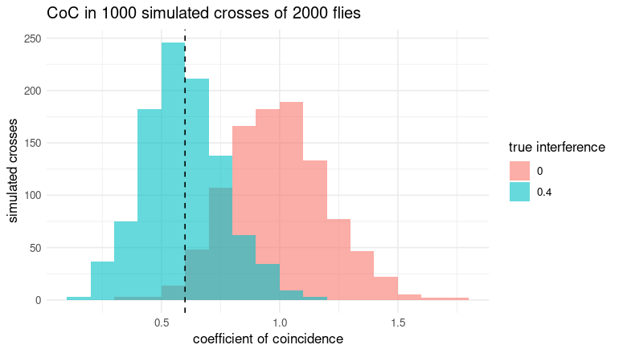

## Goal

By the end of this exercise you should be able to:

- store the 8 classes of a three-point cross as a tibble and pick out the parental and double crossover classes with `slice_max()` and `slice_min()`;
- write a function that, for a given gene order, returns the distances, the expected DCOs, the CoC and the interference as a **one-row tibble**;
- run that function over all three possible orders with **`map()`**, stack the results with **`list_rbind()`**, and pick the order where the double crossovers are rarest;
- simulate three-point crosses to see how noisy the coefficient of coincidence is.

## Before you start

This page builds on the by-hand part of the [Exercise](exercise.qmd), so do that first. You need the packages readr, dplyr, purrr and ggplot2. Download [drosophila_v_cv_ct.csv](data/drosophila_v_cv_ct.csv) and [maize_lg_gl_bm.csv](data/maize_lg_gl_bm.csv) and save them in a `data/` folder of your R project. Both are **invented teaching data** (see [data/README.md](data/README.md)); the fly file holds the lecture's example.

```r
library(readr)
library(dplyr)
library(purrr)
library(ggplot2)
```

## Tasks

You already know `map_dbl()` (Extensions to Mendel), which calls a function for each element of a list and returns a **number** for each. This unit's new idiom is a function that returns a **one-row tibble**, called for each element with [`map()`](https://purrr.tidyverse.org/reference/map.html). `map()` returns a **list** of tibbles, one per element, and [`list_rbind()`](https://purrr.tidyverse.org/reference/list_c.html) stacks them into one tibble, with one row per input. This is how you compare one analysis under several hypotheses side by side.

**R1. (the data)** Read the fly data. Each row is one class: the alleles the offspring got from the heterozygous female (`+` = wild type) and the count `n`. Compute N, and use [`slice_max()`](https://dplyr.tidyverse.org/reference/slice.html) and `slice_min()` to pull out the two most common and the two rarest classes. (The first `n` in `slice_max(n, n = 2)` is the column; the second says how many rows to keep.) Which gene differs between the rarest classes and the parentals?

```r
fly <- read_csv("data/drosophila_v_cv_ct.csv") |> select(-note)
fly
N <- sum(fly$n)
N
fly |> slice_max(n, n = 2)
fly |> slice_min(n, n = 2)
```

**R2. (classify the classes for one order)** Take the most common class as the reference parental chromosome. For each gene, `TRUE` means the offspring got the allele from the same chromosome as the reference. A crossover between two neighbouring genes shows up as a change from `TRUE` to `FALSE` (or back). Classify each class for the order *cv*–*ct*–*v* with [`case_when()`](https://dplyr.tidyverse.org/reference/case_when.html), and add up the counts per class type.

```r
parental <- fly |> slice_max(n, n = 1)
fly2 <- fly |>
  mutate(cv_same = cv == parental$cv,
         ct_same = ct == parental$ct,
         v_same  = v  == parental$v,
         region1 = cv_same != ct_same,      # crossover between cv and ct
         region2 = ct_same != v_same,       # crossover between ct and v
         class = case_when(region1 & region2 ~ "DCO",
                           region1 ~ "SCO cv-ct",
                           region2 ~ "SCO ct-v",
                           TRUE ~ "parental"))
fly2 |> select(v, cv, ct, n, class)
fly2 |> group_by(class) |> summarise(n = sum(n))
```

Check the four totals against the lecture.

**R3. (one function, one order)** Write a function `three_point(df, order)` that does R2 for any data frame and any order (a character vector of the three column names, left to right) and returns the two distances in cM, the observed and expected DCOs, the CoC and the interference as a one-row tibble. `df[[g]]` picks the column whose name is stored in `g`. Note that `sum(df$n[sw1])` already includes the DCOs, which have a crossover in region I too.

```r
three_point <- function(df, order) {
  top  <- df |> slice_max(n, n = 1)            # one parental class
  same <- function(g) df[[g]] == top[[g]]      # allele from the same chromosome as top?
  sw1  <- same(order[1]) != same(order[2])     # crossover in region I
  sw2  <- same(order[2]) != same(order[3])     # crossover in region II
  N    <- sum(df$n)
  r1   <- sum(df$n[sw1]) / N                   # SCO I + DCO
  r2   <- sum(df$n[sw2]) / N                   # SCO II + DCO
  n_dco   <- sum(df$n[sw1 & sw2])
  exp_dco <- r1 * r2 * N
  tibble(order = paste(order, collapse = "-"),
         dist1 = 100 * r1, dist2 = 100 * r2,
         n_dco = n_dco, exp_dco = exp_dco,
         coc = n_dco / exp_dco, interference = 1 - coc)
}
three_point(fly, c("cv", "ct", "v"))
```

**R4. (all three orders with `map()`)** There are only three different orders, one for each gene in the middle (reading a map backwards gives the same order). Put them in a list, run `three_point()` on each with `map()`, stack the results with `list_rbind()`, and pick the order with the fewest DCOs with `slice_min()`. What happens to the CoC for the wrong orders?

```r
orders <- list(c("ct", "v", "cv"), c("v", "cv", "ct"), c("cv", "ct", "v"))
all_orders <- map(orders, \(o) three_point(fly, o)) |> list_rbind()
all_orders
all_orders |> slice_min(n_dco)
```

**R5. (reuse: maize, and the two-point distance)** Your function works for any three-point data set. Run it on the maize data of B1 over all three orders and sort by `n_dco` with `arrange()`. Then go back to the flies and compute the **two-point** *cv*–*v* distance, ignoring *ct*. Compare it with the three-point outer distance, 7.0 + 13.0 cM.

```r
maize <- read_csv("data/maize_lg_gl_bm.csv") |> select(-note)
maize_orders <- list(c("gl", "lg", "bm"), c("lg", "gl", "bm"), c("lg", "bm", "gl"))
map(maize_orders, \(o) three_point(maize, o)) |> list_rbind() |> arrange(n_dco)

top <- fly |> slice_max(n, n = 1)
outer_rec <- (fly$cv == top$cv) != (fly$v == top$v)   # cv and v in a new combination
100 * sum(fly$n[outer_rec]) / sum(fly$n)
```

**R6. (how noisy is the CoC?)** The flies gave CoC = 0.60 from only 11 DCOs. Could that happen with **no** interference? Write `simulate_tp()`, which draws `N` offspring with [`sample()`](https://rdrr.io/r/base/sample.html) from the four class types (parental, SCO in I, SCO in II, DCO), with probabilities from the Background of the exercise, and returns the CoC. Its arguments `r1`, `r2` and `I` have **default values** (as in Linkage & recombination), so `simulate_tp(2000)` simulates the fly intervals with no interference. Run it 1000 times with I = 0 and 1000 times with I = 0.4, using `map_dbl()`, and plot the two distributions.

```r
simulate_tp <- function(N, r1 = 0.07, r2 = 0.13, I = 0) {
  p_dco <- (1 - I) * r1 * r2
  probs <- c(parental = 1 - r1 - r2 + p_dco, sco1 = r1 - p_dco,
             sco2 = r2 - p_dco, dco = p_dco)
  kids <- sample(names(probs), N, replace = TRUE, prob = probs)
  n1 <- sum(kids %in% c("sco1", "dco"))
  n2 <- sum(kids %in% c("sco2", "dco"))
  n_dco <- sum(kids == "dco")
  n_dco / (n1 / N * n2 / N * N)                # the CoC
}
set.seed(33)
simulate_tp(2000)
coc_sims <- tibble(I = rep(c(0, 0.4), each = 1000)) |>
  mutate(coc = map_dbl(I, \(i) simulate_tp(2000, I = i)))
coc_sims |> group_by(I) |>
  summarise(mean = mean(coc), low = quantile(coc, 0.025), high = quantile(coc, 0.975))

ggplot(coc_sims, aes(x = coc, fill = factor(I))) +
  geom_histogram(binwidth = 0.1, boundary = 0, position = "identity", alpha = 0.6) +
  geom_vline(xintercept = 0.60, linetype = "dashed") +
  labs(x = "coefficient of coincidence", y = "simulated crosses",
       fill = "true interference",
       title = "CoC in 1000 simulated crosses of 2000 flies") +
  theme_minimal()

coc_sims |> filter(I == 0) |> summarise(p_as_low = mean(coc <= 0.604))
```

What fraction of the crosses without interference give a CoC as low as the flies' 0.60? How would the spread change with 500 flies instead of 2000?

## Solutions

::: {.callout-note collapse="true" title="Solutions: In R"}

All output below is from `Rscript --vanilla` run in the unit folder. `read_csv()` also prints a short column summary, left out here.

**R1.**

```
# A tibble: 8 × 4
  v     cv    ct        n
  <chr> <chr> <chr> <dbl>
1 v     +     +       812
2 +     cv    ct      799
3 +     +     +       128
4 v     cv    ct      121
5 +     +     ct       66
6 v     cv    +        63
7 v     +     ct        6
8 +     cv    +         5
[1] 2000
# A tibble: 2 × 4
  v     cv    ct        n
  <chr> <chr> <chr> <dbl>
1 v     +     +       812
2 +     cv    ct      799
# A tibble: 2 × 4
  v     cv    ct        n
  <chr> <chr> <chr> <dbl>
1 +     cv    +         5
2 v     +     ct        6
```

N = 2000. The parentals are *v* + + and + *cv ct*; the rarest classes are + *cv* + and *v* + *ct*. Compared with + *cv ct*, the class + *cv* + differs only at ***ct***, so *ct* is in the middle.

**R2.**

```
# A tibble: 8 × 5
  v     cv    ct        n class
  <chr> <chr> <chr> <dbl> <chr>
1 v     +     +       812 parental
2 +     cv    ct      799 parental
3 +     +     +       128 SCO ct-v
4 v     cv    ct      121 SCO ct-v
5 +     +     ct       66 SCO cv-ct
6 v     cv    +        63 SCO cv-ct
7 v     +     ct        6 DCO
8 +     cv    +         5 DCO
# A tibble: 4 × 2
  class         n
  <chr>     <dbl>
1 DCO          11
2 SCO ct-v    249
3 SCO cv-ct   129
4 parental   1611
```

As in the lecture: 1611 parental, 129 SCO in *cv*–*ct*, 249 SCO in *ct*–*v*, 11 DCO.

**R3.**

```
# A tibble: 1 × 7
  order   dist1 dist2 n_dco exp_dco   coc interference
  <chr>   <dbl> <dbl> <dbl>   <dbl> <dbl>        <dbl>
1 cv-ct-v     7    13    11    18.2 0.604        0.396
```

*cv*–*ct* 7.0 cM, *ct*–*v* 13.0 cM, 11 DCOs observed against 18.2 expected, CoC 0.60, I 0.40.

**R4.**

```
# A tibble: 3 × 7
  order   dist1 dist2 n_dco exp_dco   coc interference
  <chr>   <dbl> <dbl> <dbl>   <dbl> <dbl>        <dbl>
1 ct-v-cv  13    18.9   249    49.1 5.07        -4.07
2 v-cv-ct  18.9   7     129    26.5 4.88        -3.88
3 cv-ct-v   7    13      11    18.2 0.604        0.396
# A tibble: 1 × 7
  order   dist1 dist2 n_dco exp_dco   coc interference
  <chr>   <dbl> <dbl> <dbl>   <dbl> <dbl>        <dbl>
1 cv-ct-v     7    13      11    18.2 0.604        0.396
```

The order with the rarest DCOs is ***cv*–*ct*–*v***. With a wrong order, the "DCO" pair is really a single crossover pair (249 or 129), so the CoC is about 5: five times more "double crossovers" than independence allows, which is a sign of the wrong order. The outer distance in the wrong orders, 18.9 cM, is the two-point *cv*–*v* distance (see R5).

**R5.**

```
# A tibble: 3 × 7
  order    dist1 dist2 n_dco exp_dco   coc interference
  <chr>    <dbl> <dbl> <dbl>   <dbl> <dbl>        <dbl>
1 lg-gl-bm  22.3  20.3    13    45.3 0.287        0.713
2 lg-bm-gl  40    20.3   190    81.2 2.34        -1.34
3 gl-lg-bm  22.3  40     210    89.2 2.35        -1.35
[1] 18.9
```

Maize: order *lg*–*gl*–*bm*, 22.3 and 20.3 cM, CoC 0.29, I 0.71, as in B1. Flies: the two-point *cv*–*v* distance is **18.9 cM**, against 7.0 + 13.0 = **20.0 cM** from the three-point cross. The difference, 1.1 cM, is 2 × 11 / 2000: each of the 11 double crossovers hides two crossovers from a two-point cross.

**R6.**

```
[1] 0.9506833
# A tibble: 2 × 4
      I  mean   low  high
  <dbl> <dbl> <dbl> <dbl>
1   0   0.995 0.626 1.43
2   0.4 0.593 0.284 0.944
# A tibble: 1 × 1
  p_as_low
     <dbl>
1     0.02
```

{width="80%" fig-align="center"}

Without interference the CoC averages 1.0, but 95% of the crosses fall between 0.63 and 1.43. Only **2%** give a CoC as low as 0.60. So the flies' 0.60 is fairly good evidence of interference, though not overwhelming: it is a bit like a p-value of 0.02. With true interference I = 0.4, the CoC averages 0.59 but ranges from 0.28 to 0.94. With 500 flies, the expected DCO count drops to about 4.5 and the spread becomes roughly twice as wide (noise falls with $\sqrt{N}$, as in the Mendel exercise), so one cross could hardly tell I = 0 from I = 0.4.
:::

## Where this leads

The pattern **one function, many hypotheses, one tibble** comes back in **Human linkage & LOD scores**, where you compute the likelihood of family data for many values of the recombination frequency θ and find the one that fits best. The simulation in R6 is the same idea as the χ² simulations in Probability & the χ² test: when a formula is awkward, simulate the null hypothesis.
