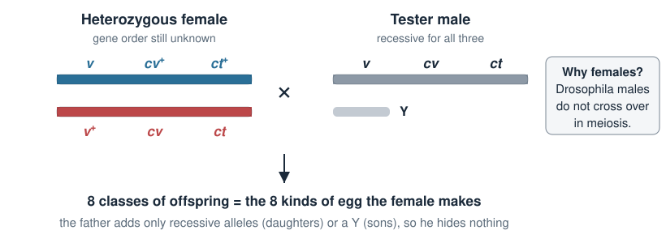
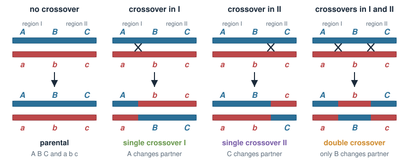
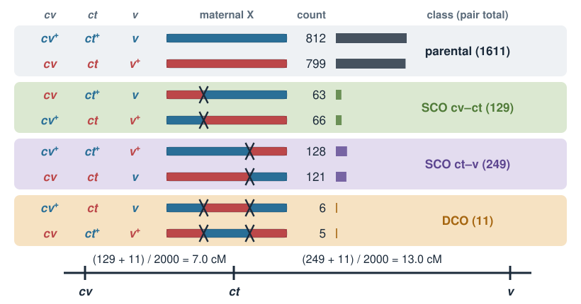
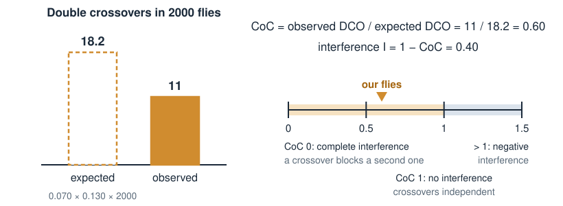
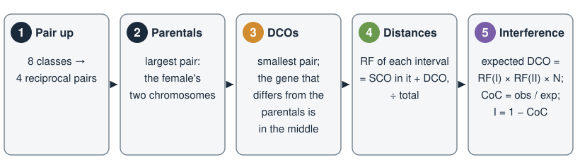

## About this lecture {.smaller}

In **Linkage & recombination** we measured the distance between **two** genes from a testcross. Following **three** linked genes in one cross gives more than three distances: it gives the **order** of the genes, and it shows the **double crossovers** that a two-point cross cannot see.

- The **three-point testcross**: a triple heterozygote × a triple recessive tester; **8** offspring classes.
- A five-step recipe: **parentals** (most common), **double crossovers** (rarest), the **gene in the middle**, the two **distances**.
- Why the outer distance must count the double crossovers **twice**.
- **Checking the order**: what goes wrong when you put the wrong gene in the middle.
- **Expected** double crossovers from the product rule; the **coefficient of coincidence** and **interference**, and how noisy they are.
- Running the recipe **backwards**: predicting the eight classes from a map and an interference value.
- A worked *Drosophila* example on the X chromosome: *cv*, *ct* and *v*.

Book: Hartwell, *Genetics: From Genes to Genomes*, linkage and recombination chapter (the three-point cross sections).

::: notes
This unit is mostly a method, and the method is short. The skill students should leave with is reading eight class counts and, in a few minutes, writing down the gene order, two distances and the interference. Everything rests on the previous unit: recombination frequency, the testcross as a direct readout of gametes, and map units. The new ideas are the double crossover class, which tells the order, and interference, which tells us that crossovers are not independent events. The product rule from Probability & the chi-square test comes back to compute the expected number of double crossovers.
:::

## What two-point crosses leave open {.smaller}

Suppose two-point testcrosses give *cv*–*ct* 7 cM, *ct*–*v* 13 cM and *cv*–*v* 19 cM.

- **Order.** 7 + 13 = 20 ≈ 19, so *ct* is probably in the middle. But with sampling noise in three separate crosses, and distances that do not add up exactly, the order can be ambiguous, especially for close genes.
- **Hidden double crossovers.** Two crossovers between *cv* and *v* put *cv* and *v* back together in the parental combination. A two-point cross counts that chromatid as **parental**, so the long distance comes out **too short**.
- **Effort.** Three separate crosses, three sets of flies.

A **three-point cross** answers all three in **one** cross: it measures both intervals in the same offspring and shows the double crossovers directly.

::: notes
Start from what the students can already do. With three two-point distances they can guess the order by additivity: the two short distances should add up to the long one. But 7 + 13 is 20, not 19, and with real data and small samples the mismatch can be bigger. The second point is the important one conceptually: a double crossover between the outer genes leaves them in the parental combination, so in a two-point cross it is invisible. That is the same reason RF never exceeds 0.5, from the previous unit, now at short range. A third marker in between catches these events, because the middle gene changes partner.
:::

## The three-point testcross {.smaller}

{width="70%" fig-align="center"}

- Female: heterozygous for three X-linked genes, *v* (vermilion eyes), *cv* (crossveinless wings) and *ct* (cut wings), with *v* on one X and *cv ct* on the other.
- Male: recessive for all three (*v cv ct* / Y). He adds only recessive alleles, so each offspring's phenotype shows **which egg** it came from.
- Each egg carries one of $2^3 = 8$ combinations of alleles: **8 phenotype classes**.

::: notes
This is the testcross logic from Mendel, scaled up to three genes. The tester contributes nothing visible, so offspring classes equal female gametes. For X-linked genes in Drosophila there is a bonus: sons get the father's Y and daughters get his recessive X, so in both sexes the phenotype is the maternal X. We use females as the heterozygous parent for a second reason: Drosophila males do not cross over in meiosis, so a heterozygous male would give no recombinants at all. Note that we do not yet know the order of the three genes on the chromosome; the figure lists them in an arbitrary order. Finding the order is the first goal.
:::

## The data: eight classes, four pairs {.smaller}

2000 offspring from *v cv*^+^ *ct*^+^ / *v*^+^ *cv ct* females × *v cv ct* / Y males (invented teaching counts):

| Class | *v* | *cv* | *ct* | Count | |
|---|:-:|:-:|:-:|---:|---|
| 1 | *v* | + | + | 812 | largest pair: **parental** |
| 2 | + | *cv* | *ct* | 799 | |
| 3 | + | + | + | 128 | |
| 4 | *v* | *cv* | *ct* | 121 | |
| 5 | + | + | *ct* | 66 | |
| 6 | *v* | *cv* | + | 63 | |
| 7 | *v* | + | *ct* | 6 | smallest pair: **double crossovers** |
| 8 | + | *cv* | + | 5 | |

The 8 classes come in **reciprocal pairs**: each crossover makes two complementary chromatids, so the two members of a pair have similar counts.

::: notes
The + sign is the usual fly shorthand for the wild-type allele. First thing to do with any three-point data: pair the classes. Two classes form a pair when they are exact opposites at all three loci: v + + and + cv ct, + + + and v cv ct, and so on. Their counts are similar because one crossover produces both products in equal numbers. If a pair has very unequal counts, something else is going on, such as reduced viability of one phenotype. The counts are invented for teaching, but they were made to fit the real map of the X chromosome, which we check at the end.
:::

## What each kind of crossover produces

{width="88%" fig-align="center"}

A single crossover moves an **end** gene to the other chromosome. A **double** crossover, one in each interval, moves only the **middle** gene.

::: notes
This is the key picture of the lecture. Use generic letters A, B, C, in the true order, with B in the middle. No crossover gives the two parental chromosomes. A crossover in region I, between A and B, gives A b c and a B C: A has changed partner. A crossover in region II changes C's partner. Two crossovers, one in each region, swap the middle segment only: A b C and a B c. The outer genes are still in their parental combination, which is why a two-point cross between A and C would call these chromatids parental. Since two crossovers are rarer than one, the double crossover classes are the rarest pair. So: find the rarest pair, compare it with the parentals, and the gene that has switched is the middle one.
:::

## Steps 1–2: pair up and find the parentals {.smaller}

**Step 1.** Pair the reciprocal classes: (1, 2), (3, 4), (5, 6), (7, 8).

**Step 2.** The **largest** pair is **parental**: no crossover in either interval. Here *v* + + (812) and + *cv ct* (799).

So the female was *v cv*^+^ *ct*^+^ / *v*^+^ *cv ct*: *v* was on one X, *cv* and *ct* on the other. The parentals tell you the **phase** of the heterozygote, even if you were not told it.

| Pair | Counts | Total | What it must be |
|---|---|---:|---|
| (1, 2) | 812 + 799 | 1611 | parental |
| (3, 4) | 128 + 121 | 249 | single crossover |
| (5, 6) | 66 + 63 | 129 | single crossover |
| (7, 8) | 6 + 5 | 11 | double crossover |

::: notes
The parentals are the most common classes as long as all the genes are linked, which they are when every recombinant class is well below a quarter. A frequent student mistake is to assume that the parentals are + + + and v cv ct, that is, all mutant alleles on one chromosome. That is only true when the heterozygote is in coupling for all three genes. Here the female carried v on one X and cv ct on the other, a mixed phase, and the data say so. Always read the parentals from the counts, not from an assumption.
:::

## Step 3: the double crossovers give the order {.smaller}

Compare each double crossover class with the parental class it most resembles:

| | *v* | *cv* | *ct* |
|---|:-:|:-:|:-:|
| parental | *v* | + | **+** |
| DCO | *v* | + | ***ct*** |
| parental | + | *cv* | ***ct*** |
| DCO | + | *cv* | **+** |

Only ***ct*** has changed partner. A double crossover moves only the middle gene, so ***ct* is in the middle**:

$$cv \;-\; ct \;-\; v \qquad (\text{or } v - ct - cv\text{: the same map read backwards})$$

The parental chromosomes in the true order: *cv*^+^ *ct*^+^ *v* / *cv ct v*^+^.

::: notes
This is the whole trick. Pick a DCO class, find the parental class that agrees with it at two of the three loci; the locus where they disagree is the middle one. Check with the other DCO class: it must give the same answer. The direction of the map does not matter; cv-ct-v and v-ct-cv are the same order. A useful check: if you try the other two orders, the class you would call "double crossover" is much more common than the singles, which makes no sense. The next slide does exactly that.
:::

## Check the order: try all three {.smaller}

There are only three orders, one for each gene in the middle. For each, ask: which pair would be the "double crossovers", and does that make sense?

| Gene in the middle | "DCO" pair = classes where only that gene switched | Count | Expected if DCO | CoC |
|---|---|---:|---:|---:|
| *v* (*cv*–*v*–*ct*) | + + + and *v cv ct* | 249 | 49.1 | 5.07 |
| *cv* (*v*–*cv*–*ct*) | + + *ct* and *v cv* + | 129 | 26.5 | 4.88 |
| ***ct*** (*cv*–*ct*–*v*) | *v* + *ct* and + *cv* + | **11** | 18.2 | **0.60** |

- In a wrong order, the "DCO" pair is really a **single** crossover pair, so it is far too common: CoC ≈ 5, "five times more double crossovers than chance allows".
- In the right order, the DCO pair is the **rarest** pair, and CoC is at or below 1.

A CoC far above 1 almost always means **the order is wrong**, not that the biology is strange.

::: notes
These are the numbers the demo and the R exercise produce. How the expected values come about for a wrong order, for example v in the middle: region I, cv to v, now contains the classes where cv and v are in a new combination, 129 plus 249 = 378, so RF 0.189; region II, v to ct, contains 249 plus 11 = 260, RF 0.13; expected DCO 0.189 times 0.13 times 2000 = 49. Observed "DCO" 249. The point for students: the three-order check is a safety net. In an exam, if your CoC comes out above 1, go back and check which gene you put in the middle.
:::

## Rewrite the classes in the right order

{width="75%" fig-align="center"}

In the order *cv*–*ct*–*v*, each class shows its crossovers: one switch of colour = one crossover.

::: notes
Rewriting the data in the correct order is the step students skip and then get lost. Blue alleles came from the cv+ ct+ v chromosome, red from cv ct v+. The two parental classes are all blue or all red. In 63 and 66, cv has switched: a crossover between cv and ct, region I. In 128 and 121, v has switched: a crossover between ct and v, region II. In 6 and 5, only ct has switched: one crossover in each region. The map at the bottom is the result of the next step.
:::

## Step 4: the two distances {.smaller}

Each interval's recombination frequency counts **every** offspring with a crossover **in that interval**, so the double crossovers count in **both**:

$$RF(cv\text{–}ct) = \frac{\text{SCO in I} + \text{DCO}}{N} = \frac{129 + 11}{2000} = 0.070 \;\Rightarrow\; \mathbf{7.0\ cM}$$

$$RF(ct\text{–}v) = \frac{\text{SCO in II} + \text{DCO}}{N} = \frac{249 + 11}{2000} = 0.130 \;\Rightarrow\; \mathbf{13.0\ cM}$$

$$cv\text{–}v = 7.0 + 13.0 = \mathbf{20.0\ cM}$$

::: notes
The common mistake is to leave the DCOs out of the interval distances. A double crossover chromatid has a crossover in region I and one in region II, so it is a recombinant for both intervals. The outer distance is the sum of the two intervals. In map units from the previous unit, 1 percent recombination is 1 centimorgan; for short intervals like these, RF and map distance are nearly the same, so we do not need a map function here.
:::

## Why two-point crosses underestimate long distances {.smaller}

Ignore *ct* and score only *cv* and *v*, as a two-point cross would:

| | Recombinant for *cv*–*v*? |
|---|---|
| SCO in I (129) | yes |
| SCO in II (249) | yes |
| DCO (11) | **no**: *cv* and *v* are back in the parental combination |

$$RF_{\text{two-point}}(cv\text{–}v) = \frac{129 + 249}{2000} = 0.189 \quad\text{vs}\quad 7.0 + 13.0 = 20.0\ \text{cM}$$

Each DCO is **two** crossovers that look like **zero**: $0.189 + 2 \times \frac{11}{2000} = 0.200$.

Adding up short intervals is more accurate than measuring a long one directly. That is why maps are built from **closely spaced markers**.

::: notes
This connects back to the map functions of the previous unit. Over long distances, even-numbered crossovers are invisible, so RF grows more slowly than the true distance and never passes 0.5. The three-point cross shows the effect at short range, with real counts: 11 double crossovers, 22 crossovers in total, went missing from the two-point estimate. Map functions such as Haldane's are a way to correct for this when there is no marker in between. With a marker in between, you can count the crossovers directly.
:::

## How many double crossovers do we expect? {.smaller}

If crossovers in the two intervals were **independent**, the product rule (Probability & the χ² test) gives:

$$P(\text{DCO}) = RF_{\text{I}} \times RF_{\text{II}} = 0.070 \times 0.130 = 0.0091$$

$$\text{expected DCO} = 0.0091 \times 2000 = \mathbf{18.2}$$

We **observed 11**. Fewer double crossovers than independence predicts: a crossover in one interval seems to make a crossover in the neighbouring interval **less likely**.

::: notes
This is the product rule again: P(A and B) = P(A) times P(B) if A and B are independent. Here A is "crossover in region I" and B is "crossover in region II". The calculation uses the RFs that include the DCOs, which is the right estimate of each interval's crossover probability. The observed number is well below the expected one. We could have got 11 instead of 18 by chance, and we look at that on a later slide, but the deficit is typical: in Drosophila and in many other organisms, crossovers that are close together are rarer than independence predicts.
:::

## Coefficient of coincidence and interference

{width="82%" fig-align="center"}

$$\text{CoC} = \frac{\text{observed DCO}}{\text{expected DCO}} \qquad I = 1 - \text{CoC}$$

::: notes
The coefficient of coincidence is a ratio, observed over expected double crossovers. Interference is its complement. Read the scale: CoC 1, I 0, means crossovers in the two intervals are independent. CoC 0, I 1, means complete interference: no double crossovers at all, one crossover blocks the other. Values in between, as here, mean partial interference. A CoC above 1, negative interference, means more doubles than expected; that is rare in standard crosses and is seen, for example, over very short distances in some fungi and bacteriophage crosses, where it reflects a different mechanism. In this course, expect positive interference.
:::

## Interference in real chromosomes {.smaller}

- **Crossovers are spaced out.** In *Drosophila*, mice and humans, a crossover makes another one nearby less likely. Over short intervals (a few cM) double crossovers are almost never seen: interference is close to complete.
- **Interference fades with distance.** Over long distances, two crossovers on one chromosome arm are again roughly independent.
- **At least one crossover per bivalent.** Most organisms make at least one crossover per pair of homologues; it holds the pair together until anaphase I and helps them separate correctly (Chromosome theory & sex linkage).
- **Not universal.** The fission yeast *Schizosaccharomyces pombe* shows essentially no interference.

Map functions encode this: **Haldane** assumes no interference; **Kosambi** builds some in (Linkage & recombination).

::: notes
Keep this slide qualitative. The mechanism of interference is still studied; the useful picture is that once a crossover is designated, it inhibits other crossovers nearby along the chromosome axis. The consequence for mapping: over short distances, we can treat RF as additive and DCOs as nearly absent, and over long distances, map functions are needed. The link to nondisjunction in the first unit of this part: bivalents without a crossover are prone to missegregation, which is one reason why chromosomes evolved to ensure one obligate crossover.
:::

## Is the interference real, or noise? {.smaller}

Only **11** double crossovers were observed. Small counts are noisy:

- If there were **no** interference (CoC = 1), we would expect 18.2 DCOs, but a cross of 2000 flies could easily give 13 or 24.
- In the [Exercise in R](exercise-r.qmd) you simulate 1000 such crosses with **no** interference: the CoC lands between about **0.63 and 1.43** in 95% of them, and is as low as 0.60 in only about **2%** of them.
- So 0.60 is fairly strong evidence for interference, but with fewer flies it would not be.

A CoC computed from 2 or 3 double crossovers says very little. Rare classes need **large** crosses.

**Zero DCOs?** For a rare class, P(0 observed) ≈ e^−expected^. With 2 DCOs expected, finding none happens about 1 time in 7 (e^−2^ = 0.14) even without interference; with 5 expected, about 1 time in 150 (e^−5^ = 0.007).

::: notes
This brings back the theme of sampling noise from Part 1. CoC is a ratio of two counts, one of them small, so it is noisy. The simulation in R gives a feel for the spread; a proper test would compare the observed DCO count with the expected count, for example with a Poisson or binomial model, which is beyond what we need. Practical message: if a three-point cross has zero double crossovers in 200 offspring, you cannot conclude complete interference: with 2 expected, zero happens about one time in seven. The e to the minus expected rule is the Poisson probability of zero, which is a good approximation for rare classes; students use it in the exercise when a DCO class is missing altogether.
:::

## Running the recipe backwards: predict a cross {.smaller}

Map: *A* — 12 cM — *B* — 8 cM — *C*, interference **I = 0.25** (invented values). A plant *A B C* / *a b c* is testcrossed; predict 1000 offspring.

| Step | Class type | Calculation | Probability |
|---|---|---|---:|
| 1 | DCO | (1 − I) × RF~I~ × RF~II~ = 0.75 × 0.12 × 0.08 | **0.0072** |
| 2 | SCO in I only | RF~I~ − P(DCO) = 0.12 − 0.0072 | **0.1128** |
| 3 | SCO in II only | RF~II~ − P(DCO) = 0.08 − 0.0072 | **0.0728** |
| 4 | parental | 1 − (the three above) | **0.8072** |

- Start with the DCOs: the interference acts on them.
- Subtract the DCOs from each interval, because RF~I~ and RF~II~ **include** the double crossovers.
- Check: the four probabilities add up to 1.

::: notes
This is the three-point recipe run in reverse, the kind of prediction a breeder makes when planning how many plants to grow to get a particular recombinant. The order of steps matters. Step 1 uses the product rule corrected by interference: with I = 0.25, only three quarters of the independent expectation happen. Steps 2 and 3 are where students go wrong: an RF of 12 percent for interval I counts every chromatid with a crossover in interval I, including the double crossovers, so the singles are 12 percent minus the doubles. Step 4 is whatever is left. Exercise B5 has the same structure with other numbers.
:::

## Predict a cross, step 5: split into the eight classes {.smaller}

Each probability is shared **equally** by the two reciprocal classes of its pair. × 1000:

| Class | Type | Expected count |
|---|---|---:|
| *A B C* | parental | 403.6 |
| *a b c* | parental | 403.6 |
| *a B C* | SCO in I (*A* switched) | 56.4 |
| *A b c* | SCO in I | 56.4 |
| *A B c* | SCO in II (*C* switched) | 36.4 |
| *a b C* | SCO in II | 36.4 |
| *A b C* | DCO (*B* switched) | 3.6 |
| *a B c* | DCO | 3.6 |
| | total | 1000 |

With only 7 DCOs expected in 1000 offspring, a cross this size measures interference poorly: compare the previous slides.

::: notes
To write the classes, start from the parental chromosomes and switch the right gene: the end gene for a single crossover in its interval, the middle gene for a double. Decimal expected counts are fine; they are expectations, not flies. A useful closing check: run the forward recipe on these numbers and you get back RF I = (112.8 + 7.2) / 1000 = 0.12, RF II = 0.08, and CoC = 7.2 / 9.6 = 0.75, so I = 0.25. The exercise problem uses a mixed-phase parent, which only changes which classes are called what.
:::

## Try it: find the middle gene {.smaller}

```{=html}
<link rel="stylesheet" href="../demos/dist/demo.css">
<div data-demo="threepoint"></div>
<script src="../demos/dist/threepoint.js"></script>
```

::: notes
Interactive demo. It starts on the fly data with no order chosen; each class is drawn as a chromosome, blue for alleles from the most common class's chromosome, red for the other. Click each of the three orders in turn. With v in the middle or cv in the middle, the demo says "not this order": the pair it would call double crossovers has 249 or 129 offspring, more than a single crossover pair, and the CoC comes out far above 1. With ct in the middle, the rarest pair, 6 and 5, is the DCO, the distances are 7.0 and 13.0 cM, CoC 0.60 and I 0.40. Then click maize: here the female is in coupling, so the parentals are all mutant and all wild type, and the middle gene is gl. Finally click random a few times and let the room call the order before you click.
:::

## Check yourself: which gene is in the middle? {.smaller}

For each data set, the two largest classes and the two smallest classes are given. Find the middle gene before you look at the notes.

| | Parental pair (largest) | DCO pair (smallest) | Middle gene? |
|---|---|---|---|
| 1 | *D e F* and *d E f* | *D E F* and *d e f* | ? |
| 2 | + + + and *x y z* | *x* + *z* and + *y* + | ? |
| 3 | *p* + + and + *q r* | + + + and *p q r* | ? |

**Method:** take one DCO class, find the parental class that matches it at **two** of the three genes. The gene where they differ is the middle one. Check with the other DCO class.

Data set 3 is in **mixed phase**, like the fly example: + + + and *p q r* are the rarest, not the most common classes.

::: notes
Answers. 1: D E F matches D e F at D and F, differs at E: E is in the middle, order D E F. Check: d e f matches d E f except at E. 2: x + z matches x y z except at y: y is in the middle. 3: + + + matches p + + except at p: p is in the middle, order q p r (or r p q). The third case is the one that catches people, because the all-wild-type and all-mutant classes are the double crossovers. Give the room a minute; this is the single most examined skill of the unit.
:::

## The recipe, and the usual mistakes {.smaller}

{width="90%" fig-align="center"}

- Do **not** assume the parentals are + + + and all-mutant: read them off the counts.
- Do **not** forget to add the DCOs to **both** intervals.
- **Rewrite** the classes in the correct gene order before you classify the single crossovers.
- Expected DCO uses the **RFs** (fractions), not cM: 0.070 × 0.130, not 7 × 13.

::: notes
The recipe on one slide, for revision. Students who follow the five steps in order rarely go wrong. The list of mistakes comes from years of exam answers. The last one gives absurd numbers quickly (7 x 13 x 2000 is 182000 double crossovers), so a sanity check catches it: expected DCOs can never exceed the smaller SCO-plus-DCO count.
:::

## Our map and the real map {.smaller}

Genetic map positions on the *Drosophila* X chromosome, from [NCBI Gene](https://www.ncbi.nlm.nih.gov/gene/) (field "MapLocation", taken from FlyBase):

| Gene | Name | Map position | Our three-point map |
|---|---|---|---|
| *cv* | crossveinless | 1-12 | 0 |
| *ct* | cut | 1-20 | 7.0 |
| *v* | vermilion | 1-33 | 20.0 |

"1-20" means chromosome 1 (the X), 20 cM from the tip. The real order is *cv*–*ct*–*v*, with about 8 and 13 cM between them. Our (invented) counts give the same order and similar distances.

Maps like this were built in the 1910s–1930s from thousands of crosses like this one, starting with Sturtevant's map of the X in 1913 (Linkage & recombination).

::: notes
Close the loop with the real chromosome. The counts in the worked example are invented, so that we can use round numbers, but they were made to match the real map: NCBI Gene records the classical genetic map positions from FlyBase, 1-12 for crossveinless, 1-20 for cut, 1-33 for vermilion. The first number is the chromosome, the second the position in centimorgans. Our map puts cv at 0 because a three-point cross only gives relative positions; adding 12 to each puts it on the standard map. In the Linkage exercise students look up these positions in FlyBase themselves.
:::

## Summary {.smaller}

| Concept | Key fact |
|---|---|
| Three-point testcross | triple heterozygote × triple recessive; 8 classes = 8 gamete types; 4 reciprocal pairs |
| Parental classes | the **largest** pair; tells the phase of the heterozygote |
| Double crossover (DCO) classes | the **smallest** pair; only the **middle** gene has changed partner |
| Interval distance | (SCO in that interval + DCO) / N |
| Outer distance | sum of the two intervals; a two-point cross underestimates it by 2 × DCO / N |
| Expected DCO | RF~I~ × RF~II~ × N (product rule, if independent) |
| Coefficient of coincidence | CoC = observed DCO / expected DCO |
| Interference | I = 1 − CoC; usually positive (fewer DCOs than expected) |
| Wrong order check | a "DCO" pair that is not the rarest gives CoC ≫ 1 |
| Predicting a cross | P(DCO) = (1 − I) RF~I~ RF~II~; SCO = RF − P(DCO); split each pair equally |
| Worked example | *cv* – 7.0 cM – *ct* – 13.0 cM – *v*; CoC 0.60, I 0.40 |

::: notes
The summary is the revision sheet. The two ideas to keep: the rarest pair reveals the middle gene, and the double crossovers count in both intervals. Interference is the one new biological fact: crossovers are not independent, they repel each other.
:::

## Where this leads

- **Human linkage & LOD scores** (next). In humans we cannot set up a testcross with thousands of offspring. Instead we combine small families and weigh the evidence for linkage with a **likelihood**, the LOD score.
- **Genome analysis** (Part 4). Genetic maps in cM are now anchored to DNA sequence in base pairs; markers such as SNPs replace visible phenotypes.
- **Rearrangements & aneuploidy** (Part 5). In an inversion heterozygote, recombinant chromatids from crossovers inside the inversion are lost, so map distances across it shrink.

::: notes
Point forward. The logic of counting recombinants carries over to humans, but the data are scarce, so the statistics change: next time we write down the probability of a family's data as a function of the recombination frequency, and compare it with no linkage. The exercise today has the paper problems, the demo, and an R page where students write one function for a given gene order, run it over all three orders with map, and pick the order with the rarest double crossovers.
:::
